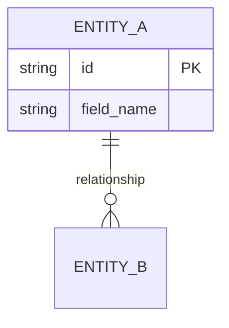

# TÀI LIỆU THIẾT KẾ TỔNG THỂ (HIGH-LEVEL DESIGN) / [AI Agent: Điền Tên Dự Án]

<!-- QUY ƯỚC OKF: dòng bắt đầu bằng "okf-id:" ngay dưới mỗi heading H2/H3 là ĐỊNH DANH
     ỔN ĐỊNH của mục đó trong đồ thị OKF. Đổi tiêu đề thì GIỮ NGUYÊN marker. Xoá marker
     thì danh tính tụt về slug của tiêu đề, và mọi cạnh trỏ tới mục này sẽ đứt lặng lẽ
     ngay lần đầu ai đó sửa câu chữ của tiêu đề.

     Tài liệu này đặc biệt cần nó hơn DD/techspec: SỐ MỤC NẰM TRONG TIÊU ĐỀ, nên id hôm
     nay là `3-1-mo-hinh-phan-lop`. Chèn thêm một §2.5 là mọi mục phía dưới bị đánh số
     lại và tái sinh dưới id mới. Marker cắt số ra khỏi danh tính.

     Marker phải là DÒNG KHÔNG RỖNG ĐẦU TIÊN dưới heading — bộ đọc dừng ở dòng đó. Đặt
     sau một comment hướng dẫn là marker không được đọc. -->

## 0. NGUYÊN TẮC THIẾT KẾ BẮT BUỘC (HIGH-FIDELITY PRINCIPLES)
<!-- okf-id: design-principles -->
Để đảm bảo bản thiết kế có giá trị thi công và bảo mật cao, mọi Agent phải tuân thủ tuyệt đối:
1. **Un-bundling (Rã băng):** TUYỆT ĐỐI KHÔNG gộp các hệ thống ngoài thành một khối. Phải tách rời từng node (vd: tách riêng từng Payment Gateway, từng ERP, từng Auth Provider, External LLM — không gộp thành "Core Systems" hay "External Services").
2. **Security Zoning:** Sơ đồ Container phải thể hiện rõ ranh giới mạng: **DMZ (Demilitarized Zone)** cho các thành phần Gateway/Proxy và **Internal Network (Trust Zone)** cho logic lõi.
3. **Identity & Protocol Specificity:** Mọi quan hệ (Rel) trên sơ đồ phải ghi rõ Protocol (HTTPS, gRPC, REST, gRPC/SQL...) và cơ chế xác thực.
4. **Visual Fidelity (Mermaid C4):** BẮT BUỘC sử dụng 100% cú pháp Mermaid C4 (C4Context, C4Container) để render biểu đồ chuyên nghiệp. KHÔNG dùng ASCII art.


*Tài liệu này đóng vai trò là Siêu Template (Final Edition) cho Thiết kế Kiến trúc Tổng thể, hợp nhất giữa tiêu chuẩn đặc tả chi tiết của bản gốc và tư duy hệ thống đa tầng của bản Combined. BẮT BUỘC tuân thủ mức độ chi tiết thông tin cho từng mục.*

---

## BẢNG GHI NHẬN THAY ĐỐI TÀI LIỆU
`[AI Agent: Trích xuất bảng lịch sử cập nhật tài liệu. MỨC ĐỘ CHI TIẾT YÊU CẦU: Tuyệt đối chính xác (100% Exact Match) các version, vị trí thay đổi và mô tả thay đổi.]`

| Ngày thay đổi | Vị trí thay đổi | A*, M, D | Nguồn gốc | Phiên bản cũ | Mô tả thay đổi | Phiên bản mới |
| :--- | :--- | :--- | :--- | :--- | :--- | :--- |
| `[Data]` | `[Data]` | `[Data]` | `[Data]` | `[Data]` | `[Data]` | `[Data]` |
| 2026-04-09 | Toàn bộ | A | Template Merge | - | Khởi tạo Final Master Template (Combined Standard) | 1.0 |

*(A - Tạo mới, M - Sửa đổi, D - Xóa bỏ)*

---

## 1. GIỚI THIỆU
<!-- okf-id: introduction -->

### 1.1 Mục đích
<!-- okf-id: purpose -->
`[AI Agent: Điền đoạn tóm tắt mục đích tài liệu. MỨC ĐỘ CHI TIẾT YÊU CẦU: Định nghĩa rõ vai trò của tài liệu (Ví dụ: xác định mô hình tổng thể, làm căn cứ thiết kế chi tiết/coding, dành cho các đối tượng như Developer, Tester, SA...).]`

### 1.2 Phạm vi
<!-- okf-id: scope -->
`[AI Agent: Xác định phạm vi ảnh hưởng của kiến trúc. Nêu rõ tài liệu này bao phủ các hệ thống/phân hệ nào và công nghệ nền tảng được đề xuất.]`

### 1.3 Khái niệm, thuật ngữ
<!-- okf-id: glossary -->
`[AI Agent: Trích xuất bảng thuật ngữ kỹ thuật/nghiệp vụ có trong tài liệu.]`

| STT | Từ viết tắt | Định nghĩa | Ghi chú |
| :--- | :--- | :--- | :--- |
| `[Data]` | `[Data]` | `[Data]` | `[Data]` |

### 1.4 Tài liệu tham khảo
<!-- okf-id: references -->
`[AI Agent: Trích xuất danh sách tài liệu liên kết, ví dụ như PRD, SRS, UR...]`

| STT | Tên tài liệu | Nội dung | Ghi chú |
| :--- | :--- | :--- | :--- |
| `[Data]` | `[Data]` | `[Data]` | `[Data]` |

### 1.5 Mô tả tài liệu
<!-- okf-id: document-structure -->
`[AI Agent: Tóm tắt cấu trúc chính của tài liệu này (Thường bao gồm Mô hình C4, Kiến trúc bảo mật, Giải pháp hiệu năng...).]`

---

## 2. PHÂN TÍCH TƯ DUY HỆ THỐNG & CÁC YÊU CẦU ẢNH HƯỞNG
<!-- okf-id: system-thinking-requirements -->

### 2.1 Phân tích đa tầng (System Thinking Analysis)
<!-- okf-id: multi-layer-analysis -->
`[AI Agent: BẮT BUỘC thực hiện phân tích 3 tầng để hiểu sâu rễ vấn đề.]`

- **Tầng Sự kiện (Event):** `[Mô tả các vấn đề bề mặt cần giải quyết ngay lập tức.]`
- **Tầng Hành vi (Pattern):** `[Mô tả các xu hướng, ràng buộc về tải (TPS), khối lượng dữ liệu và tần suất lỗi.]`
- **Tầng Cấu trúc (Underlying Structure):** `[Xác định nguyên nhân gốc rễ và cấu trúc lõi (Ontology) để giải quyết triệt để vấn đề.]`

### 2.2 Các yêu cầu phi chức năng (NFR)
<!-- okf-id: nfr -->
`[AI Agent: Trích xuất các yêu cầu phi chức năng (NFR - Non-Functional Requirements) và các ràng buộc hệ thống.]`
`[MỨC ĐỘ CHI TIẾT YÊU CẦU: Phân tích sâu ở tầng Cấu trúc (Underlying structure) với các số liệu cụ thể (nếu có): 
- Độ lớn và độ tăng trưởng dữ liệu.
- Số lượng giao dịch (TPS).
- Số lượng concurrent connection.
- Tính chất xử lý (Real time hay Batch, Online hay Offline).
- Yêu cầu môi trường phần cứng/mạng.
- Yêu cầu mở rộng (Scalability), tự động hóa triển khai (CI/CD) và đồng nhất hệ sinh thái.]`

---

## 3. KIẾN TRÚC ỨNG DỤNG
<!-- okf-id: application-architecture -->

### 3.1 Mô hình phân lớp
<!-- okf-id: layering-model -->
`[AI Agent: Đọc hiểu và mô phỏng lại các mô hình kiến trúc theo chuẩn Mermaid. TUYỆT ĐỐI KHÔNG SỬ DỤNG ASCII ART.]`

#### 3.1.1 System Context Diagram (Level 1)
`[AI Agent: Sử dụng cú pháp Mermaid C4Context. MỨC ĐỘ CHI TIẾT YÊU CẦU (High-Fidelity):
1. Tách biệt rõ từng Actor (người dùng cụ thể).
2. Tách biệt rõ từng External System (Hệ thống vệ tinh).
3. Ghi rõ Protocol và mục đích giao tiếp trên từng mũi tên Rel.]`
4. Mô tả chi tiết các thành phần trong diagram ở ngay dưới digrams

#### 3.1.2 Container Diagram (Level 2) & Đặc tả Container
`[AI Agent: Sử dụng cú pháp Mermaid C4Container graph TD. BẮT BUỘC phân rã theo vùng mạng (Boundary dmz, Boundary internal).]`

`[⚠️ QUY TẮC BỐ CỤC BẮT BUỘC (Layout Convention):`
`Mermaid C4 mặc định xếp System_Boundary cạnh nhau. BẮT BUỘC thêm directive sau dòng title để buộc layout dọc (Top → Bottom):`

```
C4Container
    title [Diagram Title]
    UpdateLayoutConfig($c4ShapeInRow="3", $c4BoundaryInRow="1")

    %% $c4BoundaryInRow="1" → Mỗi Boundary chiếm 1 hàng riêng (xếp dọc)
    %% $c4ShapeInRow="3"    → 3 Container/hàng bên trong mỗi Boundary

    System_Ext(...)                  %% LAYER 1: External Systems    (TOP)
    System_Boundary(dmz, ...) {}     %% LAYER 2: Integration Edge    (MIDDLE)
    System_Boundary(internal, ...) {} %% LAYER 3: Internal Network   (BOTTOM)

    %% Rel nhóm theo tầng: (1) External↔DMZ  (2) DMZ↔Internal  (3) Internal nội bộ
```

`KHÔNG ĐƯỢC bỏ qua directive UpdateLayoutConfig. Không có directive này, các Boundary sẽ xếp cạnh nhau.]`

`[MỨC ĐỘ CHI TIẾT YÊU CẦU:
1. Giao thức & Hành vi: Các mũi tên trên hình (vd: HTTP, CONSUME, PUSH EVENT) phải được ghi rõ trong cột "Giao tiếp".
2. Định danh thành phần (Identifiers): Phải trích xuất chính xác tên Kafka Topic, tên DB (vd: topic `order.created.v1`, MariaDB, Elasticsearch).
3. Logic cốt lõi & Fallback: Phải lấy ĐẦY ĐỦ các logic xử lý ngầm (vd: "Nếu không có trong redis thì load từ DB", "Mapping về format chung").]`

| Tên Container | Công nghệ (Tech Stack) | Giao tiếp (Inbound/Outbound Protocols) | Vai trò & Cơ chế xử lý chi tiết (Bao gồm Data Domain, Logic Mapping, Fallback) |
| :--- | :--- | :--- | :--- |
| `[Data]` | `[Data]` | `[Data]` | `[Data]` |


#### 3.1.3 Global Data Model (ERD)
`[AI Agent: BẮT BUỘC: Sử dụng Mermaid erDiagram để mô hình hóa thực thể dữ liệu cho toàn hệ thống.
1. ERD là SSoT cho việc xây dựng Tech Spec L2 (phần 3.2).
2. Derivation: Phải dựa trên bộ 3 (Tech Research, L1 Context, L2 Container).
3. Traceability: Ghi rõ thực thể nào được lưu trữ tại Database Container nào.]`



#### 3.1.4 Mô hình ứng dụng framework (Nếu có)
`[AI Agent: Trích xuất mô hình Design Pattern bên trong ứng dụng (Ví dụ: Hexagonal Architecture, Layered Architecture). Nêu rõ sự chia tách giữa Presentation, Application Core, và Infrastructure.]`

### 3.2 Mô hình phân rã chức năng/phân hệ
<!-- okf-id: functional-decomposition -->

#### 3.2.0 Phân rã chức năng (Functional Breakdown - WBS)
`[AI Agent: Inject verbatim TOÀN BỘ nội dung file SSoT: ({planning_artifacts}/project_wbs.md), gồm 2 thành phần theo thứ tự:`
`  1. Function Decomposition Tree (ASCII tree trong fenced block ```text — exception duy nhất với Principle 4 "không dùng ASCII art").`
`  2. Coverage Matrix (bảng 4 cột với cấu trúc <br> Input/Output).`
`MỨC ĐỘ CHI TIẾT: phân rã đến mức Actionable (vd thay vì "Quản lý hồ sơ" phải là "Upload File", "OCR Extractor", "Format Validation") kèm ID mã hóa (vd [BE-MOD-01]). Mọi Container trong sơ đồ L2 BẮT BUỘC ánh xạ được ít nhất một WBS ID.]`

#### 3.2.1 Mô hình tổng thể
`[AI Agent: Liệt kê các module (phân hệ) vi dịch vụ (Microservices) hoặc thành phần lớn.]`
`[MỨC ĐỘ CHI TIẾT YÊU CẦU: Với từng phân hệ (vd: WEB CMS, Query Service, Inbound Service...), phải phân tích cơ chế nội tại:
- Nhiệm vụ cốt lõi của Service này là gì?
- Nó cung cấp các bộ API/Chức năng nào?
- Nó lắng nghe (Consume) hay đẩy dữ liệu (Produce/Push) từ công cụ streaming nào? (Nếu có).]`

#### 3.2.2 Mô hình luồng xử lý tổng thể (Sequence/Data Flow)
`[Đặc tả các luồng xử lý chính của hệ thống gồm sequence diagram, luồng lưu dữ liệu, luồng truy vấn, bảng step-by-step.]`
##### 3.2.2.1. [Tên phân hệ A]
**A. Sequence Diagram (Nội tại Module):**
`[Sử dụng Mermaid sequenceDiagram để mô phỏng tương tác giữa các Class/Service nội bộ hoặc cách Module xử lý một Request trọng tâm.]`
**B. Bảng luồng dữ liệu (Data Flow):**
`[AI Agent: Dựa vào các biểu đồ Sequence hoặc Flow (vd: Luồng lưu dữ liệu, Luồng truy vấn), hãy lập bảng Step-by-step dựa trên tính chất của luồng (vd: Luồng xử lý giao dịch, Luồng xử lý truy vấn).]`
`[MỨC ĐỘ CHI TIẾT YÊU CẦU TỐI THƯỢNG: Phân rã luồng ở mức độ "Traceability" (Truy vết).
1. Phải chỉ rõ dòng chảy dữ liệu đi qua CÁC ĐIỂM NÚT (Nodes) nào (API -> Logic -> Queue -> Cache -> DB).
2. Phân tách rõ nhiệm vụ của từng loại Database.
3. Đưa các nhánh rẽ (Conditional Logic) vào rõ ràng (VD: Nhánh Success, Nhánh Cache Miss, Nhánh Timeout).]`
**Luồng Lưu dữ liệu (Inbound/Write Flow):**
| Điểm nút (Node) | Hành động kích hoạt (Trigger) | Cơ chế xử lý & Chuyển hóa dữ liệu (Transformation/Storage) | Đích đến tiếp theo |
| :--- | :--- | :--- | :--- |
| `[Data]` | `[Data]` | `[Data]` | `[Data]` |

**Luồng Truy vấn dữ liệu (Query/Read Flow):**
| Đối tượng gọi | Nút kiểm tra / Xác thực | Nhánh xử lý (Condition) | Nguồn cấp dữ liệu (Source of Truth) & Cơ chế trả về |
| :--- | :--- | :--- | :--- |
| `[App/Web]` | `[Xác thực...]` | `[VD: Cache Hit/Miss]` | `[Data]` |

##### 3.2.2.2 [Tên Phân hệ B]
`[...]`

### 3.3 Giao tiếp với các hệ thống khác
<!-- okf-id: external-integration -->
`[Mô tả cơ chế tích hợp cơ sở (Integration Mechanism). Giao tiếp qua HTTP REST hay Kafka Message Queue? Sử dụng hệ thống Authen nào (VSA/SSO) để xác thực (Token/JWT)?]`

---

## 4. CHIẾN LƯỢC TRIỂN KHAI VẬT LÝ
<!-- okf-id: physical-deployment -->
`[AI Agent: ĐÂY LÀ GPS CHO AI. Phải định nghĩa cấu trúc thư mục thực tế để thi công.]`

```text
{{project_root}}/
├── apps/                # Phân hệ người dùng cuối
├── libs/                # Các module nghiệp vụ dùng chung
└── infrastructure/      # Cấu hình Deploy, Docker, K8s
```

`[AI Agent Mapping: Ánh xạ Feature -> File Path.]`
| Feature | Folder Path | Role/Responsibility |
| :--- | :--- | :--- |
| `[Feature Name]` | `[Path]` | `[Description]` |

---

## 5. CÁC GIẢI PHÁP KIẾN TRÚC KHÁC
<!-- okf-id: other-architecture-solutions -->

### 5.1 Kiến trúc bảo mật hệ thống - ATTT
<!-- okf-id: security-architecture -->
`[AI Agent: Trích xuất giải pháp An toàn thông tin. BẮT BUỘC đặc tả lớp LLM Proxy/Gateway bảo mật nằm tại phân vùng DMZ để lọc PII và quản lý Token.]`


### 5.2 Giải pháp đối với yêu cầu hiệu năng
<!-- okf-id: performance-solutions -->
`[AI Agent: Chỉ ra chính xác các phương pháp Tối ưu hóa: Message Queue (đa luồng), Caching (chiến lược reload), Database Scaling (Sharding key, Indexing).]`

### 5.3 Các giải pháp đối với các yêu cầu đặc biệt khác
<!-- okf-id: special-requirements -->
`[Nêu rõ việc áp dụng các Pattern như Event-Driven Architecture, Microservices, Event Sourcing, và quy trình phân phối (CI/CD pipeline).]`

### 5.4 Các giải pháp tuân thủ tiêu chuẩn Quản trị dữ liệu
<!-- okf-id: data-governance -->
`[Trích xuất các tiêu chuẩn quản trị: Quản lý Secret (Vault), Thuật toán băm (Hash+Salt), Tính bất biến (Immutability), Audit log tập trung.]`

---

## 6. NHẬT KÝ QUYẾT ĐỊNH KIẾN TRÚC (ADR)
<!-- okf-id: adr-log -->
`[AI Agent: Lưu trữ các quyết định then chốt và sự đánh đổi (Trade-offs). Giúp con người phản biện và Agent tuân thủ ranh giới.]`

<!-- KHÔNG gắn `okf-id` cho các khối `### ADR-XXX:` dưới đây, và đó là CỐ Ý.
     Chúng thuộc về họ `runtime-adr`, họ này đọc chính chúng bằng
     `key_pattern: ^(ADR-\d{3}):\s*(.+)$` và cấp id `runtime-adr/ADR-001`.
     `hld-section` bỏ qua chúng bằng `skip_headings: ["ADR-00"]`.

     Trước khi có cả hai luật đó, mỗi ADR ra HAI node từ cùng một khối chữ —
     `hld-section/adr-001-…` và `runtime-adr/ADR-001`. Gắn `okf-id` vào đây là
     dựng lại đúng cái trùng lặp đó, chỉ khác là lần này trông có chủ đích.

     Tiêu đề PHẢI giữ nguyên dạng `ADR-{3 chữ số}: {tiêu đề}` — đó là khoá.
     Chuỗi runtime dùng 3 chữ số; `designed-adr` ở Stage 1 dùng 4. Hai chuỗi
     KHÔNG được cùng bề rộng, nếu không số của chúng va nhau. -->

### ADR-XXX: [Tiêu đề Quyết định]
- **Bối cảnh:** `[Vấn đề cần giải quyết]`
- **Quyết định:** `[Giải pháp đã chọn]`
- **Lý do:** `[Ưu điểm và sự đánh đổi]`
