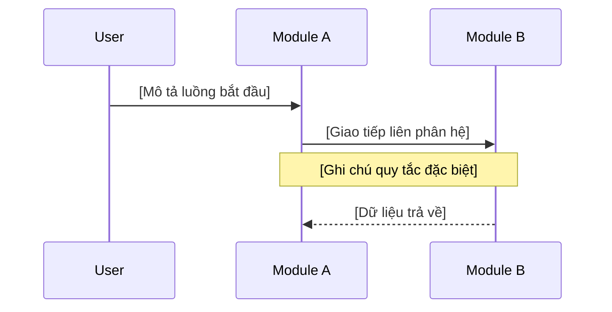

# SYSTEM INTEGRATION MAP (MODULE 0) - [PROJECT_NAME]

*Bản đồ kết nối và Hợp đồng dữ liệu chủ - Single Source of Truth cho toàn hệ thống.*

---

## 1. Ma trận kết nối hệ thống (Connectivity Matrix)

| ID | Source | Target | Protocol | INT-* (Contract) | Description | Auth Method |
| :--- | :--- | :--- | :--- | :--- | :--- | :--- |
| **C-01** | [Module A] | [Module B] | [Example: gRPC] | [INT-A-01 hoặc `external`/`no-contract` + lý do] | [Mô tả mục đích kết nối] | [vd: JWT] |
| ... | ... | ... | ... | ... | ... | ... |

> **Checkpoint (A-U4):** mọi cạnh nội bộ (service→service) phải có một `INT-*` sở hữu, hoặc được đánh dấu `external`/`no-contract` kèm lý do — không để cạnh nội bộ không hợp đồng.

## 2. Sơ đồ trình tự xuyên suốt (End-to-End Sequence)



## 3. Hợp đồng dữ liệu chủ (Master Data Schema)

### 3.1. Cấu trúc Metadata (Bắt buộc)
```json
{
  "trace_id": "string (UUID v4)",
  "timestamp": "int64 (epoch ms)",
  "client_id": "string",
  "version": "string (SemVer)"
}
```

### 3.2. Danh mục các thực thể dữ liệu chính (Canonical Entities)

#### 3.2.1 Sơ đồ thực thể quan hệ (Global ERD)
`[AI Agent: BẮT BUỘC trích xuất và chi tiết hóa sơ đồ ERD từ part_04.1_global_architecture.md vào đây. Sử dụng Mermaid erDiagram.]`

#### 3.2.2 Đặc tả chi tiết thực thể
[Đặc tả chi tiết các Object dùng chung giữa các phân hệ: Field Name, Type, Description, PII Masking status]

## 4. Chính sách bảo mật Mesh (Security Flow)

- **Cơ chế xác thực:** [Mô tả cách các module nhận diện nhau]
- **Kiểm soát truy cập:** [Mô tả phân quyền cấp Service]

## 5. Chiến lược xử lý lỗi & Kháng lỗi (Resilience Strategy)

| Scenario | Strategy | Timeout | Retry Count | Fallback Action |
| :--- | :--- | :--- | :--- | :--- |
| Connection Timeout | Exponential Backoff | 500ms | 3 | Return Error 503 |
| Service Down | Circuit Breaker | N/A | N/A | Open Circuit after 5 fails |

## 6. Danh mục trạng thái toàn cục (Global State Registry)

| Entity | State Name | Meaning | Trigger Source |
| :--- | :--- | :--- | :--- |
| [vd: Profile] | `PENDING_VERIFY` | Chờ xác thực từ module X | Module Y |
| ... | ... | ... | ... |

---

## 7. Danh mục hạ tầng & Cổng (Infrastructure Registry)

| Service Name | Default Port | Internal Endpoint | Protocol |
| :--- | :--- | :--- | :--- |
| [Module A] | 50051 | `module-a.internal` | gRPC |
| ... | ... | ... | ... |
