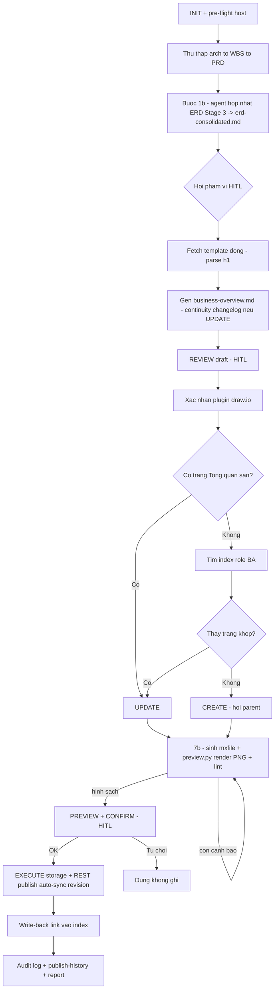

# WORKFLOW: NTAPP — Business Overview → Confluence

Sinh & đồng bộ **1 tài liệu Tổng quan nghiệp vụ toàn hệ** lên Confluence theo template fetch động. Runbook chi tiết
(HITL gates + changelog continuity + log lịch sử tác động) cho [SKILL.md](SKILL.md). Sơ đồ dùng draw.io (Opt 2).

**Iron Rules (không được vi phạm):**
1. Nguồn = `architecture_design` → `project_wbs` → PRD/Epics (+ code fallback) — chỉ đọc, không bịa. Template = khung mục, **thay data ví dụ**.
2. Mọi thao tác ghi Confluence (`create_page`/`update_page`/`upload_attachment`/PUT) DỪNG preview + chờ xác nhận (§8).
3. Không đoán trang đích / nơi index tài liệu. Không rõ → DỪNG hỏi user.
4. **Attachment KHÔNG đi MCP** (upload luôn fail trên Server) — REST qua `scripts/confluence-publish.ps1` + `{auth_file}`, agent tự chạy (§9). Không bắt user gõ lệnh.
5. Không hardcode host/space/parent/pageId trong nội dung sinh ra — lấy từ link + MCP response tại runtime (trừ template/index đã biết ở §0).
6. **Log mọi lần publish** (audit + history) — §10. Update thì **giữ changelog cũ, thêm dòng mới, bump version doc** (§4).
7. **KHÔNG publish sơ đồ chưa soi bằng ảnh.** Sinh mxfile xong phải chạy `scripts/preview.py`, mở PNG xem và lint sạch (§7b). Sinh XML rồi upload thẳng = không ai thấy hình cho tới khi nó đã ở trên wiki.

---

## 0. INIT (Configuration Resolution)

Resolve theo thứ tự: (a) tham số user / `.bo-confluence.yaml` / `.bmm-config.yaml` nếu có → (b) default dưới đây.

| Biến | Ý nghĩa | Default |
|:---|:---|:---|
| `{arch_file}` | HLD | `NTAPP-output/Stage_2_Architecture/architecture_design.md` |
| `{wbs_file}` | WBS | `NTAPP-output/Stage_2_Architecture/project_wbs.md` |
| `{prd_file}` / `{epics_file}` | Bối cảnh KD | `NTAPP-output/Stage_1_Discovery/prd.md` · `epics.md` |
| `{parts_dir}` | (tùy chọn) phần xây mới | `NTAPP-output/Stage_4_Design/detailed_design/feature_design_parts` |
| `{techspec_dir}` | Nguồn field-level ERD (Stage 3) | `NTAPP-output/Stage_3_Specs/techspec` |
| `{bo_dir}` | Workspace output | `NTAPP-output/Stage_2_Architecture/business-overview` |
| `{template_page_id}` | Template Tổng quan nghiệp vụ | `.35`: **`200745079`** (space `TDOV`) |
| `{system_index_url}` | Index nơi quản lý tài liệu Tổng quan (có dòng role BA) | *(resolve — §7; không bịa)* |
| `{target_space}` | Space đích khi tạo mới | `TDOV` |
| `{mcp_server}` | Server MCP host đích | `.35` → `mcp__atlassian__*` |
| `{auth_file}` | Token REST publish attachment | `<repo-root>/.confluence-auth` (dotenv `CONFLUENCE_BASE_URL`+`CONFLUENCE_PAT`, gitignored) |

**Pre-flight host:** `mcp__atlassian__confluence_get_page(page_id={template_page_id})` OK → host `.35` qua MCP. Fail (403) →
thử REST đọc `scripts/confluence-get.ps1 -PageId {template_page_id}` (host khác trong `{auth_file}`). Cả hai fail → DỪNG hỏi user.

**Auth file (BẮT BUỘC nếu publish có sơ đồ draw.io = luôn có attachment):** thiếu file / PAT còn placeholder → DỪNG hỏi user
setup (copy `.confluence-auth.example` → `.confluence-auth`, dán PAT). Chi tiết: [references/confluence-publish.md](references/confluence-publish.md) §1.

## 1. Bước 1 — THU THẬP NGUỒN (im lặng)

Đọc theo thứ tự, dừng khi đủ tín hiệu: `{arch_file}` (Mô hình tổng quan + ERD + zoning) → `{wbs_file}` (xương sống §6 Phân rã)
→ `{prd_file}`/`{epics_file}` (bối cảnh, mục tiêu KD) → (fallback) source code khi thiếu, theo
[references/extract-from-code.md](references/extract-from-code.md).
- **Gate mềm:** thiếu cả `{arch_file}` lẫn `{wbs_file}` → cảnh báo user "chưa có HLD/WBS — tài liệu Tổng quan sẽ mỏng, xác nhận tiếp?" (không tự dựng HLD/WBS).

## 1b. Bước 1b — HỢP NHẤT ERD TỪ STAGE 3 (sub-agent, im lặng)

Dispatch sub-agent [`agents/agent_erd_data_architect.md`](agents/agent_erd_data_architect.md) (tuân [`references/erd-consolidation.md`](references/erd-consolidation.md)) với `{techspec_dir}`, `{arch_file}`, Module 0, `{bo_dir}`.
- Output: `{bo_dir}/erd-consolidated.md` — ERD nhóm theo datastore + từ điển field 2 tầng, cite nguồn.
- **Soft gate:** không có `{techspec_dir}/*_techspec.md` với §11 datastore → skip agent, đánh dấu mục ERD dùng fallback (chỉ Tầng A từ `{arch_file}`) + cảnh báo user "ERD không có field-level".
- 🔴 **Gate đối chiếu code (bắt buộc):** sau khi có `erd-consolidated.md`, phải xác minh **từng bảng + từng quan hệ** bằng khai báo thật trong code repo (`@Table` / `@Document` / hằng số tên collection; tìm chỗ code thực sự ghép hai bảng), ghi kết quả ra artifact riêng có trích dẫn `file:dòng`. Bảng chỉ có trong HLD → **loại khỏi sơ đồ + báo user kèm bằng chứng**. Mọi quan hệ phải có **khoá nối** + **loại quan hệ**. Các bẫy nhận dạng: [references/erd-consolidation.md](references/erd-consolidation.md) §6b.
- KHÔNG ghi Confluence ở bước này. Artifact độc lập, tái dùng được.

## 2. Bước 2 — HỎI PHẠM VI (HITL, 1 lượt)

**AskUserQuestion** (mặc định = đầu tiên):
- **Toàn hệ theo WBS** — cây §6 từ `{wbs_file}`, không phân lớp.
- **Toàn hệ 2 lớp** — thêm nhánh A brownfield (xám, từ WBS) + B xây mới (màu, từ `{parts_dir}`).
- **Chỉ phần xây mới** — chỉ `{parts_dir}`.
Kèm hỏi nhanh bối cảnh/mục tiêu KD nếu PRD thiếu. Xem [references/scope-brownfield-vs-newbuild.md](references/scope-brownfield-vs-newbuild.md).

## 3. Bước 3 — FETCH TEMPLATE (động)

- `{mcp_server}confluence_get_page(page_id={template_page_id}, convert_to_markdown=false)` → parse **thứ tự + tên các `<h1>`** làm khung mục chuẩn. (MCP chết → `scripts/confluence-get.ps1`.)
- Đọc mô tả trong mỗi mục để biết yêu cầu trình bày (bố cục vùng / swimlane / cột bảng / cây 3 loại).
- ⚠️ Template chứa **data ví dụ dự án khác** (VOUCHER_*/App VTP) → **CHỈ lấy khung mục + hướng dẫn**, thay bằng dữ liệu reconciliation. Giữ cấu trúc: bảng Đơn vị phê duyệt (task-list) · macro `toc` · bảng ghi nhận thay đổi.
- Fetch lỗi → dùng khung fallback trong [references/style-conventions.md](references/style-conventions.md), cảnh báo user.

## 4. Bước 4 — GEN DRAFT + CHANGELOG CONTINUITY (1 file)

Sinh thẳng `{bo_dir}/business-overview.md` — map nguồn → khung mục template, theo [references/style-conventions.md](references/style-conventions.md).
Mục không có dữ liệu → `N/A` (no-silent-defaults: không bịa; không chắc → `[Cần xác nhận]`).

**🔴 Gate văn phong + blocklist (bắt buộc, đọc [style-conventions §0](references/style-conventions.md) TRƯỚC khi viết):**
tài liệu bàn giao — **văn nghiệp vụ, không văn nói**. Sau khi sinh, tự quét lại toàn file và xoá nếu còn:
1. Cụm văn nói: `Dễ hiểu` · `Tóm lại` · `Nói cách khác` · `bóc tách` · `xương sống` · `bức tranh` · `làm được gì` · `chạy ngầm` · `kéo file` · `bắn event` · emoji · dấu `!`.
2. Khối meta (nói về **cách làm tài liệu**, không phải nghiệp vụ): hộp `tip` "Dễ hiểu" đầu mỗi quy trình · hộp cảnh báo "Phạm vi — không đưa vào…" · đoạn "Nguyên tắc cốt lõi…" + bảng `Loại lá | Bản chất | Ví dụ` · hộp đối chiếu số lượng ("N dòng khớp N lá…", "xem Coverage Matrix") · hộp `warning` "Điểm cần xác nhận (N mục)" gom cụm ở ERD.
   → Điểm chưa chốt vẫn phải giữ, nhưng ghi `[Cần xác nhận]` **tại đúng ô/dòng**; danh sách gom nằm ở `erd-consolidated.md` + báo cáo cuối (§10), KHÔNG lên trang.
   → Việc bảng §6 khớp 1-1 với số lá là **tự kiểm khi sinh** + báo ở §10, KHÔNG công bố trên trang.
- Nội dung 6 mục (bám template): Mục đích · Mô hình tổng quan (bố cục vùng) · Quy trình nghiệp vụ (swimlane + bảng bước 5 cột) · ERD · Biểu đồ trạng thái · Phân rã chức năng (cây 3 loại + bảng).
- **ERD (2 tầng — nguồn `{bo_dir}/erd-consolidated.md`):** Tầng A sơ đồ cross-store (`erd collapsed`) + bảng quan hệ; Tầng B mỗi datastore 1 sơ đồ cụm + bảng tổng hợp bảng + expand lồng từ điển field 2 tầng. Bám [references/style-conventions.md](references/style-conventions.md). Thiếu artifact → fallback Tầng A từ `{arch_file}`.
- **Header blockquote:** tên tài liệu, hệ thống, ngày, version tài liệu.
- **🔴 Continuity (publish lần 2+):** trang đích đã tồn tại (§7 = UPDATE) → **đọc bản live** (`get_page` raw) lấy **version tài liệu hiện tại + toàn bộ bảng "Ghi nhận thay đổi" cũ**; version mới = cũ+1; **GIỮ NGUYÊN mọi dòng cũ**, thêm **1 dòng mới trên đầu** (Ngày = date macro · Vị trí · A/M/D · Nội dung thay đổi · Phiên bản). Lần đầu (CREATE) → `v1`, changelog 1 dòng "A — tạo mới".

## 5. Bước 5 — REVIEW DRAFT (HITL gate)

Hiển thị `business-overview.md` cho user (tóm tắt từng mục + danh sách sơ đồ sẽ vẽ + dòng changelog thêm mới).
- Kèm hiển thị tóm tắt `{bo_dir}/erd-consolidated.md` (số cluster, số bảng, danh sách techspec skip, điểm `[Cần xác nhận]`) để user duyệt mô hình dữ liệu trước khi build storage.
- **Kèm kết quả self-check** (3 dòng, báo PASS/FAIL từng dòng):
  (a) quét cụm văn nói + khối meta ở §4 → còn 0 lần xuất hiện;
  (b) số dòng bảng §6 == số lá trên cây (nêu con số 2 vế; lệch → sửa trước khi tiếp);
  (c) mỗi node sơ đồ quy trình có đúng 1 dòng trong bảng bước.
**DỪNG**, chờ duyệt/sửa. Sửa → sửa thẳng file, show lại phần sửa. Chỉ tiếp §6 khi user duyệt.

## 6. Bước 6 — XÁC NHẬN PLUGIN SƠ ĐỒ

`{mcp_server}confluence_search(query='macro="drawio"')` + đọc `body.view` **vài** trang thật: có `unknown-macro?name=drawio`
→ plugin chưa cài. **Rỗng ≠ chưa cài** → probe chủ động (tạo trang nháp có macro, đọc `body.view`, xoá). Host `.35` đã biết có
draw.io (SEIBERT). Chi tiết render + `revision`: [references/diagram-drawio.md](references/diagram-drawio.md).

## 7. Bước 7 — LOCATE TARGET trên Confluence

**a. Có link sẵn?** Tìm trong `{bo_dir}/business-overview-publish-history.md` (dòng URL gần nhất) / dòng write-back ở nguồn.
- Có → verify host ≡ host §0 → `get_page(pageId)` verify là trang Tổng quan của hệ thống này → `action=UPDATE`, `{target_page_id}`.

**b. Không có → tìm nơi index (`{system_index_url}`).**
1. `{mcp_server}confluence_get_page_children(parent_id={system_index_url}, include_folders=true, limit=50)` (phân trang tới hết) hoặc `get_page(convert_to_markdown=true)` trích link → tìm dòng **role BA / "Tổng quan nghiệp vụ"** (`{ba_row_label}`). Không chắc → **AskUserQuestion** liệt kê ứng viên; không xác định được index → DỪNG hỏi user.
2. Khớp trang Tổng quan sẵn có → `action=UPDATE`. Không có → `action=CREATE`, `{parent_id}` = trang index phù hợp (hỏi nếu mơ hồ), `{space_key}` từ metadata MCP (default `{target_space}`).

## 7b. Bước 7b — SINH SƠ ĐỒ + SOI HÌNH (bắt buộc, TRƯỚC khi xin confirm)

1. **Sinh mxfile** từng sơ đồ bằng `scripts/drawio_lib.py` (`overview_zones`/`process_3col`/`erd`/`state_diagram`/`breakdown_tree`) → ghi vào `{bo_dir}/diagrams/`, tên file = `diagramName` (không đuôi).
2. **Render + lint:** `python scripts/preview.py {bo_dir}/diagrams/* -o {bo_dir}/diagrams/`.
   - **Agent PHẢI mở từng PNG xem** (`.preview.png`) — đây là lần duy nhất nhìn thấy hình trước khi nó lên wiki. Bỏ bước này chính là cách lỗi "mũi tên trùng nhau" lọt lên trang (2026-08-07).
   - Cảnh báo lint (hộp đè hộp · cạnh xuyên hộp · 2 cạnh chồng trục · tràn khổ · trang > 2600px) → **sửa data đầu vào hoặc tách sơ đồ theo cụm rồi sinh lại**. KHÔNG publish hình còn cảnh báo.
   - Exit code 2 (thiếu Chrome) → **không chặn**: mxfile vẫn publish được, macro draw.io tự render live; soi tạm bằng file `.preview.svg` và nói rõ với user là chưa soi được bằng ảnh.
   - `.preview.svg` / `.preview.png` là **file soi tạm** — không đính kèm trang trừ khi cố ý dùng làm ảnh tĩnh dự phòng.

## 8. Bước 8 — PREVIEW + CONFIRM (HITL bắt buộc)

Hiện trước khi ghi: `action` (CREATE/UPDATE) · trang đích (title+URL update / space+parent create) · host MCP · `content_format=storage`
· tóm tắt mục ghi + **dòng changelog thêm mới** + version cũ→mới · danh sách **sơ đồ draw.io** (tên mxfile) · **attachment sẽ upload**
+ đã có `{auth_file}` PAT hợp lệ chưa (chưa → báo setup TRƯỚC) · (UPDATE) diff ngắn theo mục.
- Danh sách sơ đồ ERD giờ gồm: 1 sơ đồ cross-store (Tầng A) + N sơ đồ cụm datastore (Tầng B) — mỗi cụm 1 mxfile.
- **Kèm kết quả §7b:** đường dẫn PNG từng sơ đồ (user tự mở xem) + trạng thái lint (`sạch` / liệt kê cảnh báo còn lại + lý do chấp nhận).
**DỪNG.** Chỉ tiếp khi user xác nhận rõ ("ok"/"ghi đi"). Từ chối → dừng, không ghi gì.

## 9. Bước 9 — EXECUTE

1. **Build storage-format** → `{bo_dir}/business-overview.storage.xhtml` (tên cố định, ghi đè — git + version Confluence giữ lịch sử). Bám khung template, theo [references/confluence-publish.md](references/confluence-publish.md): **checkbox `ac:task-list`** (task-id unique) · **ngày = date macro** · **escape `&<>"`** ngoài CDATA · bảng lồng OK · **HTML macro tắt** trên `.35`.
2. **mxfile đã sinh + soi ở §7b** — chỉ chèn macro `ac:name="drawio"` (diagramName + revision — script auto-sync, xem diagram-drawio.md). KHÔNG sinh lại ở đây; nếu phải sửa sơ đồ thì quay về §7b render + lint lại rồi mới publish.
3. **Trang đích:**
   - CREATE → `{mcp_server}confluence_create_page(space_key, title, content=<skeleton storage>, parent_id, content_format="storage")` → lấy `pageId`.
   - UPDATE → dùng `{target_page_id}`.
4. **Publish (luôn có sơ đồ = có attachment) → REST script:** soạn `{bo_dir}/confluence-publish.manifest.json` (pageId, title, storageFile, attachments `{path,name,contentType,label,comment}`) → kiểm `{auth_file}` PAT ≠ placeholder → agent chạy `powershell -ExecutionPolicy Bypass -File scripts/confluence-publish.ps1 -Manifest {bo_dir}/confluence-publish.manifest.json`. Script upload attachment (mxfile label `drawio`) + **auto-sync `revision`==version** + PUT body version live+1 (atomic).
   - Body-only (vd chỉ cập nhật ô link bảng index) → MCP `update_page(content_format="storage", version_comment=...)`.
   - Lỗi MCP/REST (401/403/404/409/timeout) → DỪNG báo nguyên nhân, KHÔNG retry host khác.

## 10. Bước 10 — WRITE-BACK + LOG + REPORT

- **Write-back:** cập nhật ô link trong bảng index `{system_index_url}` (dòng role BA) trỏ tới URL trang Tổng quan — body-only qua MCP `update_page`.
- **Audit log:** ghi `{bo_dir}/.confluence-sync/{YYYYMMDD-HHMMSS}.log` (tạo thư mục nếu chưa): action · host · space · parent · pageId · version cũ→mới · phạm vi (toàn hệ/2 lớp/xây mới) · danh sách sơ đồ + trạng thái revision · tóm tắt changelog.
- **History:** append 1 dòng vào `{bo_dir}/business-overview-publish-history.md` (tạo với header nếu chưa có). Cột: `Ngày | Action | Phạm vi | pageId | Version | URL | Người`.
- **Report user:** URL trang, action, version mới, danh sách sơ đồ + attachment, các điểm `[Cần xác nhận]`, đường dẫn file log. **Verify**: `get_attachments` → version mxfile == `revision` macro; `body.view` không `unknown-macro`. Nhắc hard-refresh (Ctrl+F5).

---

## Sơ đồ quyết định

