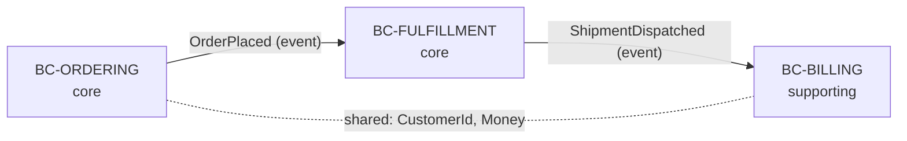

# CONTEXT MAP — [PROJECT_NAME]

*Bản đồ Bounded Context & Ngôn ngữ chung — Single Source of Truth cho mô hình miền (as-is). Business đọc file này đầu tiên.*

> **Trạng thái:** AS-IS (thực tại, gồm cả khuyết tật) · **Version:** v{N} · **Cập nhật:** {date} · **Ký bởi (SA):** [TBD]
> Đề xuất tương lai xem `TARGET.md` + `MIGRATION.md`. KHÔNG trộn to-be vào file này (Iron Rule R10).

---

## 1. Danh mục Bounded Context (Bounded Context Inventory)

| BC ID | Tên | Subdomain class | Team sở hữu | Trách nhiệm (1 câu) | Module/Service (WBS) | Maturity |
| :--- | :--- | :--- | :--- | :--- | :--- | :--: |
| **BC-ORDERING** | Ordering | core | [team] | Nhận & theo dõi đơn hàng | [BE-ORD-*, SCR-*] | L2 |
| ... | ... | core / supporting / generic | ... | ... | ... | L0–L4 |

> **Subdomain class** (chiến lược ưu tiên): `core` = lợi thế cạnh tranh, đầu tư mạnh · `supporting` = cần nhưng không khác biệt · `generic` = nên mua/dùng sẵn. Map mọi module trong `project_wbs.md` về đúng một BC (Iron Rule R4 — no orphan).

## 2. Bản đồ quan hệ Context (Context Map Relationships)

| Quan hệ | Upstream → Downstream | Integration pattern | Cơ chế (Module 0 ref) | Ghi chú |
| :--- | :--- | :--- | :--- | :--- |
| ORD → FUL | Ordering → Fulfillment | Published Language (event) | [C-0x] | Async qua bus |
| FUL → BIL | Fulfillment → Billing | Customer/Supplier | [C-0x] | — |
| ORD ↔ BIL | Ordering ↔ Billing | Shared Kernel | [C-0x] | ⚠️ shared type — xem maturity |

> **Integration pattern** (DDD context mapping): `Anti-Corruption Layer (ACL)` · `Published Language` · `Open Host Service` · `Conformist` · `Customer/Supplier` · `Shared Kernel` · `Separate Ways`. Pattern phải nhất quán với contract trong Module 0 (Iron Rule R8) — nếu as-is không có ACL nơi cần → đó là **finding** ở maturity, không phải sửa ở đây.

## 3. Liên kết per-BC

Mỗi BC có hồ sơ chi tiết riêng:

| BC ID | Ubiquitous Language | Aggregates |
| :--- | :--- | :--- |
| BC-ORDERING | [contexts/bc-ordering/CONTEXT.md](./contexts/bc-ordering/CONTEXT.md) | [contexts/bc-ordering/AGGREGATES.md](./contexts/bc-ordering/AGGREGATES.md) |
| ... | ... | ... |

## 4. Domain Event Catalog

→ Xem [EVENTS.md](./EVENTS.md) (catalog đầy đủ producer → consumer). Tóm tắt quan hệ event ở §2.

## 5. Mâu thuẫn nguồn cần SA reconcile (Open Conflicts)

*Liệt kê nơi HLD / code / lời SA mâu thuẫn nhau về ranh giới hay ngữ nghĩa (Iron Rule R5). KHÔNG tự quyết.*

| # | Điểm mâu thuẫn | Nguồn A | Nguồn B | Câu hỏi cho SA |
| :--: | :--- | :--- | :--- | :--- |
| 1 | [vd: "Account" là BC riêng hay thuộc Customer?] | HLD §3.2 | Code `auth/` | [TBD — SA verify] |
