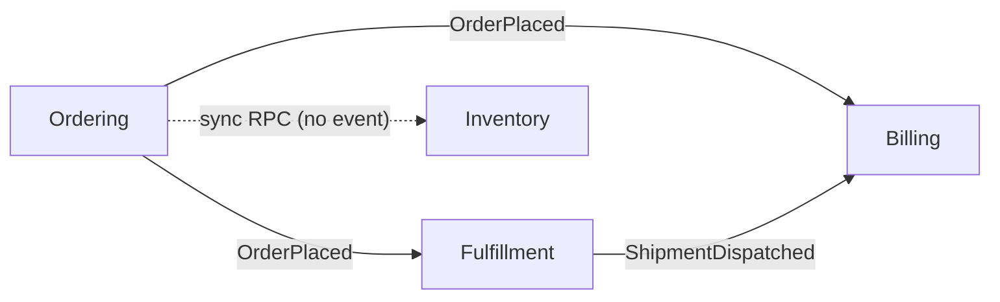

# DOMAIN EVENT CATALOG — [PROJECT_NAME] (AS-IS)

*Catalog mọi domain event + luồng producer → consumer **như hệ thống đang là**. Event chưa tồn tại (chỉ nên có) thuộc `TARGET.md`, KHÔNG ghi ở đây (R10).*

> **Version:** v{N} · **Quy ước tên:** nghiệp vụ + thì quá khứ (`OrderPlaced`). Tên kỹ thuật/CRUD (`OrderUpdated`) → ghi đúng thực tại + finding T6.

---

## 1. Bảng catalog

| Event | Producer BC · Aggregate | Consumer BC(s) | Cơ chế (as-is) | Pattern | Trạng thái |
| :--- | :--- | :--- | :--- | :--- | :--- |
| `OrderPlaced` | Ordering · Order | Fulfillment, Billing | async bus | Published Language | ✅ |
| `ShipmentDispatched` | Fulfillment · Shipment | Billing | async bus | Published Language | ✅ |
| `OrderUpdated` | Ordering · Order | — | — | — | ⚠️ tên CRUD; orphan (no consumer) |
| `(none)` | Ordering→Inventory | — | sync RPC chuỗi | — | ❌ no domain event — finding T6 |

> **Trạng thái:** ✅ tốt · ⚠️ đặt tên/định tuyến lỏng · `[orphan-event]` thiếu producer **hoặc** consumer (R4). Orphan KHÔNG xoá — là finding.

## 2. Sơ đồ luồng event (as-is)

## 3. Findings tổng hợp (chuyển cho D3 — trục T6)
- {Event tên kỹ thuật cần đổi}
- {Tích hợp lẽ ra nên là event nhưng đang sync RPC}
- {Orphan event}
