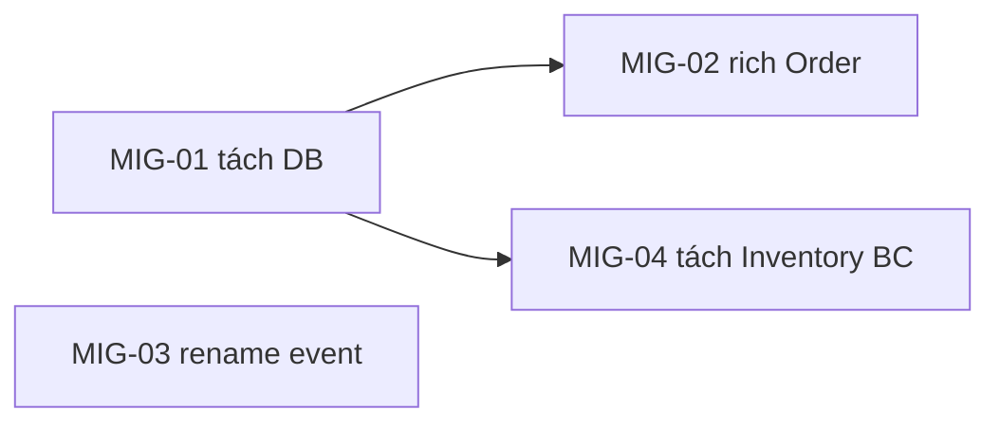

# DDD MIGRATION ROADMAP — [PROJECT_NAME]

*Lộ trình từ as-is → to-be. Mỗi item map về một **lane** thực thi NTAPP + trỏ về finding & mục to-be. Phân pha theo phụ thuộc + ưu tiên (core/level thấp trước).*

> **Version:** v{N} · **Cập nhật:** {date} · DAG `blocked_by` không cycle (gate G4).

---

## 1. Bảng migration item

| id | Target (to-be · finding) | Lane | blocked_by | Effort | Risk | Definition of Done |
| :--- | :--- | :--- | :--- | :--: | :--: | :--- |
| MIG-01 | Tách shared-DB → event+ACL (T5·Ordering) | `slice` | — | L | cao | Inventory đọc qua event; 0 cross-BC DB write |
| MIG-02 | Rich `Order` — đưa rule định giá vào aggregate (T4) | `refactor-ADR` | MIG-01 | M | trung | rule định giá test được không qua service |
| MIG-03 | Đổi `OrderUpdated`→`OrderPlaced/Cancelled` (T6) | `quick-dev` | — | S | thấp | event đặt tên nghiệp vụ; consumer cập nhật |
| MIG-04 | Tách Inventory thành BC riêng (T1) | `slice` | MIG-01 | L | cao | `[needs /ntapp-architecture-design]` — Module 0 cascade |

> **Lane:** `express` (typo/config) · `quick-dev` (fix/refactor giữ contract) · `slice` (feature/đổi hành vi) · `ad-hoc` (unit độc lập) · `refactor-ADR` (refactor lớn có ADR). Map theo CLAUDE.md "4 workflow build".

## 2. Phân pha (DAG)

| Pha | Items | Mục tiêu | Ưu tiên vì |
| :--: | :--- | :--- | :--- |
| **P1** | MIG-01, MIG-03 | Gỡ coupling nền (shared DB, event naming) | core + chặn nhiều việc sau |
| **P2** | MIG-02, MIG-04 | Rich model + tách BC | phụ thuộc P1 |

## 3. Hạng mục đụng kiến trúc (R8 — cần architecture-design)
- MIG-04: tách Inventory → đổi service boundary + Module 0 contract → chạy `/ntapp-architecture-design` (FULL) trước khi build.

## 4. Hạng mục "mua thay vì build" (generic subdomain)
- {BC generic level thấp} → đánh giá off-the-shelf thay refactor.
