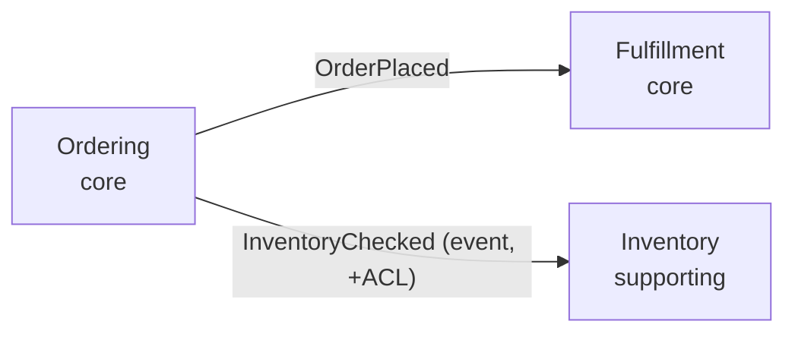

# DDD TARGET-STATE BLUEPRINT — [PROJECT_NAME] (TO-BE)

*Trạng thái đích mong muốn của mô hình miền. Mỗi mục trỏ ngược về **finding** (BC · trục) trong `maturity.md`. KHÔNG mô tả thực tại (đó là CONTEXT-MAP/AGGREGATES as-is).*

> **Trạng thái:** TO-BE · **Version:** v{N} · **Cập nhật:** {date}
> Lộ trình đi tới đích: `MIGRATION.md`. Quyết định strategic: `adr/`.

---

## 1. To-Be Context Map (đích)

| Thay đổi ranh giới | Từ (as-is) | Thành (to-be) | Sửa finding | Đụng kiến trúc? |
| :--- | :--- | :--- | :--- | :--- |
| Tách Inventory | trộn trong Ordering | BC-INVENTORY riêng | T1, T5 | `[needs /ntapp-architecture-design]` |
| ... | ... | ... | ... | — |

> **R8:** mục `[needs /ntapp-architecture-design]` = đổi service boundary/contract Module 0 → phải cascade qua architecture-design, không tự coi đã xong.

## 2. To-Be per Aggregate

| BC | Aggregate đích | Thay đổi so as-is | Sửa finding |
| :--- | :--- | :--- | :--- |
| Ordering | `Order` (chỉ line item) | tách `Shipment` ra aggregate riêng | T3 |
| Ordering | `Order` rich | đưa rule định giá vào aggregate | T4 |

## 3. To-Be Integration & Layering

| Khía cạnh | Đích | Sửa finding |
| :--- | :--- | :--- |
| Ordering↔Inventory | event `InventoryChecked` + ACL thay shared-DB read | T5, T6 |
| Persistence | repository = interface ở domain (ports & adapters) | T7 |

## 4. Subdomain strategy
| BC | Subdomain | Hành động chiến lược |
| :--- | :--- | :--- |
| Ordering | core | đầu tư DDD chặt (P1) |
| Notification | generic | cân nhắc **mua/thay** thay vì refactor |

## 5. ADR liên quan
- [adr/0001-tach-inventory-context.md](./adr/0001-tach-inventory-context.md)
- ...
