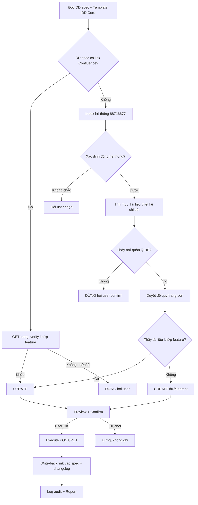

# WORKFLOW: NTAPP — DD → Confluence

Đồng bộ DD của một mã tính năng từ spec workspace lên Confluence theo Template DD Core.

**Iron Rules (không được vi phạm):**
1. Spec DD là source of truth — chỉ đọc, không tự bịa nội dung khi map.
2. Mọi thao tác ghi Confluence (POST/PUT/upload) DỪNG preview + chờ user xác nhận (§ Bước 7).
3. Không đoán trang đích / hệ thống / nơi quản lý DD. Không xác định được → DỪNG hỏi user.
4. Dùng đúng host trong link đang xử lý; không tìm chéo host; lỗi → DỪNG hỏi user.
5. Không hardcode host/space/parent/pageId trong nội dung sinh ra — lấy từ link/API tại runtime (trừ pageId index đã biết ở §2).
6. **Giữ nguyên dấu tiếng Việt** trong MỌI nội dung ghi lên Confluence (heading, prose, ô bảng, chú thích trong Expand). Body gửi API dạng UTF-8 → ký tự có dấu giữ nguyên hoặc numeric entity (`&#7841;`...). TUYỆT ĐỐI không strip dấu / viết không dấu để "né encoding" — sai encoding thì sửa cách gửi (charset), không sửa bằng cách bỏ dấu.
7. **Đối tượng đọc gồm cả tester/BA, không chỉ dev.** Prose mô tả bước phải hiểu được bởi người không đọc code — xem §Nguyên tắc trình bày nội dung.

---

## Nguyên tắc trình bày nội dung (đối tượng đọc: dev + tester/BA)

Áp cho mọi prose sinh ra (đặc biệt cột "Mô tả xử lý"/"Logic xử lý nội bộ" của bảng các bước, và chú thích trong Expand). Mục tiêu: tester/BA đọc để viết testcase, không cần đọc source code.

1. **Diễn đạt bằng ngôn ngữ nghiệp vụ, KHÔNG chép nguyên lời gọi hàm/kỹ thuật.** Lời gọi method + tham số kỹ thuật (`ClassName.method(request, false, PageRequest.of(0, 10000))`, tên biến nội bộ, kiểu Java) → dịch sang ý nghĩa nghiệp vụ.
   - ❌ `gọi merchantStore.searchMerchant(request, false, PageRequest.of(0, 10000))`
   - ✅ `thực hiện tìm kiếm danh sách merchant theo phân trang (10.000 dòng/trang)`
   - Nếu cần nêu tên class/method cho dev → để trong Expand hoặc cột "Chi tiết" phụ, KHÔNG nhét vào câu mô tả bước chính.
2. **Điều kiện rẽ nhánh + mã lỗi BẮT BUỘC giữ ĐÚNG** (tên biến điều kiện, toán tử `==`/`>`/`<=`, ngưỡng số, mã lỗi `PMT-xxx`) — nhưng **chú thích ý nghĩa** tham số + mã lỗi bằng tiếng Việt trong ngoặc.
   - ❌ `Nếu totalElements == 0 → throw NO_DATA_EXPORT (PMT-019)`
   - ✅ `Nếu totalElements == 0 (số bản ghi tìm kiếm được) → trả lỗi PMT-019 (không có dữ liệu cần export)`
3. **Giữ nguyên** các định danh nghiệp vụ cần cho testcase: endpoint/path, tên tham số request (`fromDate`, `status`...), tên cột hiển thị, ngưỡng (10.000), mã lỗi. Đây là dữ liệu test, không phải "chi tiết code".

## 1. INPUT

- Tham số: `<feature-id>` — vd `HUB-01`, `MPF-20`, `SCR-COMPOSE`, `WGT-SIDEBAR`.
- Không có tham số → hỏi user nhập mã tính năng rồi tiếp tục.

## 2. INITIALIZATION (Configuration Resolution)

Resolve các biến sau, theo thứ tự ưu tiên: (a) `.bmm-config.yaml` / `_bmad/bmm/config.yaml` nếu có khai báo → (b) default dưới đây.

| Biến | Ý nghĩa | Default |
|:---|:---|:---|
| `{dd_dir}` | Thư mục DD spec | `_bmad-output/Stage_4_Design/detailed_design` |
| `{dd_file}` | File DD của feature | `{dd_dir}/{feature-id}_detailed_design.md` |
| `{sync_log_dir}` | Thư mục log audit | `{dd_dir}/.confluence-sync` |
| `{env_file}` | File chứa credentials Confluence | resolve theo thứ tự ở dưới (KHÔNG hardcode đường dẫn tuyệt đối) |
| `{template_dd_core_url}` | Trang Template DD Core | `http://10.254.136.32:8090/display/TTCN24/Template+DD+Core` |
| `{system_index_url}` | Trang index "tài liệu của hệ thống" | `http://10.254.136.32:8090/pages/viewpage.action?pageId=88716677` |

**Resolve `{env_file}`** (dừng ở match đầu tiên tồn tại):
1. Key `confluence.env_file` trong `.bmm-config.yaml` / `_bmad/bmm/config.yaml` (nếu khai báo — chấp nhận cả đường dẫn tương đối tính từ project root lẫn tuyệt đối).
2. Biến môi trường `CONFLUENCE_ENV_FILE` (nếu set).
3. Dò lần lượt các vị trí tương đối/portable, lấy file đầu tiên tồn tại: `.env/env.md`, `.env`, `env.md` (tính từ project root); rồi `$HOME/.env/env.md` (Windows: `$USERPROFILE/.env/env.md`).
4. Không tìm thấy ở mọi vị trí trên → **DỪNG, dùng AskUserQuestion hỏi user cung cấp đường dẫn `env_file`** (chứa `CONFLUENCE_URL` + `CONFLUENCE_TOKEN`). Nhận đường dẫn xong mới tiếp tục; nếu user muốn cố định, gợi ý khai báo `confluence.env_file` trong `.bmm-config.yaml` cho lần sau.

Từ `{env_file}` đọc `CONFLUENCE_URL` + `CONFLUENCE_TOKEN` (và host thứ hai nếu khai báo). Chi tiết: `references/confluence-api.md` §Credentials. **Không in token ra output.**

## 3. Bước 1 — Đọc DD spec

- Mở `{dd_file}`. Không tồn tại → DỪNG, báo: "Không tìm thấy DD spec cho `{feature-id}` tại `{dd_file}`". Gợi ý chạy `/NTAPP-feature-design` trước.
- Trích: tiêu đề feature (H1), Module/Project (blockquote header), bảng "LỊCH SỬ THAY ĐỔI", các mục nội dung (§1..§n), các block ` ```mermaid `.
- Ghi nhớ `document version` hiện tại của spec (dùng cho changelog).

## 4. Bước 2 — Fetch Template DD Core

- GET `{template_dd_core_url}` (dạng storage) → parse **thứ tự + tên mục** làm khung chuẩn. Xem `references/confluence-api.md` §Đọc trang.
- Khung tham chiếu đã quan sát (dùng khi fetch lỗi, nhưng **ưu tiên khung fetch được**):
  1. `BẢNG GHI NHẬN THAY ĐỔI TÀI LIỆU` — cột: Ngày thay đổi · Vị trí thay đổi · Loại thay đổi (A/M/D) · Nguồn gốc · Phiên bản cũ · Mô tả thay đổi · Người approve.
  2. `Danh sách các tài liệu tham khảo hoặc liên quan` — cột: Tên tài liệu · Link tương ứng.
  3. `1. Tổng quan` → các mục nghiệp vụ/kỹ thuật → `6. Yêu cầu phi chức năng` → `7. Stack công nghệ` → `8. Thiết kế CSDL` (`8.1 Thiết kế CSDL`, `8.2 Thiết kế` = PlantUML Macro).
- Nếu Template fetch được **khác** khung tham chiếu → **theo Template fetch được** (nó là chuẩn hiện hành).

## 5. Bước 3 — Dò link Confluence có sẵn trong DD spec

- Tìm trong `{dd_file}` (header blockquote + toàn văn) một URL Confluence (chứa `pageId=` hoặc `/display/`) — thường ở dòng `> **Confluence DD:** ...` do skill này ghi lần trước.
- **Có link** → GET trang đó (đúng host trong link). Verify tiêu đề/nội dung khớp `{feature-id}`.
  - Khớp → nhánh **UPDATE** (Bước 6B).
  - GET lỗi / không khớp → DỪNG, báo user link nghi ngờ sai, hỏi: giữ link cũ / cấp link mới / chuyển sang tìm mới.
- **Không có link** → nhánh **SEARCH** (Bước 6A).

## 6A. Bước 4 (SEARCH) — Tìm nơi quản lý DD của hệ thống

**a. Xác định hệ thống của feature.** Từ Module/Project trong DD spec, suy tên hệ thống (vd HUB → Composite/Hub Service; MPF → Merchant Profile; PMT → Participant Management). GET `{system_index_url}` → liệt kê các hệ thống (child pages + link trong body).
- Match được đúng 1 hệ thống → tiếp.
- Nhiều kết quả gần giống / không chắc → **AskUserQuestion**: liệt kê ứng viên (tên + link) để user chọn.
- Không có ứng viên nào → DỪNG, báo user không tìm thấy hệ thống trong index, hỏi cấp link trang hệ thống.

**b. Vào trang hệ thống → tìm mục "Tài liệu thiết kế chi tiết".** GET trang hệ thống, tìm heading/link chứa "Tài liệu thiết kế chi tiết" (hoặc "Detailed Design"). Lấy pageId trang quản lý DD.
- Không thấy mục quản lý DD → **DỪNG, hỏi user confirm** nơi quản lý DD của hệ thống này (theo yêu cầu bắt buộc).

**c. Duyệt đệ quy trang con tìm tài liệu của feature.** Từ trang quản lý DD, duyệt **đệ quy** cây con (`/child/page`, nhiều tầng — vd `DD theo phase → DD phase 3 → ... → DD Luồng ...`). Xem `references/confluence-api.md` §Duyệt cây.
- Match tài liệu theo **tên tài liệu giống tên feature** (title similarity) → GET đọc chi tiết **kiểm chứng** đúng feature.
  - Đúng → nhánh **UPDATE** tại pageId đó (Bước 6B), nhớ ghi lại parent.
  - Nhiều ứng viên gần giống → **AskUserQuestion** cho user chọn hoặc chọn "tạo mới".
- Không thấy tài liệu nào khớp → nhánh **CREATE** (Bước 6C), parent = trang quản lý DD (hoặc thư mục con phù hợp nếu template phân theo phase — hỏi user nếu mơ hồ).

## 6B. Bước 5+6 (UPDATE) — Build nội dung + Preview

1. **GET version hiện tại** của trang đích (`?expand=version,body.storage`), giữ `version.number`.
2. **Build storage-format mới** từ DD spec map sang khung Template (Bước 2). Dùng `references/storage-format.md` + `references/mermaid-to-plantuml.md`. Khi render bảng mô tả nghiệp vụ (Logic Matrix §3.2 của spec) → áp **Bước 6D** (enrich Expand curl/SQL/Response/Kafka).
3. **Map changelog**: cột spec ("LỊCH SỬ THAY ĐỔI": Ngày · Vị trí · A/M/D · Nguồn gốc · Link CR/Jira · Mô tả · Phiên bản) → cột Template ("BẢNG GHI NHẬN THAY ĐỔI TÀI LIỆU": Ngày thay đổi · Vị trí thay đổi · Loại thay đổi · Nguồn gốc · Phiên bản cũ · Mô tả thay đổi · Người approve). Thêm **1 dòng mới** ghi nhận lần sync này: Loại `M`, Nguồn gốc từ spec, Mô tả = tóm tắt delta so với nội dung Confluence cũ, Phiên bản cũ = version Confluence trước. Giữ nguyên các dòng cũ.
4. → tiếp Bước 7 (Preview) với `action=UPDATE`.

## 6C. Bước 5+6 (CREATE) — Build nội dung + Preview

1. Xác định `space key` + `ancestor (parent) pageId` từ trang quản lý DD tìm được ở Bước 4 (lấy từ API, không hardcode).
2. **Build storage-format** đầy đủ theo khung Template (đủ mọi mục; mục không có dữ liệu trong spec → ghi `N/A`). Khi render bảng mô tả nghiệp vụ (Logic Matrix §3.2 của spec) → áp **Bước 6D** (enrich Expand curl/SQL/Response/Kafka).
3. **Changelog**: tạo bảng với **1 dòng đầu**: Loại `A`, Nguồn gốc từ spec, Mô tả = "Viết mới", Phiên bản cũ để trống.
4. Đặt **title** = tên tài liệu theo convention hệ thống (tham khảo title các doc con hiện có; nếu mơ hồ → hỏi user).
5. → tiếp Bước 7 (Preview) với `action=CREATE`.

## 6D. Bước 6D — Enrich bảng mô tả nghiệp vụ bằng Expand (curl / SQL / Response / Kafka)

Áp khi render **Logic Matrix §3.2** của spec (bảng mô tả nghiệp vụ) sang storage-format. Với mỗi bước trong bảng, đính kèm **Expand macro** vào ô "Logic xử lý nội bộ" theo loại đầu việc và loại bước. Cú pháp Expand + Code Block: `references/storage-format.md` §Expand macro (title = `Expand`; `language`: curl → `bash`, SQL → `sql`, Response/Kafka → `json`).

**a. Theo loại đầu việc (đọc "Loại chức năng" §1 + sequence §3.1):**
- **API (REST endpoint):** bước ĐẦU TIÊN của bảng phải là "Client gọi API `{tên API}`" và đính Expand chứa **curl** của API đó.
- **Consumer Kafka:** bước ĐẦU TIÊN phải mô tả consume từ topic nào (tên topic + CMD nếu có) và đính Expand chứa **data mẫu** (message JSON).

**b. Theo loại bước (đọc nội dung từng bước trong §3.2):**
- **Bước gọi 1 API khác** (outbound integration — đối chiếu §4.2 "API gọi ra") → đính Expand chứa **curl** của API đó.
- **Bước select / update / delete / insert DB** → đính Expand chứa **câu lệnh SQL** tương ứng.
- **Bước đẩy message lên Kafka** (producer) → đính Expand chứa **data mẫu** message (kèm tên topic + CMD).
- **Bước trả kết quả về client** → đính Expand chứa **Response** mẫu (JSON) — cả nhánh thành công và nhánh lỗi nếu spec mô tả (vd mã lỗi ở §4.2).

**c. Nguồn nội dung Expand (Iron Rule 1 — KHÔNG bịa):**
1. **Ưu tiên trích** block đã viết sẵn trong DD spec: code block curl/SQL/JSON trong mô tả bước, hoặc mục con dành riêng. Trích nguyên văn (kể cả chú thích mapping `:params` / `Trong đó:` — giữ trong CDATA).
2. **Fallback render từ bảng cấu trúc** khi bước không có block literal nhưng spec có dữ liệu cấu trúc:
   - SQL ← §4.3 Persistence Write-Spec (bảng · op · cột · giá trị/biểu thức · điều kiện áp dụng).
   - curl ← endpoint + "Loại chức năng" (§1) + request body từ §4.1 Mapping Field.
   - Response ← §4.2 Schema & Integration Error Codes + response schema trong spec.
   - Kafka message ← đặc tả integration/topic trong spec.
   Render **faithfully** từ đúng dữ liệu spec, không thêm field/giá trị không có nguồn.
3. **Thiếu cả block lẫn dữ liệu cấu trúc** → KHÔNG bịa. Ghi note ngắn trong ô ("`[Thiếu <curl/SQL/Response/Kafka> trong spec]`") và **flag ở preview (Bước 7) + log (Bước 10)**; hỏi user nếu cần bổ sung.

**d. Chú thích "trong đó:" trong Expand (BẮT BUỘC cho SQL/curl có tham số):** sau block SQL/curl, cách ra 1 dòng trống (vẫn TRONG cùng `<![CDATA[...]]>` của Expand), thêm khối chú thích `-- trong đó:` (SQL/bash) hoặc `// trong đó:` (JSON) liệt kê **từng tham số** trong lệnh: tên tham số — ý nghĩa nghiệp vụ — **lấy ở đâu** (bước nào / nguồn nào, vd "người dùng nhập ở B2", "server tự resolve ở B3", "hằng số cấu hình"). Chỉ liệt kê tham số thực sự xuất hiện trong lệnh; nội dung ý nghĩa/nguồn phải faithful theo spec (§4.1 Mapping Field, §3.2 Logic Matrix), KHÔNG bịa.

Ví dụ (đuôi block SQL trong Expand):
```
... order by s.last_modified_date desc
limit :limit offset :offset;

-- trong đó:
-- :fromDate, :toDate : dải ngày tìm kiếm (người dùng nhập / server default 1 tháng ở B3)
-- :code   : mã merchant người dùng nhập ở B2
-- :name   : tên merchant người dùng nhập ở B2
-- :status : trạng thái lọc người dùng chọn ở B2
-- :limit, :offset : phân trang export (10.000 dòng/trang; offset = số trang × 10.000)
```

**e. Đếm để verify:** ghi lại số Expand đính theo từng loại (curl / SQL / Response / Kafka) và số bước bị flag thiếu nguồn — đưa vào tóm tắt Bước 7 và log Bước 10.

## 7. Bước 7 — PREVIEW + CONFIRM (HITL bắt buộc)

Hiện cho user trước khi ghi:
- `action`: CREATE hay UPDATE.
- Trang đích: title + URL (nếu update) hoặc space + parent title/URL (nếu create).
- Host sẽ dùng (đúng host của link đang xử lý).
- Tóm tắt thay đổi: các mục được ghi, dòng changelog thêm mới, số diagram convert PlantUML thành công / fallback code block.
- Số Expand đính vào bảng mô tả nghiệp vụ theo loại (curl / SQL / Response / Kafka) và các bước bị flag thiếu nguồn (Bước 6D).
- (UPDATE) diff ngắn gọn giữa nội dung cũ và mới ở cấp mục.

**DỪNG.** Chỉ tiếp tục khi user trả lời xác nhận rõ ràng (vd "ok"/"ghi đi"). User từ chối → dừng, không ghi gì.

## 8. Bước 8 — EXECUTE

- **CREATE**: POST `/rest/api/content` với `type=page`, `title`, `space.key`, `ancestors=[{id: parent}]`, `body.storage.value`. Xem `references/confluence-api.md` §Tạo trang.
- **UPDATE**: PUT `/rest/api/content/{id}` với `version.number = old+1`, `title`, `body.storage.value`. Xem §Cập nhật trang.
- Nếu có attachment (chỉ khi cần) → upload sau khi trang tồn tại.
- Lỗi HTTP (401/403/404/409...) → DỪNG, báo user nguyên nhân (xem bảng lỗi), không tự retry host khác.
- Lấy URL trang kết quả từ response (`_links.base` + `_links.webui`).

## 9. Bước 9 — WRITE-BACK vào DD spec

- Chèn/refresh ở header blockquote của `{dd_file}` dòng: `> **Confluence DD:** <url-canonical>` (giữ đúng host đã ghi thành công).
- Thêm **1 dòng** vào bảng "LỊCH SỬ THAY ĐỔI" của spec ghi nhận lần publish (Ngày hôm nay, Vị trí "Toàn tài liệu (publish Confluence)", Loại `M`, Mô tả "Publish/Sync DD lên Confluence pageId=...", Phiên bản = version spec hiện tại).
- Dùng Edit để sửa file, không ghi đè toàn bộ.

## 10. Bước 10 — LOG + REPORT

- Ghi file audit `{sync_log_dir}/{feature-id}-{YYYYMMDD-HHMMSS}.log` (tạo thư mục nếu chưa có), gồm: action, host, space, parent, pageId, version cũ→mới, danh sách diagram (ok/fallback), số Expand theo loại (curl/SQL/Response/Kafka) + bước flag thiếu nguồn, tóm tắt changelog. Đây là "log thay đổi đầy đủ".
- Báo cáo cho user: URL trang Confluence, action, tóm tắt dòng changelog, cảnh báo mọi fallback (diagram không convert được), đường dẫn file log.

---

## Sơ đồ quyết định


