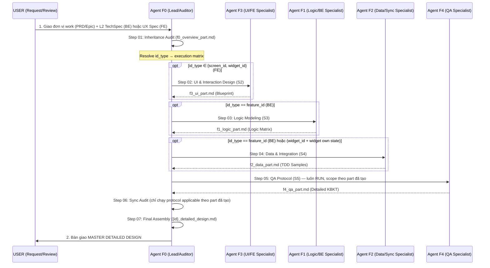

# WORKFLOW: NTAPP FEATURE DESIGN

Luồng công việc này điều phối đội ngũ **NTAPP Feature Design Squad** để bóc tách một đơn vị work (feature / screen / widget) thành bản thiết kế chi tiết (Master Detailed Design) theo tiêu chuẩn của loại đơn vị tương ứng.

**Iron Rules:** Toàn workflow tuân thủ [principles/iron_rules.md](./principles/iron_rules.md). Agent F0 PHẢI đọc file này trước khi thực thi bất kỳ step nào.

---

## WORKFLOW ARCHITECTURE — Progressive disclosure

- File này giữ KHUNG điều phối (bản đồ + cổng + rule). Chi tiết thực thi nằm TRONG từng step file (`./steps/`).
- ⛔ Đọc ĐÚNG MỘT step mỗi lần. Hoàn tất step hiện tại (gồm mọi PAUSE / skip-decision / audit) RỒI mới đọc step kế theo con trỏ `**Next:**` ở cuối step đó. KHÔNG đọc trước nhiều step. State chuyển tiếp qua part file trong `{intermediate_folder}`, không qua việc giữ instruction trong context.
- Chuỗi step là **tuyến tính** 01 → 02 → 03 → 04 → 05 → 06 → 07. Việc một step RUN hay SKIP *action* của nó do **Skip Condition (§0)** bên trong chính step quyết định theo `id_type` (xem §3 Execution Matrix) — traversal vẫn đi tuần tự qua mọi step, không nhảy cóc.

---

## MODE SELECTION (Agent F0 đọc ĐẦU TIÊN)

Skill có 2 mode. Agent F0 xác định mode từ user message / args **trước** khi chạy bất kỳ step nào:

| Mode | Trigger | Khi nào dùng |
|---|---|---|
| **FULL** (default) | không flag / "thiết kế DD" / "feature design" | Lần đầu tạo DD cho unit, hoặc re-design toàn bộ unit |
| **APPEND** | `--append`, "thêm endpoint vào DD", "append DD", growable-append gọi từ slice-loop | Đã có DD canonical cho unit; chỉ THÊM 1 vài endpoint/capability mới (thuần thêm), KHÔNG sửa endpoint/contract cũ |

- **FULL mode** → LAUNCH intake (Bước 1) → pipeline tuyến tính 01 → 07.
- **APPEND mode** → mục [APPEND MODE EXECUTION](#append-mode-execution-incremental-dd-amendment--additive-only). **Bỏ qua** pipeline full 01-07.

> **Vì sao có APPEND:** Với unit `growable` (hub cố ý lớn dần qua nhiều slice — xem slice-loop Change 5), mỗi slice tiêu thụ mới cần thêm endpoint trên cùng unit. FULL re-design sẽ tái sinh CẢ DD → rủi ro drift contract của endpoint mà slice trước đã ship + demo. APPEND **đóng băng** phần cũ verbatim, chỉ thiết kế **delta** (endpoint mới) qua đúng specialist F1-F4 với cùng độ rigor, rồi no-regression check. Đây là entry point đóng producer-contract cho node `dd-per-unit` growable-append. **Ưu tiên tách atom per-capability (A-U5)** hơn — chỉ dùng APPEND cho hub growable thật sự.

---

## 1. Sơ đồ phối hợp (Feature Orchestration)



**Lưu ý dependency:** Thứ tự specialist là bắt buộc, không chạy song song. Thông thường chỉ subset agent chạy theo `id_type` (xem §3 Execution Matrix). Khi nhiều specialist cùng chạy, agent sau kế thừa output của agent trước (F1→F3; F2→F3+F1; F4→F1+F2+F3).

## 2. INITIALIZATION (Configuration Resolution)

Trước khi chạy bất kỳ step nào, Agent F0 PHẢI resolve config theo cascade 3 layer (ưu tiên cao → thấp).

### Bước 0 — Resolve `{project-root}`

Walk up từ `cwd` tìm marker folder:
1. Nếu thấy `_bmad/` → đó là `{project-root}`.
2. Nếu thấy `.git/` → đó là `{project-root}`.
3. Nếu lên đến `/` không thấy gì → fallback `cwd` + log warning: "⚠️ Không tìm thấy marker (`_bmad/` hoặc `.git/`), dùng cwd làm project-root".

### Layer 1 — BMad project config

Đọc `{project-root}/_bmad/bmm/config.yaml` nếu tồn tại. Lookup keys:
- `project_name`
- `planning_artifacts`
- `bmad.design_system_root` (block-level, default `{spec_repo_root}/NTAPP-output/design-system`) — đây là **family root**; `{design_system_root}` dùng trong skill = **DS root resolve per unit** theo `{family_root}/_shared/ds-resolution.md` **nhánh B** (không có `registry.yaml` → chính family root, y hệt cũ; ≥2 systems → **thẻ `repo:` ở Cluster Header WBS của module chứa unit** — primary, WBS đã load ở Pre-flight §2 — → `id_prefixes`/`modules`/`default_ds`; không resolve được → WARN + hỏi user chọn ds_id — catalog là input recommended nên KHÔNG hard-STOP). Resolve path cho: (a) rule catalog `_shared/layout-best-practices.md` (+ optional `ds-rules-overrides.md`) cho composition audit §2.4 — `_shared/` LUÔN ở family root; (b) **`component_catalog.md` digest** của DS đã resolve (derived từ Master DS — F3 load để author §2.2/§2.3 theo vocabulary component thật + recipes, xem step-02); (c) `_reference/` visual notes + screenshots của DS đã resolve (grounding style). **KHÔNG** load full `master_token.json` / `components_metadata.json` vào context (nặng, 90% field không phục vụ wireframing — digest là đủ; matcher authoritative chạy ở Stage 4b với full metadata). Multi-DS: ghi `ds_id` đã resolve vào DD Section 1 (audit trail cho Stage 4b resolve khớp).

BMad dùng placeholder `{project-root}` trong values → Agent F0 thay bằng absolute path đã resolve ở Bước 0.

### Layer 2 — Skill family config (override)

Đọc `{project-root}/.bmm-config.yaml` nếu tồn tại. Tìm section `ntapp-feature-design:`. Override giá trị từ Layer 1 nếu có.

Schema mong đợi:
```yaml
ntapp-feature-design:
  project_name: <string>          # optional, override Layer 1
  planning_artifacts: <path>      # optional, override Layer 1
```

### Layer 3 — Default + Interactive (fallback)

Khi cả Layer 1 và Layer 2 đều miss biến cần → DỪNG, hỏi user (Pause & Wait):

```markdown
## ⚙️ SKILL CONFIG MISSING — Setup lần đầu

Tôi không tìm thấy config (`_bmad/bmm/config.yaml` hoặc `.bmm-config.yaml`).
Cần xác định 2 thông tin sau (ENTER để chấp nhận default):

[Q1] **project_name** (default: `{tên folder của project-root}`)?
[Q2] **planning_artifacts** path nơi đặt L2 TechSpec + UX Spec + WBS
     (default: `{project-root}/output/architecture/`)?

→ Sau khi nhận response, ghi vào `{project-root}/.bmm-config.yaml`
   để lần sau không hỏi lại.
```

### Biến runtime cuối cùng

Sau cascade (+ intake gate ở LAUNCH), các biến phải có giá trị:

| Biến | Nguồn | Ghi chú |
|---|---|---|
| `project_name` | Layer 1/2/3 | Tên dự án — hiển thị trong header DD |
| `planning_artifacts` | Layer 1/2/3 | Absolute path nơi đặt L2 TechSpec / UX Spec / WBS làm input |
| `design_system_root` | Layer 1 (`bmad.design_system_root` = family root; DS root resolve per unit — nhánh B `_shared/ds-resolution.md`, xem Layer 1) | READ-ONLY input — resolve path rule catalog `{family_root}/_shared/layout-best-practices.md` (+ override `ds-rules-overrides.md`) cho audit §2.4 + catalog/`_reference/` của DS unit. Default `{spec_repo_root}/NTAPP-output/design-system`. KHÔNG đọc token/component canonical (R10) |
| `id` | User input (LAUNCH Bước 1) | ID đơn vị đang thiết kế — `BE-{MOD}-NN` / `SCR-{NAME}` / `WGT-{NAME}` |
| `id_type` | Auto-derive từ prefix (LAUNCH Bước 2) | `feature_id` / `screen_id` / `widget_id` |
| `intermediate_folder` | Auto-derive | = `{planning_artifacts}/feature_design_parts/{id}/` |
| `template_path` | Hardcode | `./templates/master_detailed_design_v4_template.md` — resolve relative to **skill root**, không phải cwd |
| `agent_personas_path` | Hardcode | `./agents/` — relative to skill root |
| `iron_rules_path` | Hardcode | `./principles/iron_rules.md` — relative to skill root |
| `date` | System | Format ISO 8601 `YYYY-MM-DD` |

## 3. Execution Matrix theo `id_type`

Step 01 (Inheritance Audit), Step 05 (QA), Step 06 (Sync Audit), Step 07 (Assembly) **luôn RUN** với scope điều chỉnh theo part đã tạo. Step 02-04 (specialist sub-agent) RUN/SKIP *action* theo bảng (traversal vẫn tuyến tính qua mọi step — quyết định nằm ở Skip Condition §0 của từng step):

| Step (sub-agent) | `feature_id` (BE) | `screen_id` (FE screen) | `widget_id` (FE widget) |
|---|:---:|:---:|:---:|
| Step 02 — F3 UI Specialist | ❌ SKIP | ✅ RUN | ✅ RUN |
| Step 03 — F1 Logic Specialist | ✅ RUN | ❌ SKIP | ❌ SKIP |
| Step 04 — F2 Data Specialist | ✅ RUN | ❌ SKIP | ⚠️ PROMPT user "Widget own local state?" → y RUN, n SKIP |

**Lý do thiết kế:**
- BE feature: có API + Data, KHÔNG có UI (UI thuộc FE screen/widget).
- FE screen: có UI, consume API (không own), thường không own data state (state quản lý tập trung).
- FE widget: có UI, optionally own local state. PROMPT xử lý trường hợp hiếm gặp khi widget phức tạp.

**Khi sub-agent SKIP:**
- Part file tương ứng KHÔNG được tạo (f3_ui_part.md / f1_logic_part.md / f2_data_part.md).
- Step 06 audit protocol applicable: chỉ chạy protocol mà cả 2 input parts đều tồn tại (xem step-06-sync-audit.md).
- Step 07 assembly inject conditional: chỉ inject part đã tồn tại; section tương ứng trong template được mark `(không applicable cho {id_type} — SKIP)`.

## 4. GLOBAL RULES (bất biến — áp dụng mọi step)

NTAPP Feature Design Squad tuân thủ toàn bộ rule trong [./principles/iron_rules.md](./principles/iron_rules.md). Đặc biệt quan trọng cho Layer 3:

- **R1 — Verbatim Injection:** Step 07 Pass 2-4 không được tóm tắt khi merge parts đã có.
- **R3 — Zero-Fabrication:** Không bịa UI control / Logic rule / KBKT scenario không có trong L2 TechSpec / UX Spec / WBS.
- **R8 — Contract Lock:** Module 0 frozen — không sửa từ skill này.
- **R9 — Missing Input Handling:** Thiếu L2 TechSpec (BE) / UX Spec (FE) / WBS → hỏi user, không hallucinate.
- **R10 — Inheritance Compliance:** Module boundary từ L2 (BE); persona/journey/wireframe/component-chosen từ UX Spec (FE) — không tự đổi.
- ⛔ **Progressive disclosure:** Đọc đúng một step file mỗi lần; chỉ đọc step kế (`**Next:**`) khi step hiện tại xong + qua cổng applicable.
- **Single Source of Truth:** Không lưu file nháp ngoài `{intermediate_folder}` (R3 + R9).

## 5. PIPELINE MAP — Step ↔ Agent ↔ Output (neo thường trực — 1 dòng/step, KHÔNG chi tiết)

| # | Step file | Agent | Vai trò | Output file | Conditional |
|---|---|---|---|---|---|
| 01 | steps/step-01-inheritance-audit.md   | F0 | Inheritance Audit | `{intermediate_folder}/f0_overview_part.md` | luôn RUN |
| 02 | steps/step-02-ui-interaction-design.md | F3 | UI & Interaction Design | `{intermediate_folder}/f3_ui_part.md` | SKIP nếu `id_type == feature_id` |
| 03 | steps/step-03-logic-modeling.md      | F1 | Logic Modeling | `{intermediate_folder}/f1_logic_part.md` | SKIP nếu `id_type ∈ {screen_id, widget_id}` |
| 04 | steps/step-04-data-integration.md    | F2 | Data & Integration | `{intermediate_folder}/f2_data_part.md` | SKIP nếu `id_type == screen_id`; PROMPT nếu `widget_id` |
| 05 | steps/step-05-qa-protocol.md         | F4 | QA Protocol | `{intermediate_folder}/f4_qa_part.md` | luôn RUN (scope theo part đã tạo) |
| 06 | steps/step-06-sync-audit.md          | F0 | Sync Audit | `{intermediate_folder}/f0_sync_matrix_part.md` | luôn RUN (protocol applicable theo part đã tạo) |
| 07 | steps/step-07-assembly.md            | F0 | Final Assembly | `{planning_artifacts}/{id}_detailed_design.md` | luôn RUN (inject conditional theo part đã tạo) |

Chuỗi: **01 → 02 → 03 → 04 → 05 → 06 → 07** (tuyến tính). Step terminal = 07.

**Quan sát:** F0 luôn sản sinh 2 part trung gian + 1 final DD. Specialist part files (F1/F2/F3) số lượng thay đổi theo `id_type`. F4 luôn chạy.

## 6. Output Naming Convention

| Output | Path | Versioning |
|---|---|---|
| Intermediate parts | `{intermediate_folder}/f{0\|1\|2\|3\|4}_{name}_part.md` | Không version (overwrite mỗi run) |
| Final DD — canonical | `{planning_artifacts}/{id}_detailed_design.md` | Flat, overwrite mỗi run (latest pointer) |
| Final DD — archive | `{planning_artifacts}/archive/{id}_detailed_design_v{N}.md` | Bump `v1 → v2 → v3...` mỗi run (snapshot history) |

**Ví dụ:**

| `id` | `id_type` | Canonical | Archive (lần đầu) |
|---|---|---|---|
| `BE-ORDER-01` | `feature_id` | `BE-ORDER-01_detailed_design.md` | `archive/BE-ORDER-01_detailed_design_v1.md` |
| `SCR-LOGIN` | `screen_id` | `SCR-LOGIN_detailed_design.md` | `archive/SCR-LOGIN_detailed_design_v1.md` |
| `WGT-AVATAR` | `widget_id` | `WGT-AVATAR_detailed_design.md` | `archive/WGT-AVATAR_detailed_design_v1.md` |

Re-design lần sau: canonical overwrite, archive bump `v2 → v3 → ...`.

## 7. Quy chuẩn tài liệu

Sử dụng bản mẫu: `./templates/master_detailed_design_v4_template.md`.
Trọng tâm là **tính khép kín (Closure)** và **khả năng thực thi (Implementability)** cho developer scope tương ứng (BE / FE).

---

## LAUNCH — [GATE: INTAKE] (bắt buộc dừng)

### Bước 0 — Resolve mode (Agent F0)

Đọc user message / args TRƯỚC (xem [MODE SELECTION](#mode-selection-agent-f0-đọc-đầu-tiên)):
- Có `--append` (hoặc trigger APPEND) → **KHÔNG** chạy intake FULL; nhảy thẳng tới [APPEND MODE EXECUTION](#append-mode-execution-incremental-dd-amendment--additive-only).
- Không có → FULL mode → tiếp Bước 1.

> **Gọi từ automation** (vd slice-loop node `dd-per-unit` growable-append) dạng `--append <id> | <mô tả endpoint/capability mới>`: `id` + delta lấy từ args → KHÔNG Pause & Wait ở Bước 1/FA2.

### Bước 1 — Hỏi `id`

Skill này design 1 đơn vị mỗi lần — 1 trong 3 loại: feature / screen / widget. Agent F0 PHẢI hỏi user:

```markdown
**[Q]** Đơn vị nào cần thiết kế Detailed Design?
ID lấy từ `{planning_artifacts}/project_wbs.md`. Format prefix:
  • feature_id (BE feature) — `BE-{MOD}-NN` (vd `BE-ORDER-01`)
  • screen_id (FE screen) — `SCR-{NAME}` (vd `SCR-LOGIN`)
  • widget_id (FE widget shared) — `WGT-{NAME}` (vd `WGT-AVATAR`)
```

> 👉 **[PAUSE & WAIT FOR USER INPUT]**

`id` sẽ dùng để:
- Tạo `intermediate_folder` riêng cho đơn vị.
- Đặt tên output file final.
- Verify ở Step 01 pre-flight rằng ID này tồn tại trong WBS unit list tương ứng.

### Bước 2 — Auto-derive `id_type` từ prefix

Agent F0 phân loại id_type dựa trên prefix:

| Prefix | `id_type` | Module type |
|---|---|---|
| `BE-*` | `feature_id` | backend-service |
| `INT-*` | `feature_id` | integration-contract (treat as BE feature) |
| `SCR-*` | `screen_id` | frontend-app |
| `WGT-*` | `widget_id` | frontend-app (shared) |
| Khác | DỪNG, hỏi user clarify | — |

`id_type` sẽ dùng để:
- Quyết định sub-agent nào RUN/SKIP (xem §3 Execution Matrix).
- Lookup WBS unit list tương ứng (`features` / `screens` / `widgets`).
- Quyết định source-of-truth input (L2 TechSpec cho BE, UX Spec cho FE).

Sau khi resolve `id` + `id_type` →
**Next:** Read fully and follow `./steps/step-01-inheritance-audit.md`

---

## APPEND MODE EXECUTION (Incremental DD Amendment — additive only)

> **Acting as:** [Agent F0 — Lead Orchestrator](./agents/agent_f0_orchestrator.md) điều phối; specialist F1/F2/F3/F4 chỉ thiết kế **DELTA** (endpoint/capability mới), KHÔNG đụng phần cũ.
> **Tuân thủ:** [Iron Rules](./principles/iron_rules.md) — R1 (Verbatim), R2 (Zero-summarization), R3 (Zero-fabrication), R8 (Contract Lock), R10 (Inheritance).
> **Mục tiêu:** Thêm 1 vài endpoint/capability mới vào DD canonical đã có của MỘT unit, **đóng băng** mọi section cũ verbatim, chỉ thiết kế delta với đầy đủ rigor F1-F4, no-regression check, bump `dd_version`. KHÔNG re-design toàn unit. Chỉ chạy mục này khi Bước 0 resolve mode = APPEND.

### FA1 — Pre-flight (F0)
1. Resolve config 3-layer + `id` (từ args) + `id_type` (auto-derive prefix, §LAUNCH Bước 2) — giống FULL [INITIALIZATION](#2-initialization-configuration-resolution).
2. Verify canonical `{planning_artifacts}/{id}_detailed_design.md`:
   - **KHÔNG tồn tại** → STOP: *"Chưa có DD để append (unit `{id}`). Chạy FULL mode trước."*
   - **Tồn tại** → load toàn bộ, giữ nguyên văn làm **FROZEN BASELINE** (bản gốc để so no-regression ở FA5).
3. Verify `id` tồn tại trong WBS unit list tương ứng (giống Step 01 pre-flight). Thiếu → STOP (R9).

### FA2 — Clarify delta (F0 — Pause & Wait, hoặc đọc args khi automation)
Hỏi (hoặc lấy từ args) — TUYỆT ĐỐI KHÔNG tự suy đoán (R3):
- Endpoint / capability **MỚI** cần thêm là gì (method + path cho BE; control/interaction cho FE).
- **Cạnh consumer nào drive nó** — phải là một `consumes` edge đã khai trong WBS (consumer mới đến từ slice hiện tại). KHÔNG có edge khai báo → STOP (chống ảo giác: không thêm endpoint không unit nào khai là cần).
- Delta chạm section template nào: BE → Logic Matrix (Mục 3) + Data/Write-Spec (Mục 4) + KBKT (Mục 5); FE screen/widget → UI Controls/Interaction (Mục 2) + `consumes`.

### FA3 — ADDITIVE-ONLY GATE (F0 — biên giới APPEND vs escalate FULL)
APPEND **chỉ** hợp lệ khi delta THUẦN THÊM (không chạm cái cũ). Refuse → escalate khi BẤT KỲ điều kiện:
- Delta sửa request/response shape của một endpoint **ĐÃ CÓ** (không phải thêm mới) → escalate FULL.
- Delta đổi / xóa / rename endpoint hoặc field đã ship → escalate FULL.
- Delta chạm contract Module 0 (`INT-*`) → R8 Contract Lock → escalate `/ntapp-architecture-design` FULL (cascade Module 0).

→ Output refuse: *"❌ Delta không thuần-thêm (chạm endpoint/contract cũ) → KHÔNG append được. Chạy FULL mode để re-design + cascade."*

Pass gate → delta là endpoint/capability **thêm mới, nằm gọn** trên unit sẵn có → FA4.

### FA4 — Design delta only (F0 → specialists, SCOPED)
1. F0 chạy inheritance audit (step-01) đọc **FROZEN BASELINE** làm *inherited context* — KHÔNG re-derive nội dung cũ (R10).
2. F0 dispatch **chỉ** specialist applicable theo `id_type` (§3 Execution Matrix), với **SCOPE = duy nhất endpoint/capability mới**:
   - BE feature → F1 (logic endpoint mới) → F2 (data/write-spec endpoint mới) → F4 (KBKT endpoint mới).
   - FE screen/widget → F3 (control/interaction mới) → F4.
   Mỗi specialist ghi một **delta part** riêng (vd `f1_logic_delta_part.md`) chỉ chứa phần MỚI — KHÔNG chép lại phần cũ.
3. Rigor y hệt FULL (dùng chính step file 02-05, chỉ khác scope) → endpoint mới KHÔNG bị hạ chuẩn so với build mới. Đây là điểm mấu chốt: append vẫn đi qua producer, không hand-write.

### FA5 — Append-merge + NO-REGRESSION audit + version bump (F0)
1. **COPY nguyên văn FROZEN BASELINE** làm điểm khởi đầu (KHÔNG gõ lại section cũ), rồi **chỉ CHÈN** delta vào đúng anchor: Logic Matrix append dòng mới; block đặc tả endpoint mới; KBKT append dòng mới; Write-Spec append dòng mới. TUYỆT ĐỐI KHÔNG sửa/xóa dòng cũ.
2. Header: bump `dd_version` (vN → vN+1) + thêm 1 dòng **Changelog** mô tả endpoint đã thêm + slice nguồn.
3. **⛔ NO-REGRESSION CHECK (gate bắt buộc):** mọi section KHÔNG thuộc delta phải **giống hệt** FROZEN BASELINE (so baseline với kết quả, loại trừ vùng vừa append + dòng version/changelog). Có khác biệt ngoài vùng append → FAIL → sửa lại (chỉ được append, hoàn phần cũ về verbatim) → **KHÔNG release**.
4. Dual-write: canonical overwrite + archive `_v{N+1}.md` (versioning logic [step-07 §3](./steps/step-07-assembly.md)).

### FA6 — Downstream notice (F0 — nhắc, KHÔNG tự chạy)
- **FE:** nếu delta thêm UI control → nhắc re-run `/ntapp-ui-generation` cho screen/widget đó.
- **Story + code:** endpoint mới cần story mở-rộng (Stage 4c, `hub_extends`) + impl append ở slice-loop node `dev-per-story` (growable-append).

### Exit Criteria (APPEND)
- [ ] Delta endpoint/capability xuất hiện trong DD; mọi section cũ **verbatim** (NO-REGRESSION PASS).
- [ ] `dd_version` bump + Changelog có entry; archive `_v{N+1}` đã tạo.
- [ ] KHÔNG chạm endpoint/contract cũ (nếu có → đã escalate FULL ở FA3).
- [ ] Delta thiết kế qua specialist applicable (không hand-write bỏ qua rigor F1-F4).

> Đây là nhánh **TERMINAL** của APPEND mode — không có `**Next:**`; kết thúc workflow sau FA6.
