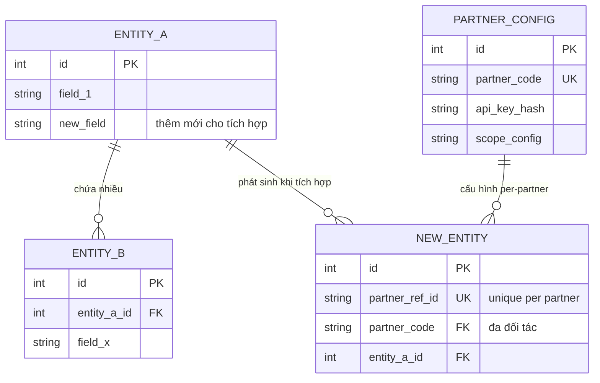
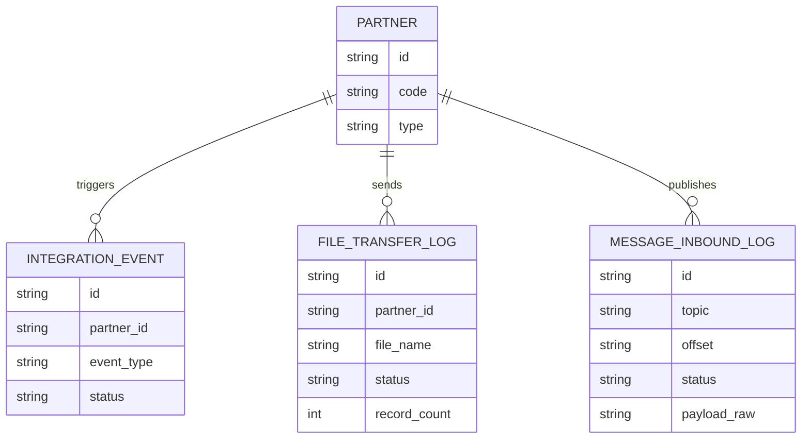

# Mapping dữ liệu, Thay đổi thực thể & ERD — Tham chiếu cho Mục 2, 4, 9

---

## A. Mục 2 — Dữ liệu & mapping nội bộ

So sánh từng trường đối tác cần với ERD/model nội bộ. Bảng phân tích trạng thái:

| Tên trường (đối tác) | Tên trường nội bộ | Thực thể | Trạng thái | Kiểu dữ liệu | Ghi chú / Rủi ro |
|---------------------|------------------|----------|-----------|--------------|-----------------|
| *(tên đối tác đặt)* | *(tên cột DB)* | *(bảng)* | ✅ Có sẵn / ⚠️ Cần transform / ❌ Chưa có | string/int/... | *(format khác biệt, null risk, PII…)* |

**Chú giải trạng thái:**
- ✅ **Có sẵn** — trường tồn tại, format khớp, dùng được ngay.
- ⚠️ **Cần transform** — tồn tại nhưng cần convert format/mapping logic.
- ❌ **Chưa có** — phải thêm mới vào DB hoặc tính toán từ trường khác.

### Bảng mapping chi tiết IN/OUT (góc nhìn field-level)

Với mỗi API / file / message, sinh bảng đầy đủ (`[IN]` = đầu vào, `[OUT]` = đầu ra):

| Field / Cột | IN/OUT | Type | Required | Source | Default/Rule | Validation | Mapping nội bộ | Persist? | Purpose | Notes |
|---|---|---|---|---|---|---|---|---|---|---|

- **[IN] Source** đổi theo loại — xem [`integration-types.md`](integration-types.md) §4.
- **[OUT]**: xác định `Mapping nội bộ` (bảng/trường nào), `Persist?` (Yes/No), `Purpose` (truy vết / đối soát / hiển thị / phục vụ call tiếp / đa đối tác), `Notes` (normalization khi nhiều đối tác dùng field/format khác nhau).
- **Góc nhìn cấu hình:** field nào cần màn hình cấu hình, bảng master, hard-code per-partner?
- **Góc nhìn lưu trữ:** field nào bắt buộc lưu, lưu để làm gì, cần bảng mapping status không?

---

## B. Mục 4 — Danh sách thay đổi thực thể dữ liệu *(BẮT BUỘC)*

Với các trường "Chưa có" / "Cần transform", chốt scope dữ liệu bằng 3 phần:

**Phần A — Thực thể thêm mới**

| Thực thể mới | Mục đích nghiệp vụ | Khóa chính | Quan hệ với thực thể hiện có | Ghi chú |
|-------------|-------------------|-----------|------------------------------|---------|

**Phần B — Thực thể bổ sung trường**

| Thực thể hiện có | Trường bổ sung | Kiểu dữ liệu | Bắt buộc | Giá trị mặc định | Mô tả nghiệp vụ |
|-----------------|--------------|-------------|---------|-----------------|----------------|

**Phần C — Dataset chi tiết theo từng thực thể thay đổi**

> Convention tên field: xem [`integration-types.md`](integration-types.md) §6.

| Field (DB) | Field (API) | Type | Required | Constraints | Description | Example |
|-----------|------------|------|---------|-------------|-------------|---------|

**Câu hỏi cần làm rõ ở phần này:**
- Trường mới phát sinh từ rule nghiệp vụ nào? Có cần lưu lịch sử thay đổi (SCD)?
- Có cần backfill dữ liệu cũ không? Theo logic gì?
- Trường nào immutable sau khi duyệt/xác nhận?
- Có cần unique constraint chống trùng dữ liệu tích hợp (vd: `partner_order_id`)?

---

## C. Mục 9 — ERD tích hợp đa đối tác *(BẮT BUỘC)*

- Chỉ thể hiện thực thể liên quan trực tiếp đến luồng tích hợp.
- Bao gồm thực thể **thêm mới** (Phần A) và **bổ sung trường** (Phần B).
- Annotation trên đường quan hệ phải mô tả **nghiệp vụ**, không chỉ ghi "relates".

### Nguyên tắc thiết kế

- Nếu user **CÓ ERD hiện tại**: đọc ERD → chỉ liệt kê field bổ sung trên bảng đã có + bảng mới cần tạo → confirm trước khi vẽ.
- Nếu user **KHÔNG có ERD**: đề xuất ERD từ đầu, đánh dấu **[Giả định]**.
- 🔷 **Tư duy đa đối tác (bắt buộc):** có cột `partner_code` hoặc bảng `PartnerConfig`; bảng log/tracking per-partner; bảng mapping chuẩn hoá (status/service/product…); giữ **raw data** để đối soát. KHÔNG hardcode 1 đối tác.

### ERD mẫu — nghiệp vụ mở rộng

### ERD mẫu — log/audit chung mọi loại

Bảng log đặc thù nên thêm theo loại: xem [`integration-types.md`](integration-types.md) §5.
