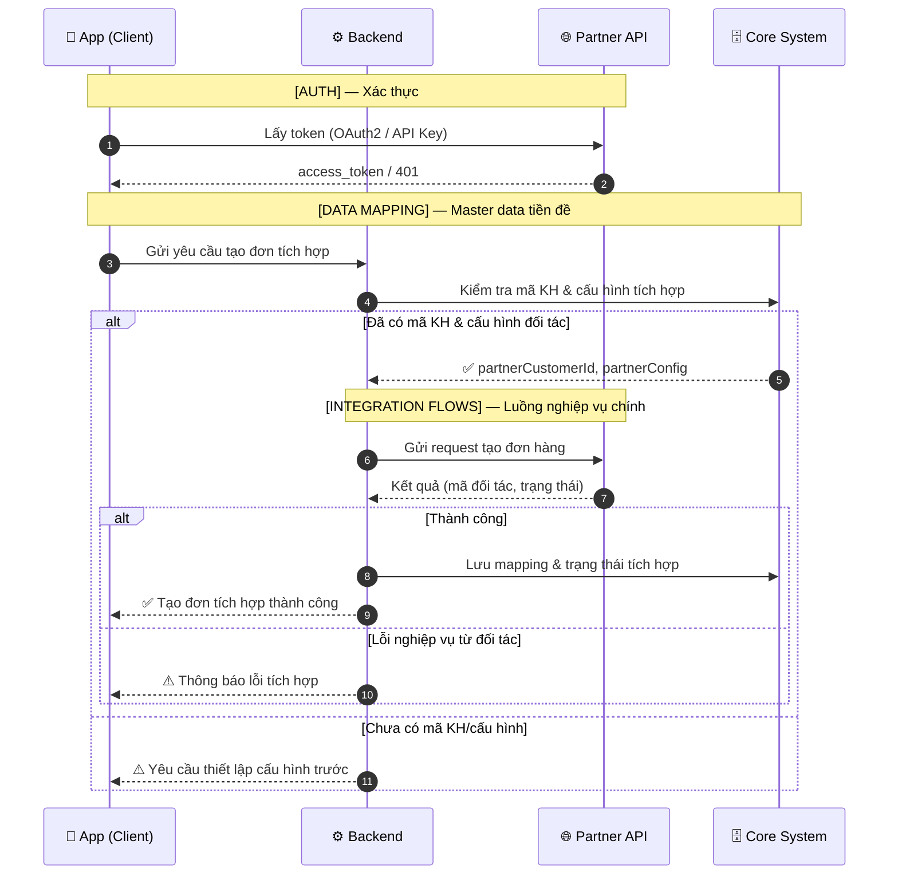
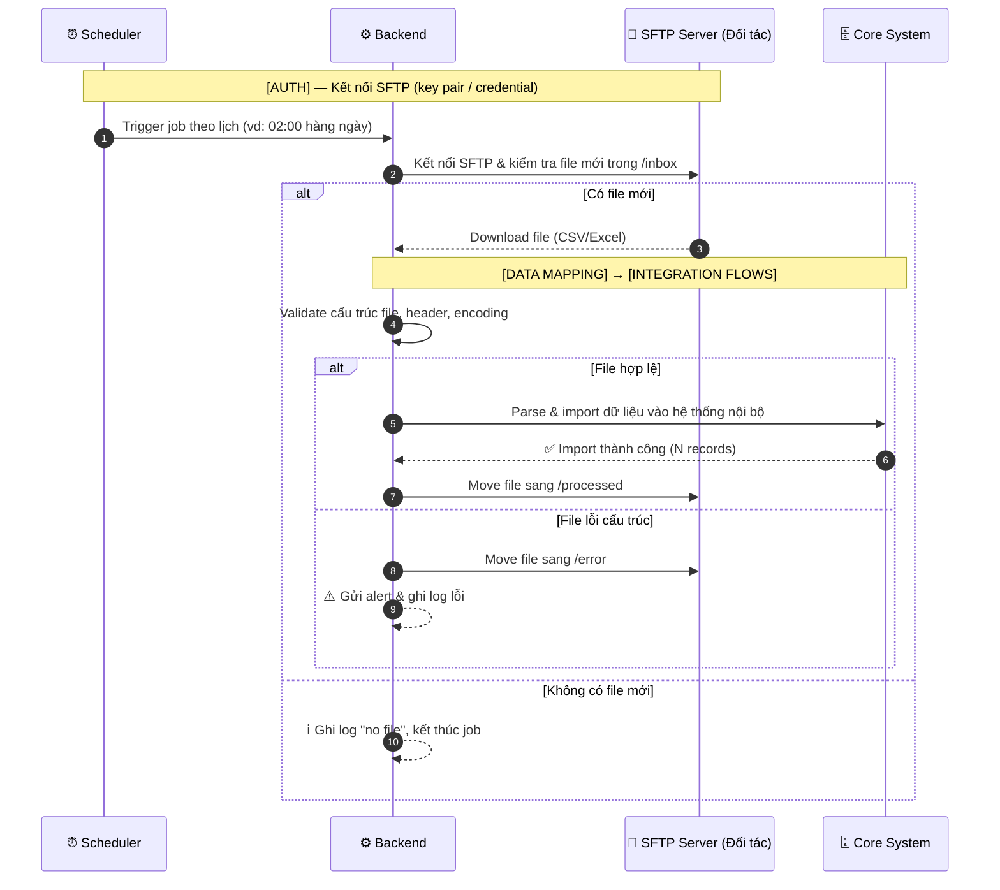
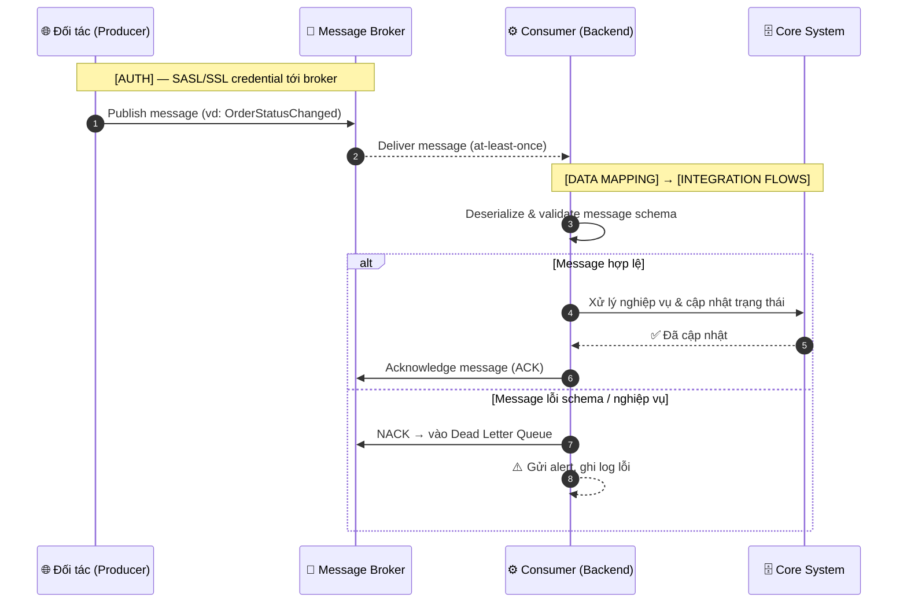
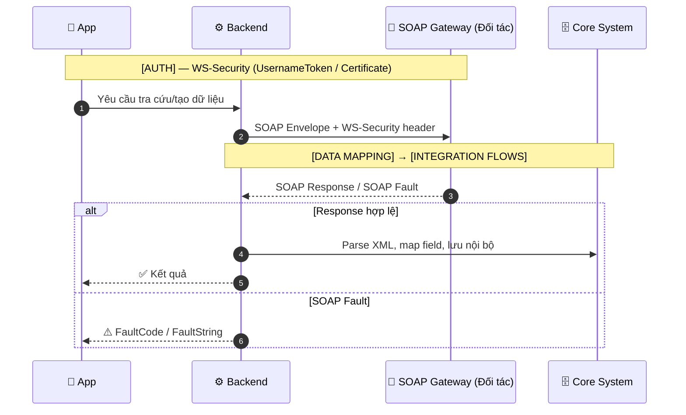
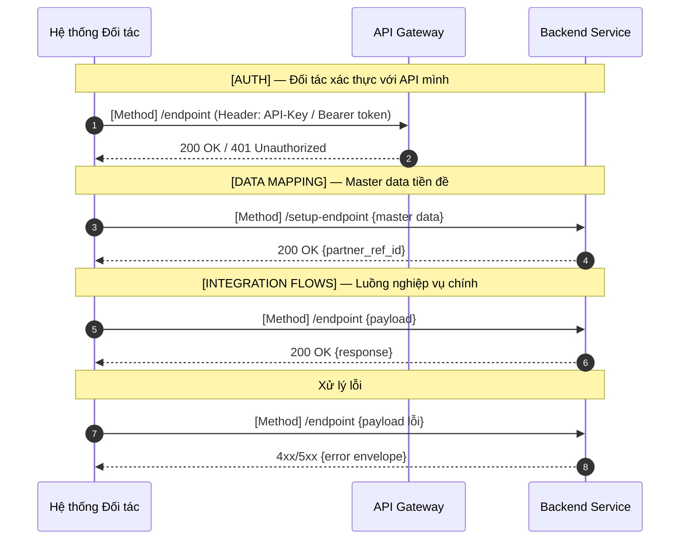

# Sequence Diagram Examples — Tham chiếu cho Mục 6

> Mọi sequence PHẢI: dùng `autonumber`, dùng `Note over` phân nhóm 3 giai đoạn **[AUTH] → [DATA MAPPING] → [INTEGRATION FLOWS]**, KHÔNG đưa Database object vào diagram. Tập trung luồng thành công; nhánh lỗi dùng `alt/else`; retry dùng `loop`. Chi tiết payload mô tả ở bảng đặc tả (Mục 8), không inline vào message.

Participant theo loại: xem [`integration-types.md`](integration-types.md) §3.

---

## 🌐 Ví dụ REST API

---

## 📁 Ví dụ File-based (SFTP)

---

## 📨 Ví dụ Message Queue (Kafka)

---

## 🔧 Ví dụ SOAP / Web Service

---

## 📨 Ví dụ `direction: inbound` (đối tác gọi mình — REST API mình expose)

