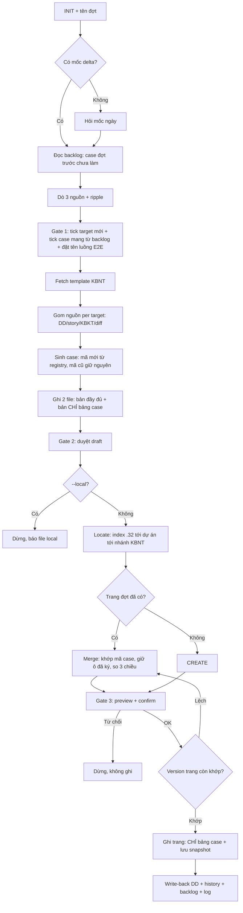

# WORKFLOW: NTAPP — KBNT → Confluence

Sinh và đồng bộ KBNT của một đợt nghiệm thu lên Confluence.

**Iron Rules (không được vi phạm):**
1. Trang KBNT là nơi người dùng ký. Publish lần 2+ phải đọc trang live trước và merge; parse bảng thất bại thì DỪNG, tuyệt đối không ghi đè.
2. Mã case cấp một chiều từ registry, không renumber, không tái sử dụng, kể cả khi case bị hủy.
3. Không bịa: không bịa định danh dữ liệu, không bịa microcopy, không bịa hành vi. Nguồn không nói thì ghi `[TBD]` và nêu ở gate.
4. Không đoán trang đích, không tự tạo nhánh KBNT, không tự đặt tên đợt.
5. Mọi thao tác ghi Confluence dừng ở preview và chờ xác nhận rõ ràng của người dùng.
6. CẤM case field-level và case an toàn thông tin — đó là phần của KBKT.
7. `--local` thì tuyệt đối không gọi tool **ghi** Confluence nào; đọc template và trang đợt trước vẫn được phép và vẫn nên làm.
8. **Chỉ đẩy bảng case lên Confluence.** Cảnh báo, chuẩn bị dữ liệu, phụ lục là bản làm việc nội bộ.
9. **Không tự dời case.** Chỉ đánh dấu dời khi người dùng chốt rõ đúng case đó. Người dùng nói "chưa hiểu câu hỏi" thì hỏi lại bằng lời thường, KHÔNG suy diễn từ quyết định của case khác.
10. **Case dời phải vào `{backlog}`.** Dời mà không ghi backlog là mất case vĩnh viễn — đợt sau không có chỗ nào để tra.
11. **Phải đọc các trang KBNT đã có trên nhánh trước khi chốt phạm vi đợt** (§2 nguồn D). `{history}` rỗng KHÔNG có nghĩa là chưa ai nghiệm thu gì — nó chỉ có nghĩa là skill chưa từng chạy. Trang đã điền ô kết quả là bằng chứng đã ký; viết lại nội dung đó thành case mới là bắt người dùng nghiệm thu hai lần.
12. **Bullet hóa mọi ô nhiều ý trước khi ghi trang** — ngưỡng và cách làm ở `references/confluence-resolve.md` §3b, dùng đúng rule đã chốt ở skill SRS. Ô dồn 3-4 câu vào một dòng là lỗi phải sửa, không phải chuyện thẩm mỹ.
13. **KHÔNG copy nguyên byte header của template.** Tự viết header theo `template-snapshot.md`, và validator phải kiểm cả hàng header — lý do ở `references/confluence-resolve.md` §3a.
14. **Nhánh và convention tiêu đề đọc từ Confluence, ghi vào `{branch_ref}`** — KHÔNG hardcode pageId trong skill (nguyên tắc portability), KHÔNG áp khuôn tên trang của skill lên nhánh đã có convention riêng.

---

## 0. INIT

Resolve theo thứ tự: (a) `.bmm-config.yaml` khối `ntapp-kbnt-to-confluence` nếu có → (b) default dưới đây.

| Biến | Ý nghĩa | Default |
|:---|:---|:---|
| `{stage4_dir}` | DD spec | `NTAPP-output/Stage_4_Design/detailed_design` |
| `{stage5_dir}` | Story / ATDD | `NTAPP-output/Stage_5_Build_Verify` |
| `{slices_dir}` | Slice plan | `NTAPP-output/Stage_2_Architecture/slices` |
| `{qa_dir}` | KBKT (nếu có) | `NTAPP-output/Stage_5_Build_Verify/test-artifacts` |
| `{kbnt_root}` | Root KBNT | `NTAPP-output/Stage_5_Build_Verify/kbnt` |
| `{dot_dir}` | Workspace một đợt | `{kbnt_root}/{dot_slug}` |
| `{registry}` | Ledger mã case | `{kbnt_root}/case-registry.yaml` |
| `{history}` | Ledger đợt | `{kbnt_root}/kbnt-publish-history.md` |
| `{backlog}` | Ledger case đã cấp mã nhưng chưa nghiệm thu | `{kbnt_root}/kbnt-backlog.md` |
| `{cases_file}` | Bản CHỈ bảng case — nguồn duy nhất để build storage | `{dot_dir}/{dot_slug}_kbnt_cases.md` |
| `{branch_ref}` | Nhánh KBNT đã resolve được (cache, tránh dò lại) | `{kbnt_root}/kbnt-branch.json` |
| `{project_index_url}` | Điểm vào cố định | `.32` pageId `88716677` |
| `{target_system_name}` | Hệ thống đích | `Đối soát tập trung` |
| `{template_title}` | Template KBNT | `Template KBNT` (`.35`, space `TDOV`) |
| `{auth_file}` | Credential REST (đọc `.32` khi MCP chết, PUT body lớn) | `<repo-root>/.confluence-auth` (gitignored) |

**Tham số:** `"<tên đợt>"` bắt buộc — không có thì hỏi, KHÔNG tự đặt. `--since YYYY-MM-DD` đặt lại mốc dò delta. `--local` chỉ sinh file local, bỏ toàn bộ bước Confluence (§3, §7-§10).

`{dot_slug}` = tên đợt chuyển kebab-case không dấu. Ví dụ `Bàn giao tháng 8` → `ban-giao-thang-8`.

`--local` bỏ §7 đến §11 (locate, merge, ghi trang, write-back, ledger publish) nhưng **giữ §3** (đọc template) — xem Iron Rule 7.

## 1. Bước 1 — XÁC ĐỊNH MỐC DELTA

1. Đọc `{history}`. Có dòng đợt gần nhất → `{since}` = ngày của dòng đó.
2. Không có file (đợt đầu tiên) và không có `--since` → **AskUserQuestion** hỏi mốc ngày, kèm gợi ý (ngày commit đầu tiên chưa nghiệm thu, ngày bàn giao lần trước). KHÔNG tự chọn.
3. `--since` truyền vào thì luôn thắng, và ghi nhận là mốc thủ công ở §11.
4. Kiểm tra trùng đợt: `{dot_dir}` đã tồn tại → đây là publish lần 2+ của chính đợt đó, ghi nhớ `{rerun}=true` và đọc `{dot_dir}/{dot_slug}_kbnt.md` cùng snapshot lần trước.
5. **Đọc `{backlog}` — bắt buộc, không được bỏ.** Mọi case ghi ở đó là case đợt trước đã cấp mã nhưng chưa nghiệm thu (thiếu tiền đề bên ngoài, chưa chốt nghiệp vụ, mã chưa lên bản build). Chúng **tự động là ứng viên của đợt này**, trình ở gate 1 thành một phần riêng "Mang từ đợt trước" cùng lý do dời và đợt cấp mã. Người dùng tick giữ hoặc dời tiếp. Case được giữ thì **dùng lại đúng mã cũ**, KHÔNG cấp mã mới, và KHÔNG viết lại nội dung case trừ khi nguồn đã đổi.
   Backlog trống hoặc không có file (đợt đầu tiên) → bỏ qua, không phải lỗi.
6. **Đọc `{branch_ref}`** nếu có — đây là nhánh KBNT đã resolve ở lần chạy trước, dùng luôn cho §2 nguồn D và §7. Không có file thì §7 dò rồi ghi lại.

## 2. Bước 2 — DÒ NỘI DUNG ĐỢT (HITL gate 1)

Theo `references/delta-detection.md`. Tóm tắt:

- **Nguồn A — code repo:** với mỗi code repo trong workspace, `git log --since={since} --name-only` + `git status --porcelain` (bắt cả code chưa commit). Với mỗi file đổi, đọc 10 dòng đầu lấy header `id:` → unit ID.
- **Nguồn B — spec repo:** file `{stage4_dir}/*_detailed_design.md` và `{stage5_dir}/*.md` mới hoặc đổi kể từ `{since}` (dùng `git log --since`; file chưa commit lấy từ `git status`) → ID từ tên file.
- **Nguồn C — slice plan:** slice có `demo_status: passed` chưa từng xuất hiện trong `{history}`.
- **Nguồn D — trang KBNT đã có trên Confluence (BẮT BUỘC, chạy cả khi `--local`):** liệt kê con của nhánh KBNT (`{branch_ref}`, hoặc dò theo §7 nếu chưa có) và đọc từng trang đợt để biết **thứ gì đã nghiệm thu rồi**. `{history}` chỉ ghi các đợt **do skill sinh** — đội thường đã viết KBNT tay nhiều đợt trước khi skill tồn tại, và những trang đó là bằng chứng ký duy nhất. Với mỗi trang: tên trang, số case, **bao nhiêu case đã điền ô kết quả**, tên các mục chức năng. Ô kết quả đã điền = đợt đó đã nghiệm thu; chi tiết thủ tục ở `references/delta-detection.md` §3.
- Hợp bốn nguồn, khử trùng, map unit → slice chứa nó (nếu có).
- **Dò ripple** (`references/delta-detection.md` §2): seam code dùng chung, tài nguyên chung (bảng, topic, endpoint, key cache), phụ thuộc slice → danh sách ứng viên "nghiệm thu ảnh hưởng", mỗi ứng viên kèm **lý do và bằng chứng đường dẫn file**.

**DỪNG — gate 1.** Trình bảng ứng viên hai phần (target trực tiếp / ứng viên ảnh hưởng), mỗi dòng: ID, tên, lý do, nguồn tín hiệu, có DD không, có story không, có KBKT không, **và trang KBNT nào đã phủ nội dung này** (từ nguồn D — để trống nếu chưa có).

Target đã bị một trang KBNT cũ phủ thì **mặc định đề xuất bỏ**, hoặc giữ lại dưới dạng **case hồi quy** nếu đợt này sửa đúng vùng đó. Đừng để người dùng tự phát hiện trùng sau khi trang đã lên — dò trùng là việc của bước này. Người dùng tick giữ hoặc bỏ, thêm tay target còn thiếu, và **đặt tên các luồng E2E** gom từ phần ảnh hưởng. Chốt xong ghi `{dot_dir}/dot-manifest.yaml` (danh sách target + luồng + lý do + mốc `{since}`).

## 3. Bước 3 — FETCH TEMPLATE

Chạy **cả khi `--local`** — đây là thao tác đọc, và draft dựng trên khung fallback sẽ phải làm lại toàn bộ khi publish. Chỉ khi không đọc được Confluence mới dùng fallback.

- Tìm template theo tiêu đề: `mcp__atlassian__confluence_search` CQL `space = TDOV AND title = "{template_title}"`. Nhiều kết quả → hỏi.
- `confluence_get_page(page_id, convert_to_markdown=false)` → parse **thứ tự mục, tên mục, và bộ cột của bảng case** làm khung chuẩn.
- Ghi khung parse được ra `{dot_dir}/template-snapshot.md` để bước sau bám và để so sánh khi template đổi.
- Fetch lỗi → cảnh báo và dùng khung fallback trong `references/kbnt-authoring.md` §Khung fallback. Template fetch được luôn thắng fallback.
- **Kiểm cột khóa:** bảng case phải có cột đầu kiểu `STT` để chứa mã case. Không có cột nào dùng được → **DỪNG**, hỏi người dùng chọn: thêm cột `Mã case`, hay chỉ định cột khác làm chỗ chứa mã.

## 4. Bước 4 — GOM NGUỒN CHO TỪNG TARGET

Với mỗi target trong manifest:

- DD: `{stage4_dir}/{id}_detailed_design.md`.
- Story: `{stage5_dir}/{id}.md`, `{stage5_dir}/{id}-full-screen.md`, hoặc `{stage5_dir}/E*-{id}-*.md`.
- KBKT nếu có: `{qa_dir}/**/{id}_detailed_test_manual_testcase.md`, `{id}_fixtures.yaml`.
- Diff của đợt: danh sách file và hunk đã dò ở §2 — dùng để biết **phần nào vừa sửa**.
- Thiếu DD hoặc thiếu story → đánh dấu `nguon: code-only` cho target đó, ghi rõ thiếu gì; không dừng.
- Target đã xuất hiện ở đợt trước (có trong `{registry}`) → chỉ sinh case cho AC hoặc hành vi **mới/đổi**, cộng một đến hai case hồi quy chạm trực tiếp vùng sửa (dùng lại mã case cũ, đánh dấu là hồi quy).

## 5. Bước 5 — SINH CASE

> **Đọc `references/kbnt-authoring.md` trước khi viết chữ đầu tiên**, và đọc `terminology.md` của skill SRS (resolve bằng Glob) trước khi chọn từ.

Sinh **hai** file, cùng một nguồn nội dung:

| File | Chứa gì | Dùng làm gì |
|:---|:---|:---|
| `{dot_dir}/{dot_slug}_kbnt.md` | đầy đủ — thông tin đợt, mục A, mục B, bảng case, phụ lục, ký duyệt | bản làm việc của đội, review ở gate 2, giữ ở repo |
| `{cases_file}` | **CHỈ** bảng case (heading mục + bảng) | nguồn duy nhất để build storage ở §10 |

Bố cục `{dot_slug}_kbnt.md` — **đánh số bắt đầu từ A, không nhảy chữ**:

1. **Thông tin đợt nghiệm thu:** bảng thông tin theo đúng template + bảng thuộc tính đợt (tên đợt, mốc delta, ngày sinh, số case, nguồn dựng case), cộng một dòng nêu **phạm vi đẩy lên Confluence**.
2. **Mục A — Cảnh báo trước khi mở đợt:** `A1`, `A2`, … Mỗi cảnh báo là một thứ **quyết định case nào ký được**: mã nguồn phân nhánh, dữ liệu nhạy cảm, case dời đợt sau, môi trường đặc thù, test chưa từng chạy.
3. **Mục B — Chuẩn bị dữ liệu và môi trường:** `B1`, `B2`, … Gom mọi `[TBD]` **theo nhóm người phải cấp** (hạ tầng / dữ liệu nghiệp vụ / chữ hiển thị / lưu ý vận hành), mỗi dòng ghi rõ cần gì, vì sao, ảnh hưởng mục nào.
4. **Danh sách chức năng nghiệm thu trong đợt:** bảng một dòng một mục, kèm số case và lưu ý trỏ về `A*`/`B*`.
5. **Bảng case:** theo target trước, rồi luồng E2E / nghiệm thu ảnh hưởng đặt cuối.
6. **Phụ lục 1** — lệch giữa tài liệu và mã nguồn; **Phụ lục 2** — chi tiết `[TBD]` theo từng mục.
7. **Kết luận và ký duyệt** theo đúng template, cộng dòng **bản build đã nghiệm thu** (bắt buộc điền).

> Dùng `A`/`B` cho hai mục đầu và `Phụ lục 1`/`Phụ lục 2` cho hai phụ lục — KHÔNG dùng `C`, `D` cho mục thân bài rồi lại `A`, `B` cho phụ lục: người đọc sẽ tưởng thiếu mục A và B.

**Cấp mã case:** đọc `{registry}`, với mỗi case mới lấy `nn` kế tiếp của target đó, ghi ngay vào registry cùng `dot_cap_ma`, tóm tắt mục đích và trạng thái. Case đã có mã ở đợt trước (kể cả case mang từ `{backlog}`) thì **dùng lại mã cũ**. Không lấp chỗ trống của mã đã hủy.

**Trạng thái trong `{registry}`** — đúng bốn giá trị:

| `trang_thai` | Nghĩa | Ai đặt |
|:---|:---|:---|
| `active` | đã đưa vào đợt này và chạy được | §5 |
| `deferred` | đã cấp mã nhưng **dời sang đợt sau** — có mặt trong `{backlog}` | §5, khi người dùng chốt dời ở gate 1 hoặc gate 2 |
| `done` | đã nghiệm thu và ký xong | §11, sau khi đợt kết thúc |
| `huy` | bỏ hẳn, mã không tái sử dụng | §8, theo `references/merge-rules.md` |

**Quy ước đánh dấu case dời** — phân biệt rõ ba tình huống, đừng gộp:

| Tình huống | Đánh dấu | Trạng thái registry | Vào `{backlog}`? |
|:---|:---|:---|:---|
| Người dùng chốt **không làm đợt này** | tiền tố `[Chưa nghiệm thu đợt này — dời đợt KBNT sau: <lý do>]` ở cột `Ghi chú` | `deferred` | **có** |
| **Giữ trong đợt** nhưng cần bản build có đủ mã | KHÔNG đánh tiền tố. Nêu ở `A1` thành danh sách case kèm điều kiện build; người nghiệm thu để trống cột kết quả nếu bản build thiếu mã | `active` | không |
| **Giữ trong đợt** nhưng chờ chốt nghiệp vụ | KHÔNG đánh tiền tố. Ghi `[TBD]` trong `Điều kiện` và một dòng ở `B3` | `active` | không |

⚠️ **Chỉ đánh dấu dời khi người dùng nói rõ dời.** Người dùng trả lời "chưa hiểu câu hỏi" **không phải** là đồng ý dời — phải hỏi lại bằng lời thường, không được tự suy ra rồi áp cách xử lý của case khác. Đánh dấu dời sai làm case biến mất khỏi đợt mà không ai quyết.

## 6. Bước 6 — REVIEW DRAFT (HITL gate 2)

**DỪNG.** Trình tóm tắt: số case theo target, số case luồng E2E, số case chạy trong đợt so với số case dời, danh sách `[TBD]`, danh sách target `code-only`, các case vượt trần định lượng kèm lý do (trần là **gợi ý mềm** ở `references/kbnt-authoring.md` §1 — nêu lý do là đủ, KHÔNG cắt case cho vừa trần). Người dùng sửa thì sửa vào part file rồi ghép lại, KHÔNG sửa tay file đã ghép. Chỉ sang §7 khi người dùng duyệt.

`--local` thì dừng hẳn ở đây và báo đường dẫn cả hai file (`{dot_slug}_kbnt.md` và `{cases_file}`).

## 7. Bước 7 — LOCATE TARGET trên Confluence

Theo `references/confluence-resolve.md`. Tóm tắt:

1. `{rerun}` và `{dot_dir}/page-ref.json` có sẵn pageId → verify bằng `get_page`, khớp tiêu đề thì `action=UPDATE`.
2. `{branch_ref}` có sẵn nhánh KBNT → **dùng luôn, bỏ toàn bộ bước dò**. Verify bằng `get_page` trên `parent_id`; trang không còn thì mới dò lại.
3. Chưa có `{branch_ref}`: đọc index `.32` `{project_index_url}` (MCP `atlassian32`; 403 thì REST `confluence-get.ps1`) → lấy link hệ thống `{target_system_name}`. **Index `.32` chết cả hai đường là chuyện thường** (token MCP hết hạn, và `{auth_file}` có thể chỉ có block `.35`). Khi đó KHÔNG bỏ cuộc và cũng KHÔNG đoán: đi đường phụ ở `references/confluence-resolve.md` §1b — lấy `ancestors` của một trang **đã biết chắc thuộc dự án** (template KBNT, hoặc trang SRS ghi trong header DD) để suy ra node dự án, rồi duyệt xuống.
4. Từ trang dự án dò xuống nhánh KBNT. **Nhánh KBNT thường nằm cạnh tài liệu yêu cầu/thiết kế, KHÔNG nằm dưới nhánh Test** — nhánh Test hay chỉ chứa KBKT và test plan. Duyệt children nhiều tầng; CQL chỉ dùng để bổ sung, không dùng làm nguồn duy nhất (xem cảnh báo xếp hạng ở `confluence-resolve.md` §1a). Không thấy → **DỪNG hỏi**, không tự tạo nhánh.
5. Ghi `{branch_ref}` ngay khi resolve được (host, space, `parent_id`, tên nhánh, convention tiêu đề đọc được từ các trang con) — lần sau khỏi dò.
6. **Tiêu đề trang lấy theo convention của chính nhánh đó, không áp khuôn của skill.** Đọc tên các trang con hiện có: đội đã dùng dạng nào thì theo dạng đó (ví dụ `KBNT - <nội dung đợt>`). Chỉ khi nhánh rỗng mới dùng mặc định `KBNT — {YYYY-MM} — {tên đợt}`. Đặt lệch convention làm trang mới trông như của dự án khác.
7. Trong nhánh KBNT tìm trang của đợt này:
   - Thấy → `action=UPDATE`, đọc storage trang đó cho §8.
   - Không thấy → `action=CREATE` dưới nhánh KBNT.
   - Trùng tiêu đề nhưng khác đợt → DỪNG hỏi.

## 8. Bước 8 — MERGE (chỉ khi UPDATE)

Theo `references/merge-rules.md`. Bắt buộc:

- Parse bảng case trên trang, khóa = mã case trong ô đầu. Parse fail → **DỪNG**.
- Giữ nguyên các ô người dùng điền (kết quả thực tế, đạt/không đạt, người nghiệm thu, ngày).
- So ba chiều với `{dot_dir}/last-published.snapshot.xhtml`: ô nội dung bị sửa tay trên trang → **mặc định giữ bản trên trang**, liệt kê riêng để người dùng tick nếu muốn đè.
- Case mới → append cuối bảng của target tương ứng.
- Case biến mất khỏi spec → **không xóa**, đánh dấu hủy theo `references/merge-rules.md`.
- Ghi lại `version` của trang vừa đọc để làm khóa lạc quan ở §9.

## 9. Bước 9 — PREVIEW + CONFIRM (HITL gate 3)

Trình trước khi ghi: action CREATE/UPDATE; host và space; trang cha; tiêu đề; số case thêm mới / giữ nguyên / đánh dấu hủy; danh sách ô người dùng đã ký sẽ được bảo toàn; danh sách ô bị sửa tay và quyết định giữ hay đè từng dòng; cảnh báo lệch template nếu có.

**DỪNG.** Chỉ tiếp khi người dùng xác nhận rõ. Từ chối thì dừng, không ghi gì.

## 10. Bước 10 — EXECUTE

**Phạm vi ghi lên trang: bảng thông tin đầu tài liệu + bảng case nghiệm thu.** Build storage từ `{cases_file}`, KHÔNG từ `{dot_slug}_kbnt.md`. Mục A (cảnh báo), mục B (chuẩn bị dữ liệu) và hai phụ lục là bản làm việc nội bộ — giữ ở repo, **không đẩy lên**. Lý do: trang Confluence là nơi người dùng cuối tick kết quả và ký; hai khối trên là bề mặt ký, mọi thứ khác làm loãng nó và tạo ra nội dung thứ hai phải merge.

Kèm theo phạm vi này:

- **Bảng thông tin đầu tài liệu của template là BẮT BUỘC** (`Version tài liệu KBNV` / `Ngày thực hiện` / `Người tạo` / `Người phê duyệt` / `Người thực hiện` / `Kết luận`). Mặc định `publish_scope: cases+info` ghi trong `{dot_dir}/dot-manifest.yaml`; chỉ bỏ khi người dùng nói rõ. Điền `Người tạo` = người chạy skill, `Kết luận` = nguyên văn dòng chọn của template, **các ô còn lại để trống** — `Ngày thực hiện` là ngày nghiệm thu chưa xảy ra và `Người phê duyệt` là chữ ký, tự điền là bịa.
- **Ô `Version tài liệu KBNV` chứa link tới các trang KBNV/SRS đã viết**, dạng page-link theo tiêu đề (`<ac:link><ri:page ri:content-title="…" /></ac:link>`), nhóm theo mục. Đây là convention các trang KBNT cũ trong nhánh đang dùng — người nghiệm thu bấm sang đọc yêu cầu gốc ngay từ header. **Đừng dựa vào header DD**: thực tế chỉ một phần nhỏ DD có dòng `Confluence SRS`, nên phải duyệt nhánh KBNV của dự án để map. Map ghi ở khối `tai_lieu_kbnv` của `{dot_dir}/dot-manifest.yaml` (khóa là số La Mã của mục), builder đọc từ đó. **Mục không tra ra KBNV chắc chắn thì bỏ trống, KHÔNG đoán** — link sai trong tài liệu người ta ký tệ hơn là thiếu link.
- **Cột 2 của bảng thông tin là KHỐI CHỮ KÝ.** Publish lần 2+ phải carry nguyên văn từ `{dot_dir}/last-published.snapshot.xhtml` (script có cờ `--carry-info`), tuyệt đối không sinh lại — sinh lại là xoá trắng chữ ký người phê duyệt.
- Case mang tiền tố `[Chưa nghiệm thu đợt này — ...]` **vẫn đẩy lên** — giữ nguyên tiền tố ở ô `Ghi chú` để người nghiệm thu biết đừng chạy và đừng đánh Không đạt.
- §8 (merge) cũng chỉ parse và chỉ ghi bảng case; nội dung khác trên trang do người khác thêm thì **giữ nguyên, không xóa**.

- Build storage XHTML → `{dot_dir}/{dot_slug}.storage.xhtml` (tên cố định, ghi đè; git giữ lịch sử). Header **tự viết**, ô **bullet hóa**, có `<colgroup>` — `references/confluence-resolve.md` §3a và §3b.
- Trước khi ghi, chạy đủ bốn phép kiểm cơ học trên file storage: (1) tổng `colspan` của **mọi** hàng kể cả header đúng số cột; (2) số hàng `<tr>` = số hàng header + số mục + số case dự kiến; (3) không còn ký tự mojibake (`Ã`/`Æ`/`á»` đứng cạnh nhau); (4) mục nào có trong `da_nghiem_thu_o_dot_khac` thì không còn hàng case nào.
- **Khóa lạc quan:** ngay trước khi ghi, `get_page` lại và so `version` với giá trị đã ghi ở §8. Lệch (ai đó vừa ký hoặc vừa sửa) → **hủy ghi**, đọc lại, quay về §8. Không ghi đè bằng mọi giá.
- CREATE: `confluence_create_page(space_key, title, content, parent_id, content_format="storage")`.
- UPDATE: `confluence_update_page(page_id, title, content, content_format="storage", is_minor_edit=false, version_comment="KBNT {tên đợt} — sync {ngày}")`.
- Body quá lớn cho MCP (khoảng trên 150KB) → đi REST với `{auth_file}`; thiếu token thì DỪNG hỏi người dùng cấu hình. Lưu ý `confluence-publish.ps1` của skill SRS **chỉ PUT trang đã có** — nhánh CREATE phải tự `POST /rest/api/content` với `type`/`title`/`space.key`/`ancestors[0].id`/`body.storage`. Gọi REST bằng PowerShell, KHÔNG bằng `curl` của Git Bash: `curl` đi qua proxy hệ thống và trả 403 Squid.
- Ghi `{dot_dir}/last-published.snapshot.xhtml` = **đúng nội dung vừa PUT**, và `{dot_dir}/page-ref.json` (pageId, host, space, title, version sau khi ghi).

## 11. Bước 11 — WRITE-BACK + LOG

- Với mỗi target có DD: chèn hoặc refresh **đúng một dòng** trong header DD — `> **KBNT gần nhất:** <url> (đợt {tên đợt})`. Dùng Edit, không ghi đè file.
- Append một dòng vào `{history}`: `Ngày | Tên đợt | Mốc delta | Target (liệt kê ID, phân tách dấu phẩy) | Số case | Số case dời | pageId | URL | Người chạy`.
  **Cột Target phải liệt kê ID, không chỉ đếm số** — §2 nguồn C dò "chưa từng xuất hiện trong `{history}`", đếm số thì không tra được.
- **Ghi `{branch_ref}`** (host, space, `parent_id`, tên nhánh, convention tiêu đề) nếu §7 vừa resolve hoặc nhánh đã đổi.
- **Backfill các đợt viết tay vào `{history}`** — chạy ở lần đầu tiên skill hoạt động trên một dự án, và mỗi khi §2 nguồn D thấy trang lạ chưa có trong ledger. Mỗi trang một dòng ở mục riêng "Đợt viết tay trước skill": pageId, tên trang, số case, bao nhiêu case đã điền kết quả, nội dung nó phủ. Những trang này **không có mã case `NT-*`** nên không vào `{registry}` được — ledger là chỗ duy nhất giữ được truy vết, và thiếu nó thì đợt sau lại viết trùng.
- **Cập nhật `{backlog}`** — đây là chỗ duy nhất đợt sau đọc để lấy lại case chưa làm:
  - Case `deferred` của đợt này → ghi vào `{backlog}` theo target, kèm lý do dời và đợt cấp mã.
  - Case mang từ backlog đợt trước mà đợt này **đã nghiệm thu** → xóa khỏi `{backlog}`, đổi `trang_thai` trong `{registry}` thành `done` kèm tên đợt đã ký.
  - Case mang từ backlog mà đợt này **vẫn chưa làm** → giữ trong `{backlog}`, cập nhật lý do nếu đổi.
  - Backlog rỗng thì vẫn giữ file với một dòng ghi rõ là rỗng — xóa file làm mất truy vết.
- Ghi log audit `{kbnt_root}/.confluence-sync/{dot_slug}-{YYYYMMDD-HHMMSS}.log`: action, host, space, parent, pageId, version cũ và mới, danh sách target kèm nguồn, số case theo trạng thái merge, danh sách `[TBD]` còn lại.
- Báo cáo người dùng: URL trang, tóm tắt merge, những gì còn `[TBD]`, target nào `code-only`, đường dẫn file log.

---

## Sơ đồ quyết định

