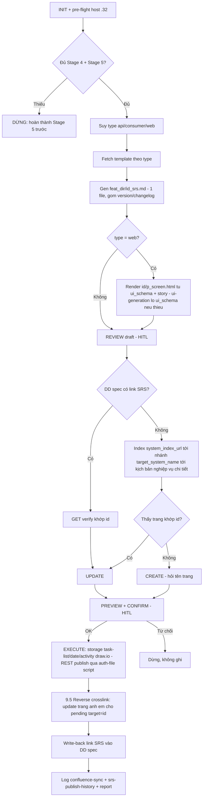

# WORKFLOW: NTAPP — SRS → Confluence

Sinh & đồng bộ SRS của một feature ID từ spec (Stage 4 DD + Stage 5 story/ATDD) lên Confluence theo template SRS fetch từ Confluence.

**Iron Rules (không được vi phạm):**
1. Nguồn = spec Stage 4 + Stage 5 — chỉ đọc, không bịa nội dung khi map.
2. Bắt buộc đủ Stage 4 VÀ Stage 5 (§1). Thiếu → DỪNG.
3. Mọi thao tác ghi Confluence (`create_page`/`update_page`/`upload_attachment`) DỪNG preview + chờ xác nhận (§8).
4. Không đoán trang đích / hệ thống / nơi quản lý SRS. Không xác định được → DỪNG hỏi user.
5. Host `.32` → `mcp__atlassian32__*`; `.35` → `mcp__atlassian__*`. Link trỏ host khác host MCP đang phục vụ → DỪNG hỏi; KHÔNG tìm chéo host. **Các bước dưới ghi `mcp__atlassian32__*` như placeholder cho "server của host đã resolve ở §0"** — nếu §0 resolve `.35` thì thay bằng `mcp__atlassian__*` (space `TDOV`).
6. Không hardcode host/space/parent/pageId trong nội dung sinh ra — lấy từ link + MCP response tại runtime (trừ pageId template/index đã biết ở §0).
7. **Attachment lên Confluence Server KHÔNG đi MCP** (upload luôn fail) — dùng REST qua `scripts/confluence-publish.ps1` + `{auth_file}`, agent tự chạy (§9). Không bắt user gõ lệnh.

---

## 0. INIT (Configuration Resolution)

Resolve theo thứ tự: (a) `.bmm-config.yaml` / `_bmad/bmm/config.yaml` nếu có khai báo → (b) default dưới đây.

| Biến | Ý nghĩa | Default |
|:---|:---|:---|
| `{stage4_dir}` | DD spec | `NTAPP-output/Stage_4_Design/detailed_design` |
| `{stage5_dir}` | Story/ATDD | `NTAPP-output/Stage_5_Build_Verify` |
| `{srs_dir}` | Root SRS — chỉ chứa index cross-feature (`srs-publish-history.md`, `.confluence-sync/`) | `NTAPP-output/Stage_4_Design/srs` |
| `{feat_dir}` | **Workspace 1 feature** — chứa TẤT CẢ artifact của `{id}`: MD nguồn (`{id}_srs.md`), storage XHTML, diagram model/mxfile/PNG, manifest, `p_screen.html` | `{srs_dir}/{id}` |
| `{srs_template_api_url}` | Template SRS API | `.32`: pageId `103228624` · **`.35` (live): `199113677`** ("Template API nghiệp vụ") |
| `{srs_template_consumer_url}` | Template SRS consumer/tiến trình | `.32`: `103228626` · **`.35`: `199113701`** ("Template tiến trình") |
| `{srs_template_web_url}` | Template SRS web | `.32`: `103228628` · **`.35`: `199113689`** ("Template Chức năng FE") |
| `{system_index_url}` | Index nơi quản lý SRS — **project-scoped** | key `srs_system_index_page_id` · default: `.32`: `88716677` (space `TTCN24`) · **`.35`: `63738215`** ("9.2.2.1. KBNV", space `TDOV`) |
| `{target_system_name}` | Tên nhánh hệ thống cần chui vào dưới index (index liệt kê nhiều hệ thống song song) — **project-scoped** | key `srs_target_system_name` · default: `Đối soát tập trung` (DSTT) |
| `{auth_file}` | Token publish REST (attachment) | `<repo-root>/.confluence-auth` (gitignored; dotenv `CONFLUENCE_BASE_URL`+`CONFLUENCE_PAT`) |

**⚠️ 5 biến project-scoped — default trong bảng CHỈ đúng cho project "Đối soát tập trung" (DSTT).** Skill này dùng chung cho nhiều project; project khác khai đè trong `.bmm-config.yaml` (ưu tiên) hoặc `_bmad/bmm/config.yaml`:

```yaml
srs_system_index_page_id: "63738215"      # index liệt kê các hệ thống (hoặc trang cha SRS của riêng project)
srs_target_system_name: "Tên hệ thống"    # đúng tiêu đề nhánh trên Confluence
srs_template_web_page_id: "199113689"
srs_template_api_page_id: "199113677"
srs_template_consumer_page_id: "199113701"
```

**Chưa khai báo → KHÔNG im lặng dùng default:** đọc index resolved, nếu nó có **>1 hệ thống con** thì §7b bắt buộc **AskUserQuestion** cho user chọn nhánh (default DSTT chỉ là ứng viên gợi ý, không auto-pick). Chọn xong ghi lại quyết định vào report + nhắc user khai vào `.bmm-config.yaml` để lần sau khỏi hỏi. Cấm publish vào cây DSTT khi đang chạy ở project khác.

**Hai host:** `.32` → `mcp__atlassian32__*` (space `TTCN24`) · `.35` → `mcp__atlassian__*` (space `TDOV`). Không đọc env qua MCP. **Đọc page mặc định qua MCP; chỉ REST-đọc khi MCP host đó chết VÀ có credential trong `{auth_file}`** — `.32` fallback qua `scripts/confluence-get.ps1` (Basic auth, §0 pre-flight tầng 2). REST cho attachment vẫn ở §9.

**Pre-flight host (3 tầng)** — canary = chính `{system_index_url}` đã resolve (project override thì dùng pageId override, số dưới đây là default DSTT): thử `mcp__atlassian32__confluence_get_page(page_id=88716677)`.
1. **OK** → host = `.32` qua MCP, dùng template/index cột `.32`.
2. **MCP `.32` fail (403 token expired — thực tế 2026-07+)** → thử **REST Basic đọc `.32`** (fallback, chỉ khi có auth `.32`): agent chạy `powershell -ExecutionPolicy Bypass -File scripts/confluence-get.ps1 -PageId 88716677`.
   - Exit 0 → host = `.32` qua **REST** (đọc template/index bằng `confluence-get.ps1`, ghi vẫn theo cơ chế `.35` nếu cần), dùng pageId cột `.32`.
   - Exit 3 (chưa cấu hình `CONFLUENCE_32_*`) hoặc exit 4 (HTTP fail) → sang tầng 3.
3. **Failover `.35`:** verify `mcp__atlassian__confluence_get_page(page_id=63738215)`. OK → host = `.35`, dùng pageId cột `.35` (template `199113677`/`199113701`/`199113689`, index `63738215` → `9.2.2.1.1 Reconcile process` `63741079` → partner-pull API `05. …` `106997885`).
4. Cả 3 tầng fail → DỪNG hỏi user.

**Auth file cho attachment (BẮT BUỘC nếu publish có attachment):** MCP KHÔNG upload attachment được lên Confluence **Server** — agent tự chạy REST script đọc `{auth_file}`. Thiếu file / PAT còn placeholder → DỪNG hỏi user setup (copy `.confluence-auth.example` → `.confluence-auth`, dán PAT). Chi tiết: [`references/confluence-server-publish.md`](references/confluence-server-publish.md) §0.

## 1. Bước 1 — PRE-CHECK NGUỒN (HARD GATE)

- **DD spec:** `{stage4_dir}/{id}_detailed_design.md` phải tồn tại. Không → DỪNG: "Không tìm thấy DD spec cho `{id}`. Chạy `/NTAPP-feature-design` trước."
- **Story Stage 5:** tìm `{stage5_dir}/{id}.md` (hoặc `{stage5_dir}/{id}-full-screen.md`, hoặc `E*-{id}-*.md`). Không thấy bất kỳ → DỪNG: "Chưa có tài liệu Stage 5 cho `{id}` — hoàn thành Stage 5 trước (workflow `slice-loop` / `/NTAPP-feature-complete`) rồi mới gen SRS." **Không** gen SRS thiếu nguồn, **không** tự chạy Stage 5.
- Đủ cả hai → ghi nhớ danh sách file nguồn, tiếp §2.

## 2. Bước 2 — XÁC ĐỊNH TYPE + CONTRACT MERGE

- Đọc DD spec (+ story) suy `type`:
  - có `ui_schema_{id}.json` / DD §UI / prefix `SCR-*` / file `{id}-full-screen.md` → **web**.
  - có scheduler/listener/cron/queue/consumer trong DD logic → **consumer**.
  - có request/response schema + endpoint (thường `INT-EXT-*`/`INT-INT-*` hoặc BE-RP API) → **api**.
  - Nhiều dấu hiệu / không chắc → **AskUserQuestion** liệt kê 3 type cho user chọn.
- **Contract merge:** nếu `{id}` là runtime (vd `BE-RP-17`) và tồn tại DD contract cặp (`INT-EXT-*`/`INT-INT-*` liên quan trong cùng slice), hoặc `{id}` chính là contract → **AskUserQuestion**: gộp contract vào SRS runtime (pair-merge) hay tách SRS riêng. Ghi nhớ quyết định `{merge_ids}`.

## 3. Bước 3 — FETCH TEMPLATE

- Chọn URL template theo `type` (`{srs_template_api_url}` / `_consumer_url` / `_web_url`).
- Gọi `mcp__atlassian32__confluence_get_page(page_id=<parse từ URL>, convert_to_markdown=false)` → parse **thứ tự + tên mục** làm khung chuẩn SRS.
- Fetch lỗi → dùng khung fallback trong `references/srs-mapping.md`, cảnh báo user đang dùng fallback.
- Template fetch được **khác** fallback → theo template fetch được (chuẩn hiện hành).

## 4. Bước 4 — GEN SRS DRAFT (1 file duy nhất)

> **Đọc [`references/terminology.md`](references/terminology.md) TRƯỚC khi viết chữ đầu tiên** — giữ tiếng Anh cho `version` / `log` / `cache` / `trace id` / `transaction`, KHÔNG tự dịch thuần Việt. Quét lại đúng bảng đó ở §9 trước khi publish.

Sinh **trực tiếp 1 file** `{feat_dir}/{id}_srs.md` — KHÔNG tách nhiều part rời (`srs_parts/` đã bỏ: 7 mảnh trùng nội dung với file ghép, sinh rác). Map spec → khung mục template (§3), theo `references/srs-mapping.md`. Mục không có dữ liệu → ghi `N/A`.

> **Quy ước thư mục: 1 feature = 1 folder `{feat_dir}`.** MD nguồn + mọi artifact publish (storage XHTML, diagram, manifest, `p_screen.html`) đều nằm TRONG `{feat_dir}` — KHÔNG rải file lẻ ra gốc `{srs_dir}/`. Gốc `{srs_dir}/` chỉ giữ index dùng chung (`srs-publish-history.md`, `.confluence-sync/`). Tạo `{feat_dir}` nếu chưa có.

- **Nội dung theo khung template** (§3): Mô tả chung (overview + thuật ngữ từ DD §overview + story) · Yêu cầu chức năng (DD §logic + AC story) · Luồng nghiệp vụ (DD sequence/`f3_sequence_diagrams_part.md`) · Dữ liệu/DB (DD §data) · *(api)* Thông tin dữ liệu API (DD contract `INT-EXT-*` / DD API §, áp `{merge_ids}`) · NFR (DD §NFR + story) · Danh sách lỗi.
- **Header blockquote:** tên tài liệu, `{id}`, type, hệ thống, ngày, version SRS.
- **Continuity (publish lần 2+):** `{feat_dir}/{id}_srs.md` đã tồn tại → đọc lấy version hiện tại + toàn bộ bảng changelog cũ; version mới = cũ+1, **giữ nguyên** dòng cũ, **thêm 1 dòng mới** trên đầu (A tạo mới / M update — `references/srs-mapping.md` §Map changelog). Chưa có → `v1`.

**type=web — render `{feat_dir}/p_screen.html`** (file riêng trong workspace feature, KHÔNG nhét inline vào markdown — nhúng ở §9):
1. **Đảm bảo có `ui_schema_{id}.json`** (layout + control). Tìm theo config ui_schema (mặc định cạnh DD ở `{stage4_dir}` hoặc `Stage_4_Design/ui_schema/`). **Thiếu** → gọi skill `NTAPP-ui-generation` với `{id}` (tool `Skill`) để sinh — output thật của skill đó (Stage 4b). Có sẵn → skip.
2. **SRS skill TỰ render** — 1 file HTML **self-contained** (inline CSS, KHÔNG asset ngoài — CSP Confluence chặn external) từ `ui_schema_{id}.json` + `{stage5_dir}/{id}-full-screen.md` + DD §UI.
   > `NTAPP-ui-generation` CHỈ sinh `ui_schema` — **KHÔNG render HTML**. Render do chính SRS skill làm, không delegate.
3. **Fidelity fallback (brownfield):** render chưa sát (user reject §5) → tham chiếu code FE thật `*.component.html`/`*.component.ts` (đường dẫn module từ DD) rồi render lại.
4. `ui_schema` thiếu mà `NTAPP-ui-generation` fail → DỪNG báo user (không bịa layout).

## 5. Bước 5 — REVIEW DRAFT (HITL gate)

- Hiển thị `{feat_dir}/{id}_srs.md` cho user (tóm tắt từng mục; type=web kèm mô tả `p_screen.html` + gợi ý mở preview local).
- **DỪNG**, chờ user duyệt/sửa. User yêu cầu sửa → sửa **thẳng trong `{feat_dir}/{id}_srs.md`** (hoặc `p_screen.html`), show lại phần sửa. Chỉ tiếp §7 khi user duyệt.

## 6. Bước 6 — (đã gộp vào §4)

Bước "Assemble" cũ (ghép part + version/changelog) đã gộp vào **§4** khi bỏ `srs_parts/` — SRS giờ sinh thẳng 1 file `{feat_dir}/{id}_srs.md`. Giữ số §7-§11 nguyên để không phá tham chiếu.

## 7. Bước 7 — LOCATE TARGET trên Confluence

**a. Có link SRS sẵn?** Tìm trong DD spec `{stage4_dir}/{id}_detailed_design.md` dòng `> **Confluence SRS:** <url>` (do skill này ghi lần trước).
- Có → verify host trong link ≡ host đã resolve ở §0. Khác → DỪNG hỏi. Cùng → `mcp__atlassian32__confluence_get_page(page_id từ URL)`, verify khớp `{id}`.
  - Khớp → `action=UPDATE`, `{target_page_id}` = pageId đó. Sang §8.
  - Lỗi/không khớp → DỪNG, báo user link nghi sai, hỏi: giữ / cấp link mới / tìm mới.

**b. Không có link → tìm nơi quản lý SRS.**
1. `mcp__atlassian32__confluence_get_page_children(parent_id={system_index_url}, include_folders=true, limit=50)` (pageId = index resolved ở §0 — `.32`:`88716677` / `.35`:`63738215`; phân trang `start=50,100,...` tới hết) → tìm nhánh hệ thống **"{target_system_name}"**. **Fallback** nếu child page/folder không có: gọi `get_page(page_id={system_index_url}, convert_to_markdown=true)` trích link trong body (một số hệ thống chỉ là link, không phải child page).
   - **Chốt nhánh theo nguồn của `{target_system_name}`:** khai báo trong `.bmm-config.yaml` → khớp tiêu đề, khớp đúng 1 nhánh thì đi tiếp. Rơi vào default (project chưa khai) và index trả về **>1 hệ thống** → **AskUserQuestion bắt buộc**, liệt kê các nhánh tìm được cho user chọn; KHÔNG tự lấy "Đối soát tập trung" chỉ vì nó là default. Index chỉ có 1 nhánh / index chính là trang cha SRS của project → đi thẳng, không hỏi.
   - Không khớp tiêu đề nào hoặc mơ hồ → **AskUserQuestion** liệt kê ứng viên.
2. Vào trang hệ thống đã chốt (`get_page convert_to_markdown=true`) → tìm link **"kịch bản nghiệp vụ chi tiết"**. Lấy pageId trang cha SRS. Không thấy → DỪNG hỏi user confirm nơi quản lý SRS.
3. Duyệt đệ quy trang con (`get_page_children`, nhiều tầng) hoặc `confluence_search` CQL `ancestor=<parent> AND (title ~ "{id}" OR title ~ "<tên feature>")` tìm trang khớp `{id}`.
   - Khớp → `action=UPDATE`, `{target_page_id}` = pageId, nhớ `{parent_id}`.
   - Nhiều ứng viên → **AskUserQuestion** chọn hoặc "tạo mới".
   - Không thấy → `action=CREATE`, `{parent_id}` = trang "kịch bản nghiệp vụ chi tiết" (hoặc thư mục con phù hợp — hỏi nếu mơ hồ). Lấy `{space_key}` từ metadata MCP.

## 8. Bước 8 — PREVIEW + CONFIRM (HITL bắt buộc)

Hiện trước khi ghi:
- `action`: CREATE / UPDATE.
- Trang đích: title + URL (update) hoặc `{space_key}` + parent title/URL (create).
- Host MCP đang phục vụ (host đã resolve ở §0).
- `content_format` dùng (`storage` — cần macro PlantUML/HTML).
- Tóm tắt part được ghi + dòng changelog thêm mới.
- **Diagram §2.1:** activity diagram draw.io — trạng thái: `mxfile + PNG tĩnh` (exit 0) hoặc `mxfile-only (thiếu Chrome → không có PNG tĩnh dự phòng; macro vẫn live-render, set CHROME_PATH nếu cần PNG)` (exit 2). Xem `references/confluence-server-publish.md` §3.
- **Attachment sẽ upload** (danh sách tên file) + đã có `{auth_file}` với PAT hợp lệ chưa (nếu chưa → báo user setup TRƯỚC khi confirm).
- (type=web) cách nhúng HTML: **HTML macro** (primary) hay **fallback attachment** (nếu đã biết macro bị chặn — server .35 tắt HTML macro).
- (UPDATE) diff ngắn theo mục giữa nội dung cũ và mới.
- **Reverse crosslink:** N trang anh em đang chờ link tới `{id}` (từ `crosslink-pending.md`) sẽ được cập nhật (+1 version mỗi trang, message `crosslink: +{id}`) — liệt kê `source_id`/`source_pageId`. 0 trang → bỏ qua §9.5.

**DỪNG.** Chỉ tiếp khi user xác nhận rõ ("ok"/"ghi đi"). Từ chối → dừng, không ghi gì.

## 9. Bước 9 — EXECUTE

**Build storage-format (XHTML)** từ `{feat_dir}/{id}_srs.md` → ghi `{feat_dir}/{id}_srs_confluence.storage.xhtml` (**tên CỐ ĐỊNH, KHÔNG hậu tố version** — ghi đè bản mới nhất; git + version Confluence giữ lịch sử, tránh tích tụ `_v1/_v2/_v3…`). Bám ĐÚNG khung template (§3), theo `references/confluence-server-publish.md`:
- **Checkbox** (Đơn vị phê duyệt · §1 Loại chức năng · §3 Loại dữ liệu · §5 nếu có) = `ac:task-list` chọn được (KHÔNG `☑/☐` unicode) — §1 ref, `ac:task-id` unique toàn trang.
- **Ngày** change-log = date macro `<time datetime="YYYY-MM-DD">` (chip lịch) — §2 ref.
- **Template fidelity** — KHÔNG thêm mục ngoài template; NFR dồn vào §1 "Chính sách & ràng buộc" — §4 ref.
- **XML escaping** `&`/`<`/`>` ngoài CDATA — §5 ref + `../NTAPP-dd-to-confluence/references/storage-format.md`.

**Diagram §2.1 — activity draw.io** (type api/consumer; template gọi "Biểu đồ activity diagram"):
1. Soạn `{feat_dir}/{id}-activity.model.json` (nodes/edges) từ luồng DD/story.
2. Chạy `node scripts/build-activity-diagram.mjs <model.json> <out_dir> <base>` → sinh mxfile `<base>` (không đuôi) + `<base>.png`. Cần `CHROME_PATH` (hoặc Chrome ở path chuẩn).
   - **Exit 0** → có mxfile + `<base>.png`: manifest gồm cả 2 attachment (mxfile label `drawio` + `<base>.png` comment `"<base> exported to image"`).
   - **Exit 2** (máy thiếu Chrome / PNG fail) → **vẫn publish**: manifest CHỈ mxfile (bỏ entry `.png`); macro drawio vẫn live-render bình thường (chỉ thiếu PNG tĩnh dự phòng). KHÔNG dừng vì thiếu PNG. Ghi trạng thái vào §8 preview + §11 log.
3. Nhúng macro `ac:name="drawio"` diagramName=`<base>` diagramWidth=`canvasW`. Chi tiết + PNG best-effort: `references/confluence-server-publish.md` §3.
> web → nhúng `p_screen.html` qua HTML macro (server .35 tắt HTML macro → fallback attachment + link tải; xem `references/srs-mapping.md`).

**Forward crosslink — nhịp 1 (trước khi publish):** build map `ID → SRS URL` (local-first: `srs-publish-history.md` + DD header `Confluence SRS:`) và resolve mục §9 "Tài liệu liên quan" của `{id}` — có URL thì chèn link thật; chưa có thì để `(chưa có tài liệu SRS)` và ghi nhớ vào danh sách `unresolved` tạm (CHƯA ghi ledger — đợi có pageId của `{id}`). Chi tiết: `references/srs-mapping.md` §Crosslink.

**Publish — CÓ attachment (draw.io/ảnh/HTML) → dùng script REST (agent tự chạy, KHÔNG bắt user gõ):**
- Soạn `{feat_dir}/confluence-publish.manifest.json` (pageId, baseUrl, **`title` nhét thẳng vào manifest** — KHÔNG cần file `title.txt` riêng, storageFile, versionMessage, attachments `{path,name,contentType,label,comment}`). Mẫu: `srs/BE-RP-17/confluence-publish.manifest.json`. Dùng script CHUNG `scripts/confluence-publish.ps1` — KHÔNG sinh `apply_*.ps1` per-feature.
- Kiểm tra `{auth_file}` tồn tại + PAT ≠ placeholder. Chưa có → DỪNG hỏi user setup (`references/confluence-server-publish.md` §0), KHÔNG publish.
- Agent chạy qua shell tool: `powershell -ExecutionPolicy Bypass -File scripts/confluence-publish.ps1 -Manifest <manifest.json>`. Script upload attachment (multipart REST, mxfile gắn label `drawio`) + PUT body version live+1, atomic. UPDATE hay CREATE đều PUT (CREATE cần tạo page skeleton trước qua MCP `create_page` rồi mới attach+PUT, hoặc REST POST).

**Publish — KHÔNG attachment (trang nhỏ, body-only):** có thể đi MCP:
- **CREATE:** `confluence_create_page(space_key, title, content, parent_id, content_format="storage")` — KHÔNG `version_comment`.
- **UPDATE:** `confluence_update_page(page_id, title, content, content_format="storage", is_minor_edit=false, version_comment="Sync SRS {id} v{srs-ver}")`.
- ⚠️ Trang mature LỚN (>~150KB body) → MCP cắt output → phải PUT REST qua script (storage-format.md).

- Lỗi MCP/REST (401/403/404/409/timeout) → DỪNG, báo nguyên nhân (`../NTAPP-dd-to-confluence/references/confluence-api.md`), KHÔNG retry host khác.
- Lấy URL + pageId kết quả từ response (script in ra URL; MCP `_links.base`+`_links.webui`).

**Forward crosslink — nhịp 2 (sau khi publish `{id}` OK, đã có pageId):** với mỗi `X` trong `unresolved` (nhịp 1), append 1 dòng `crosslink-pending.md`: `source_id={id} · target_id=X · source_pageId={pageId vừa publish} · ghi_chú=<tên hiển thị X> · ngày`. Dedupe cặp `(source_id,target_id)` trước khi ghi. Tách khỏi nhịp 1 để `source_pageId` hợp lệ cả khi `{id}` là CREATE. Chi tiết: `references/srs-mapping.md` §Crosslink.

## 9.5. Bước 9.5 — REVERSE CROSSLINK (sau publish thành công)

Sau khi trang `{id}` publish OK (đã có URL): đọc `{srs_dir}/.confluence-sync/crosslink-pending.md`, lọc dòng `target_id == {id}`:
- Với mỗi `source_pageId`: đọc nội dung (MCP get; `.32` chết → `scripts/confluence-get.ps1`), thay `{ghi_chú} (chưa có tài liệu SRS)` trong §9 (dùng cột `ghi_chú` = tên hiển thị đã lưu để khớp đúng dòng) bằng link thật `<a href="{url-của-id}">{ghi_chú}</a>`. Nếu tên hiển thị có `&`/`<`/`>`, match literal chỉ thành công khi `ghi_chú` đã lưu ở dạng escape khớp storage XHTML — xem `references/srs-mapping.md` §Crosslink.
- Re-publish trang đó qua `scripts/confluence-publish.ps1` (body PUT, +1 version, `versionMessage="crosslink: +{id}"`).
- Xoá dòng pending đã xử lý.

**HITL:** danh sách trang sẽ bị cập nhật đã hiện ở §8 preview (dòng "sẽ cập nhật thêm N trang anh em"); chỉ chạy reverse khi user confirm. Từ chối → giữ pending, không ghi. Không có dòng pending khớp → bỏ qua §9.5.

## 10. Bước 10 — WRITE-BACK vào DD spec

- Chèn/refresh trong header blockquote của `{stage4_dir}/{id}_detailed_design.md` dòng: `> **Confluence SRS:** <url-canonical>` (cạnh dòng `Confluence DD:` nếu có). Dùng Edit, không ghi đè toàn file.

## 11. Bước 11 — LOG + REPORT

- Ghi file audit `{srs_dir}/.confluence-sync/{id}-{YYYYMMDD-HHMMSS}.log` (tạo thư mục nếu chưa có): action, host, space, parent, pageId, type, version cũ→mới, danh sách part, danh sách diagram + trạng thái PNG (`png-ok` / `mxfile-only-no-png`), cách nhúng HTML, tóm tắt changelog.
- Append 1 dòng vào `{srs_dir}/srs-publish-history.md` (tạo với header nếu chưa có). Cột: `Ngày | ID | Type | Action | pageId | Version | URL | Người`.
- Báo cáo user: URL trang Confluence, action, tóm tắt changelog, mọi fallback (diagram / HTML macro), đường dẫn file log; nếu diagram mxfile-only thì nêu rõ "máy này thiếu Chrome → không có PNG tĩnh dự phòng (macro vẫn hiển thị), set CHROME_PATH rồi re-publish nếu cần PNG".

---

## Sơ đồ quyết định


