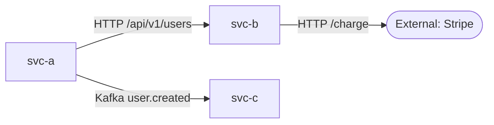

# Cross-System Overview Template (mode baseline only)

> File output `_overview.md` của mode `baseline`. Synthesize từ N file per-repo trong scope. **KHÔNG verbatim copy** TODO từ per-repo files — chỉ link tới chúng.

---

## Header

```markdown
---
generated_by_skill: ntapp-system-overview
mode: baseline
section: cross-system
project: {project_name}
date: {YYYY-MM-DD}
status: best-effort-baseline
scope_count: {N}
detected_count: {M}
---

# {project_name} — System Baseline Overview

> **⚠️ Best-effort cross-system snapshot.** Sinh từ {N} sub-system trong scope ngày {date}.
> Mỗi link tới per-repo file là source-of-truth chi tiết. Contract Match Matrix là evidence-driven (Tier 3).
> SA verify trước khi dùng làm input HLD (`/ntapp-architecture-design`).
```

---

## A. Detected vs Scope

| Status | Count | Sub-system |
|---|---|---|
| In-scope (scanned) | {N} | [link tới mỗi per-repo file] |
| Out-of-scope (detected nhưng skip) | {M-N} | {repo names + lý do skip hoặc TODO} |

**Detected total:** {M}

Nếu user nêu lý do skip → ghi nguyên văn. Không nêu → `<TODO: SA verify — lý do out-of-scope cho repo X?>`.

---

## B. Integration Diagram

Mermaid diagram thể hiện mọi edge từ Section 6.1 (Outbound) của các per-repo file. Mỗi edge label = giao thức + endpoint pattern.



Edge có target ngoài scope → dùng node shape stadium `(["..."])` để highlight cross-boundary risk cho HLD reviewer.

---

## C. Contract Match Matrix

> **Tier 3 — strict evidence.** Mỗi row là kết quả cross-reference Section 0.3 (IDL) + Section 4 (API exposed) + Section 6.1 (API consumed) giữa các per-repo file. Status theo definitions ở [../principles.md](../principles.md) Tier 3.

| Provider | Consumer | Endpoint / Topic | Status | Provider evidence | Consumer evidence | Notes |
|---|---|---|---|---|---|---|
| {svc-a} | {svc-b} | `GET /api/v1/users/:id` | `MATCHED` | `{svc-a}.md#4.1 (api/openapi.yaml:42)` | `{svc-b}.md#6.1 (src/api/users.ts:18)` | v1 match |
| {svc-a} | {fe-app} | `POST /api/v1/auth` | `VERSION-MISMATCH` | `{svc-a}.md#4.1 (api/openapi.yaml:88, v2)` | `{fe-app}.md#6.1 (src/api/auth.ts:12, v1)` | Consumer outdated |
| (none) | {svc-c} | `GET /metrics/export` | `CONSUMER-ONLY` | — | `{svc-c}.md#6.1 (src/clients/metrics.ts:5)` | Provider không trong scope |
| {svc-b} | (none) | `POST /admin/internal/sync` | `PROVIDER-ORPHAN` | `{svc-b}.md#4.1 (routes/admin.ts:30)` | — | Không consumer trong scope |
| {svc-a} | {svc-d} | `Kafka user.created` | `DTO-DRIFT` | `{svc-a}.md#4.3 (events/user.proto:15)` | `{svc-d}.md#6.1 (src/listeners/user.ts:22)` | Provider thêm field `tenant_id`, consumer chưa handle |

**Summary counts:**

| Status | Count |
|---|---|
| MATCHED | {count} |
| VERSION-MISMATCH | {count} — **HLD priority** |
| CONSUMER-ONLY | {count} — provider có thể ngoài scope hoặc thiếu |
| PROVIDER-ORPHAN | {count} — endpoint có thể dead code |
| DTO-DRIFT | {count} — **HLD priority** |
| UNKNOWN | {count} — TODO chờ SA verify |

---

## D. Shared Data Models

Entity được export ra nhiều sub-system (qua API DTO / event payload / DB shared / file share). Cross-reference **Section 5.3 Shared Schema Candidates** của các per-repo file: entity name xuất hiện ở ≥2 sub-system = MATCHED shared. Candidate chỉ ở 1 sub-system → KHÔNG list ở đây (chưa đủ evidence cross-system, giữ TODO trong per-repo Section 5.3).

| Entity | Storage canonical | Sub-system cùng dùng | Mechanism | Risk |
|---|---|---|---|---|
| `User` | `{svc-a}: users table` | `{svc-b}, {fe-app}` | API DTO `UserDto` | OK |
| `Order` | `{svc-b}: orders table` | `{svc-a}` (event) | Kafka `order.created` payload | Schema drift check needed |

---

## E. Open Questions Summary (NOT verbatim — chỉ count + link)

> **Không nhân bản từng câu hỏi vào đây.** Mỗi per-repo file có Section E aggregate riêng. Section này chỉ navigate.

| Sub-system | Total TODO | Section nhiều TODO nhất | Link |
|---|---|---|---|
| {svc-a} | {n} | Section 6.1 (Integration) | [open](./{svc-a}.md#e-open-questions-for-sa) |
| {svc-b} | {n} | Section 0.2 (External URLs) | [open](./{svc-b}.md#e-open-questions-for-sa) |

**Total TODO trong scope:** {sum}

**HIGH-impact đã hỏi qua Q&A loop** (câu trả lời đã patch vào per-repo file):

- (Q1) {câu hỏi gốc} → **Answered by SA on {date}**: `{trả lời}` → patched `{svc-a}.md`
- (Q2) ... → **Skipped** (TODO giữ inline)

---

## F. Scan Metadata

| Field | Value |
|---|---|
| Project | {project_name} |
| Workspace root | `{abs_path}` |
| Scope | {N} in-scope / {M} detected |
| Total endpoints exposed | {sum from Section 4.1 of per-repo files} |
| Total integration edges | {sum from Section 6.1} |
| Cross-boundary edges (target ngoài scope) | {count} — **HLD attention** |
| Contract MATCHED rate | {matched_count / (matched + drift + version-mismatch)} % |
| Time of synthesis | `{ISO-8601 timestamp}` |
