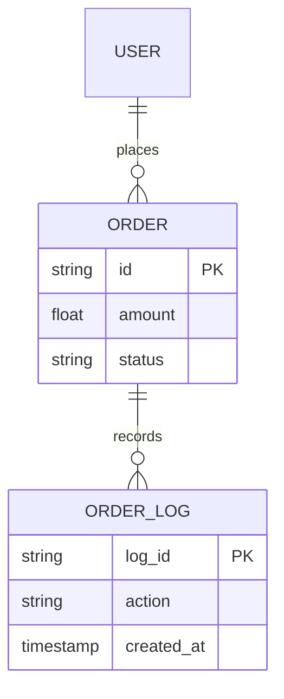

# [Hệ Thống / Phân Hệ] - TECHSPEC ULTIMATE TEMPLATE (v3)

<!-- QUY ƯỚC OKF: dòng bắt đầu bằng "okf-id:" ngay dưới mỗi heading H2 là ĐỊNH DANH
     ỔN ĐỊNH của mục đó trong đồ thị OKF. Đổi tiêu đề thì GIỮ NGUYÊN marker. Xoá marker
     thì danh tính tụt về slug của tiêu đề, và mọi cạnh trỏ tới mục này sẽ đứt lặng lẽ
     ngay lần đầu ai đó sửa câu chữ của tiêu đề. -->

*Template v3 dành cho Service Design (Layer 2 — TechSpec module-level), yêu cầu chi tiết High-Fidelity. Các khối `[AI Agent: ...]` là chỉ thị bắt buộc. Tuyệt đối không tóm tắt nội dung. Toàn bộ sơ đồ dùng Mermaid 100%.*

---

## 1. Bảng ghi nhận thay đổi tài liệu (Document History)
<!-- okf-id: change-log -->

`[AI Agent: Trích xuất bảng lịch sử cập nhật tài liệu để theo dõi version. Bảng cần duy trì cấu trúc sau.]`
`[MỨC ĐỘ CHI TIẾT YÊU CẦU: Tuyệt đối chính xác (100% Exact Match). Không được tóm tắt. Phải ghi rõ số version (vd: v1.0, v1.1), link ticket dạng URL đầy đủ nếu có, và định danh rõ người/bộ phận yêu cầu thay đổi.]`

| Ngày cập nhật | Vị trí thay đổi | Phân loại (A, M, D) | Nguồn gốc | Link Tracking (Jira/Trello) | Mô tả thay đổi | Phiên bản (Version) |
| :--- | :--- | :--- | :--- | :--- | :--- | :--- |
| `[Data]` | `[Data]` | `[Data]` | `[Data]` | `[Data]` | `[Data]` | `[Data]` |

---

## 2. Mục đích tài liệu
<!-- okf-id: document-purpose -->

`[AI Agent: Giữ nguyên đoạn mô tả chuẩn dưới đây:]`
Tài liệu Tổng quan hệ thống (System Overview) này là Input quyết định cho giai đoạn Detailed Design, nhằm:
- Phân rã yêu cầu nghiệp vụ thành các thành phần kiến trúc và cấu trúc mã nguồn cụ thể.
- Đề xuất mô hình tương tác (Interaction Model) giữa con người và hệ thống.
- Làm nền tảng để Developer triển khai code chính xác theo logic đã định nghĩa.

### 2.1. Đối soát kiến trúc (Architecture Audit)

`[AI Agent (STOPPING ERROR RULE): BẮT BUỘC liệt kê bảng ma trận đối soát dưới đây để xác nhận tính toàn vẹn của dữ liệu kế thừa từ Layer 1 (HLD). Nếu bất kỳ ID nào chưa được đặc tả tại HLD, Agent phải dừng quy trình.]`

| WBS ID | Tên tính năng | Đặc tả HLD Mục số | Trạng thái sẵn sàng (Ready?) |
| :--- | :--- | :--- | :--- |
| `[ID]` | `[Data]` | `[Mục xx]` | `[Yes/No]` |

---

---

## 3. Mục đích dự án
<!-- okf-id: project-purpose -->

### 3.1. Hiện trạng (As-Is Analysis)
`[AI Agent: Phân tích đa tầng - Multi-level Analysis:]`
`[MỨC ĐỘ CHI TIẾT YÊU CẦU: 
- Tầng Sự kiện (Event): Nêu rõ các sự cố/hoạt động bề mặt đang diễn ra (vd: user phàn nàn, lỗi giao dịch). 
- Tầng Hành vi (Pattern): Chỉ ra xu hướng lặp lại của các vấn đề đó qua thời gian. 
- Tầng Cấu trúc (Underlying Structure): Phân tích tận gốc rễ nguyên nhân hệ thống (cơ chế phân tán, quy trình thủ công, thiếu API) dẫn đến các hành vi trên.]`

### 3.2. Mong muốn (To-Be / Value Proposition)
`[AI Agent: Trình bày các mục tiêu cốt lõi mà hệ thống mới cần đạt được.]`
`[MỨC ĐỘ CHI TIẾT YÊU CẦU: Định nghĩa các cơ chế (Mechanisms) cốt lõi sẽ giải quyết cấu trúc cũ. Nêu rõ các chỉ số đo lường thành công và tính toàn diện của giải pháp tập trung.]`

### 3.3. Đối tượng sử dụng (User Personas & Actor boundaries)
`[AI Agent: Liệt kê Exhaustive (Không bỏ sót) các nhóm người dùng hoặc hệ thống tương tác.]`
`[MỨC ĐỘ CHI TIẾT YÊU CẦU: Với mỗi Actor, định nghĩa rõ: Vai trò (Role), Phạm vi quyền hạn (Permission boundaries), và Hành vi tương tác chính yếu (Primary interactions).]`

### 3.4. Quy tắc nghiệp vụ toàn cục (Global Business Invariants)
`[AI Agent: Trích xuất các "Luật chơi" bất biến áp dụng cho toàn dự án, không phụ thuộc vào từng flow riêng lẻ.]`
`[MỨC ĐỘ CHI TIẾT YÊU CẦU: 
- Tính toán/Logic: Các công thức tính toán cốt lõi.
- Bảo mật/Dữ liệu: Các luật về masking PII, logging audit bắt buộc.
- Hiệu năng/SLA: Các giới hạn về response time hoặc throughput tối thiểu.]`

---

## 4. Mô hình chức năng tổng quan (Functional Model)
<!-- okf-id: functional-model -->
`[AI Agent: Sử dụng Mermaid graph TD để vẽ sơ đồ khối các phân hệ chức năng trong Service. Sơ đồ phải thể hiện đầy đủ các thành phần như sau:]`
`[MỨC ĐỘ CHI TIẾT YÊU CẦU: 
- Phía trái: Liệt kê đầy đủ các Actor (Người dùng, Hệ thống nội bộ...)
- Phía phải: Liệt kê các Hệ thống ngoại vi (External Systems — lấy từ Module 0 Connectivity Matrix).
- Ở giữa: Các Functional Blocks (cụm chức năng logic) của Service.
- Mũi tên: Thể hiện hướng giao tiếp và nhãn giao thức (gRPC, REST, Event).
- Giữ tên kỹ thuật/giao thức trong ngoặc đơn để đối soát (Ví dụ: "Cổng tiếp nhận hồ sơ (gRPC)").
- BẮT BUỘC liệt kê bảng mô tả vai trò của từng thành phần trong sơ đồ sau khi vẽ.]`

| Thành phần | Loại (Actor/Module/External) | Mô tả vai trò và chức năng chính |
| :--- | :--- | :--- |
| `[Tên]` | `[Data]` | `[Mô tả chi tiết nhiệm vụ của thành phần này trong hệ thống]` |

---

## 5. Phân rã chức năng (WBS)
<!-- okf-id: wbs -->

### 5.1. Cấu trúc chức năng (Work Breakdown Structure)
`[AI Agent: Xây dựng sơ đồ Mermaid phân rã đến mức hành động nguyên thủy (CRUD).]`
`[MỨC ĐỘ CHI TIẾT YÊU CẦU: 
- Ngôn ngữ: Dùng động từ nghiệp vụ Tiếng Việt (vd: nhận yêu cầu → xử lý → trả kết quả). Tránh tên thuần technical (Controller, Handler).
- Độ sâu: Phân rã tối thiểu 3 lớp (Root -> Phase -> Actions).
- Đơn vị work khai báo theo module_type (Manual §3a scope rule):
  - `backend-service` / `infrastructure`: liệt kê **features** (prefix `BE-*` hoặc `{MOD}-NN`).
  - `frontend-app`: liệt kê **screens** (`SCR-*`) + **widgets** (`WGT-*`).
  - `integration-contract`: liệt kê **contracts** (`INT-*`).
- Ví dụ BE: `[{MODULE}] --> [Nhận request] --> ["Validate payload (REST/gRPC)"]`.
  Ví dụ FE: `[{MODULE}] --> [SCR-{NAME}] --> [WGT-{NAME}]`. (Lưu ý: bọc node trong dấu `""` khi chứa ký tự đặc biệt như ngoặc đơn, gạch chéo).]`

### 5.2. Đặc tả giao diện điều khiển (UI Control Specification)
`[AI Agent (CONDITIONAL — module_type=frontend-app ONLY): Fill section này nếu module là FE; nếu BE / INT / INFRA → BỎ HẲN section 5.2 khỏi output (Manual §3a: UI control không copy sang techspec BE).]`
`[AI Agent: Sử dụng sơ đồ Mermaid để mô tả Layout/Bố cục giao diện và lập bảng kỹ thuật bên dưới. Tuyệt đối không dùng ASCII Art.]`
`[MỨC ĐỘ CHI TIẾT YÊU CẦU: Technical level. Phải trích xuất chính xác Type (String, Int, Enum), Constraints (Max-length, Regex), và NGUYÊN VĂN câu thông báo lỗi (Error message) trong tài liệu gốc.]`

| Tên trường (Field) | Loại Data & Control | Ràng buộc (Constraints / Regex) | Sự kiện lỗi & Thông báo nguyên văn |
| :--- | :--- | :--- | :--- |
| `[Label]` | `[Text/Dropdown/...]` | `[Regex/Max-length]` | `[Sự kiện] -> "Nội dung câu báo lỗi"` |

---

## 6. Quy trình nghiệp vụ & Các luồng tương tác kỹ thuật (Business Process & Technical Flows)
<!-- okf-id: business-flows -->

### 6.1. Sơ đồ quy trình nghiệp vụ (Swimlane Flowchart)
`[AI Agent: BẮT BUỘC sử dụng Mermaid flowchart TD với các subgraph để giả lập Swimlane. Phân định rõ bước nào của Actor nào và bước nào của Hệ thống.]`
`[MỨC ĐỘ CHI TIẾT YÊU CẦU: Traceability Mapping. Mỗi bước trong sơ đồ BẮT BUỘC đính kèm WBS ID từ Mục 5.1 (vd: `[BE-MOD-01] Nhận request`).]`

### 6.2. Sơ đồ trình tự tương tác (Sequence Diagram)
`[AI Agent: Sử dụng Mermaid SequenceDiagram để mô tả luồng trao đổi dữ liệu. Độ chi tiết BẮT BUỘC phải tương xứng với WBS (Mục 5.1). Sử dụng prefix ID WBS cho mỗi bước tương tác.]`

### 6.3. Đặc tả logic rẽ nhánh (Logic Matrix)
`[AI Agent: Lập bảng mô tả logic rẽ nhánh IF-ELSE. Sử dụng mã ID WBS để tham chiếu.]`
`[MỨC ĐỘ CHI TIẾT YÊU CẦU: 
    1. Mỗi trạng thái phải là danh từ/tính từ tĩnh (Ví dụ: PROCESSING, COMPLETED, REJECTED).
    2. Hành động chuyển trạng thái (Transition) phải đi kèm Trigger conditions cụ thể.
    3. Bắt buộc mô tả trạng thái khép kín (Terminal states) and luồng Rollback.]`

| Actor/System | WBS ID | Node/Step | Quy tắc nghiệp vụ & Logic rẽ nhánh (IF-ELSE / Edge cases) |
| :--- | :--- | :--- | :--- |
| `[Bên thực hiện]` | `[ID]` | `[Tên hành động]` | `[Chi tiết logic]` |

---

## 7. Biểu đồ trạng thái (State Machine Diagram)
<!-- okf-id: state-machine -->

`[AI Agent (CONDITIONAL — chỉ khi module có stateful entity): Fill section này CHỈ khi module có một entity với vòng đời trạng thái thật, định nghĩa được từ source (entity có field status/lifecycle trong ERD Module 0 hoặc PRD). Nếu module STATELESS (proxy, transform, query-only, dispatcher — không entity nào persist trạng thái) → thay toàn bộ diagram bằng đúng 1 dòng: `**Module stateless — không áp dụng State Machine.**` + 1 câu lý do. TUYỆT ĐỐI không vẽ diagram rỗng/giả.]`
`[AI Agent: Nguồn của trạng thái = vòng đời entity, KHÔNG phải action trong WBS. Mỗi state là một giá trị status bền vững entity thực sự lưu (vd: `DRAFT → SUBMITTED → APPROVED`), truy vết được về entity trong ERD/PRD. Một WBS task (hành động xử lý) không tự đẻ ra state — `validate payload` là bước transient, không phải trạng thái persistent.]`
`[CẤM BỊA (R3): Nếu source không định nghĩa lifecycle nào → KHÔNG tự phát minh chuỗi `PROCESSING/COMPLETED/REJECTED`. Mark `[TBD]` + escalate Agent 0, hoặc khai báo module stateless.]`
`[MỨC ĐỘ CHI TIẾT YÊU CẦU (khi áp dụng): 
1. Mỗi trạng thái phải là danh từ/tính từ tĩnh (Ví dụ: PROCESSING, COMPLETED, REJECTED).
2. Hành động chuyển trạng thái (Transition) phải đi kèm Trigger conditions cụ thể.
3. Bắt buộc mô tả trạng thái khép kín (Terminal states) and luồng Rollback.]`

---

## 8. Ánh xạ yêu cầu vào cấu trúc (Requirements Mapping)
<!-- okf-id: requirements-mapping -->

`[AI Agent: Lập bảng ánh xạ giữa Yêu cầu (Epic/FR) và thư mục/file vật lý trong mã nguồn ở Mục 9.]`
`[MỨC ĐỘ CHI TIẾT YÊU CẦU: Đây là bảng Traceability chính của TechSpec. Mỗi Epic/Feature BẮT BUỘC tham chiếu ít nhất 1 WBS ID từ file SSoT (`{planning_artifacts}/project_wbs.md`).]`

| Epic / Feature | WBS ID (SSoT) | Folder(s) / Files | Integration Points |
| :--- | :--- | :--- | :--- |
| `[Tên epic]` | `[vd: BE-MOD-01]` | `[Đường dẫn file/folder]` | `[Cơ chế gọi: gRPC, Event, hay Direct Call]` |

---

## 9. Cấu trúc thư mục dự án (Project Directory Structure)
<!-- okf-id: directory-structure -->

`[AI Agent: Dựa trên Tech Stack đã chọn, hãy tạo Sơ đồ cây thư mục (ASCII Tree) hoàn chỉnh cho source code. Tuyệt đối không dùng Mermaid cho phần này.]`
`[MỨC ĐỘ CHI TIẾT YÊU CẦU: TUYỆT ĐỐI KHÔNG dùng placeholder chung chung. Phải liệt kê đến tận các file cấu hình quan trọng (.env.example, Dockerfile), entry points (main.py, index.ts), các module feature và thư mục test cấu trúc.]`

---

## 10. Ranh giới kiến trúc (Architectural Boundaries)
<!-- okf-id: architectural-boundaries -->

`[AI Agent: Đặc tả cách thức các thành phần/tầng giao tiếp với nhau bằng sơ đồ Mermaid:]`
`[MỨC ĐỘ CHI TIẾT YÊU CẦU: 
- API Boundaries: Danh sách Endpoints quan trọng và cơ chế Auth (Bearer, API Key).
- Service Boundaries: Phân tách logic giữa các dịch vụ/domain để tránh circular dependency.
- Data Boundaries: Ranh giới tầng truy cập DB, cơ chế Caching (Redis key patterns) và Data integration.]`

---

## 11. Mô hình dữ liệu kỹ thuật (Logical Data Model)
<!-- okf-id: logical-data-model -->

`[AI Agent (CONDITIONAL — module_type ∈ {backend-service, integration-contract} ONLY): Fill section này khi module own business data (BE) hoặc define event payload (INT). FE / INFRA → BỎ HẲN section 11 (FE không own DB; INFRA dữ liệu chủ yếu là metric/log, không phải business entity).]`
`[AI Agent: Đặc tả cấu trúc dữ liệu lưu trữ nội tại của Service.]`
`[MỨC ĐỘ CHI TIẾT YÊU CẦU (High-Fidelity):
1. Sơ đồ thực thể logic (Logical ERD): BẮT BUỘC sử dụng Mermaid erDiagram. Phải chia vùng (Grouping/Comment) để tách biệt rõ Hot Data (Transactional) và Cold Data (Audit/Log/History).
2. Data Dictionary: Lập bảng thuộc tính cho các thực thể. Phải có cột "Storage Class" để định danh Hot/Cold cho từng bảng.
3. Chiến lược lưu trữ: Xác định cụ thể Tech Stack (PostgreSQL, Redis, Elasticsearch...) và khóa phân vùng (Partition Key) cho Cold Data.]`

### 11.1. Sơ đồ thực thể logic (Logical ERD)

### 11.2. Từ điển dữ liệu chi tiết (Data Dictionary)
| Table Name | Field | Type | Constraints | Storage Class | Description |
| :--- | :--- | :--- | :--- | :--- | :--- |
| `[Entity]` | `[Name]` | `[Type]` | `[PK/FK/NN]` | `[Hot/Cold]` | `[Mô tả nghiệp vụ]` |

---

## 12. Đặc tả giao tiếp bất biến (Interface Contracts)
<!-- okf-id: interface-contracts -->

`[AI Agent (CONDITIONAL — module_type ∈ {backend-service, integration-contract, infrastructure} ONLY): Fill khi module produce contract (BE expose API/event, INT define contract, INFRA expose monitoring/admin API). FE → BỎ HẲN section 12 (FE consume contract, không produce — contract reference đặt ở section 10 boundaries).]`
`[AI Agent: Định nghĩa contract dữ liệu (Proto / JSON Schema) dựa trên mô hình dữ liệu ở Mục 11. Tuyệt đối không dùng placeholder.]`

### 12.1. Schema Specification (Proto/JSON)
`[AI Agent: Viết mã Proto (gRPC) hoặc JSON Schema (REST) hoàn chỉnh. Định nghĩa 100% các message/object fields. Sử dụng comment để giải thích logic từng field.]`

### 12.2. Field Deep-Dive & Validation
`[AI Agent: Lập bảng chi tiết cho các trường dữ liệu quan trọng, ánh xạ ngược lại các thuộc tính trong Data Model ở Mục 11.]`

| Field Name | Type | Required | constraints / Validation | Description |
| :--- | :--- | :--- | :--- | :--- |
| `[Name]` | `[Type]` | `[Yes/No]` | `[Regex/Min-Max]` | `[Logic nghiệp vụ của field]` |

### 12.3. Error Contract & Mapping
`[AI Agent: Lập bảng ánh xạ lỗi kỹ thuật sang gRPC Status hoặc HTTP Code.]`

| Code Name | Status Code | Trigger Condition | Mitigation/Response |
| :--- | :--- | :--- | :--- |
| `[Error Name]` | `[Code]` | `[Khi nào lỗi này xảy ra]` | `[Hướng xử lý cho client]` |

### 12.4. Example Payload
`[AI Agent: Cung cấp 1 ví dụ thực tế (Success Case) dạng JSON/Text.]`
