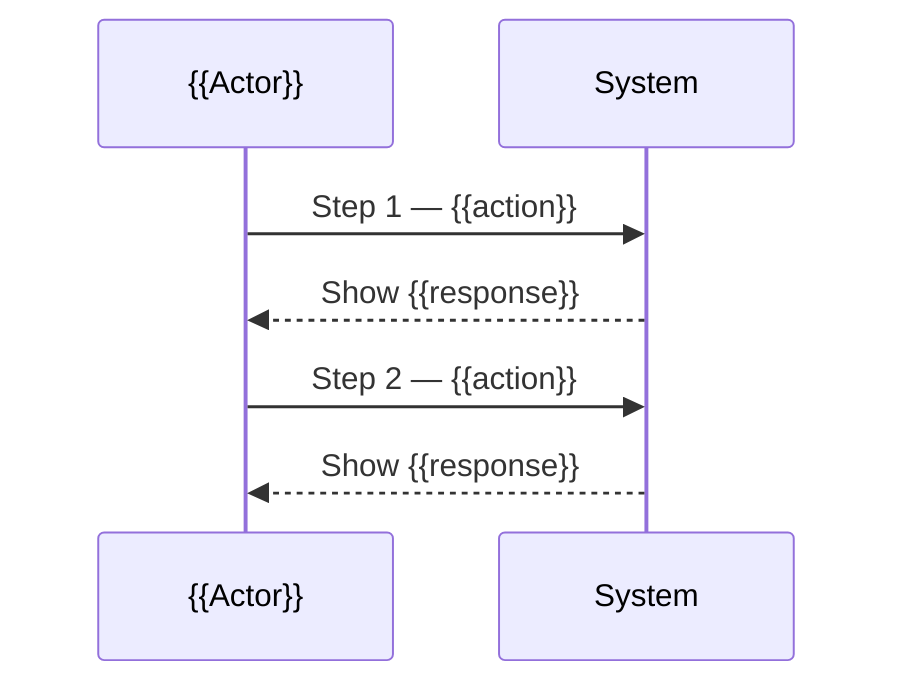

# UX Sketch — {{project_name}}

> **Stage:** 1 (sub-step) — sau PRD/Epics, trước HLD.
> **Mục đích:** Forcing function business intent + inform HLD design + reduce rework cho Master UX Spec ở Stage 3b.
> **Lưu ý:** Sketch ≠ Master UX Spec. Đây là phiên bản v0 lightweight. Master Spec đầy đủ vẫn cần ở Stage 3b sau khi HLD/Module 0 ra.

---

## Change Log

| Version | Date | Author | Changes |
|:--|:--|:--|:--|
| v{{N}} | {{date}} | {{user_name}} | Initial sketch / iteration |

---

## §1. Executive Brief

> **GENERATION INSTRUCTION (Step 01):** UXS0 viết 1 đoạn (3-5 câu) covering: anchor system, primary user goals (top 3), key business outcomes expected. Trace về ≥ 1 PRD requirement.

**Anchor System:** {{anchor_system}}

**Primary User Goals:**
1. {{goal_1}} — trace: PRD §X
2. {{goal_2}} — trace: PRD §Y
3. {{goal_3}} — trace: PRD §Z

**Business Outcomes Expected:**
{{1_paragraph_outcome}}

---

## §2. Rough Personas

> **GENERATION INSTRUCTION (Step 02 — UXS1):** 2-3 personas. Mỗi persona: name, role, top 3 pain points, top 3 goals. KHÔNG cần behavioral pattern detail / day-in-life narrative / demographic detail như full ux-design §2.

### Persona 1: {{persona_name_1}}

| Field | Value |
|:--|:--|
| **Role** | {{role}} |
| **Trace to PRD actor** | PRD §X — "{{actor_name}}" |

**Top 3 Pain Points:**
1. {{pain_1}}
2. {{pain_2}}
3. {{pain_3}}

**Top 3 Goals:**
1. {{goal_1}}
2. {{goal_2}}
3. {{goal_3}}

### Persona 2: {{persona_name_2}}

[Same structure]

### Persona 3: {{persona_name_3}} (optional)

[Same structure]

---

## §3. Rough IA

> **GENERATION INSTRUCTION (Step 03 — UXS0):** Top-level navigation tree (3-5 mục cấp 1, mỗi mục 2-4 item cấp 2). Quan trọng cho **brownfield/integration projects**: liệt kê integration points với existing systems — system nào, data nào, hướng nào (read/write/sync).

### 3.1. Navigation Tree (Top-Level)

```text
{{project_name}}
├── {{nav_item_1}}
│   ├── {{sub_item_1.1}}
│   └── {{sub_item_1.2}}
├── {{nav_item_2}}
│   ├── {{sub_item_2.1}}
│   └── {{sub_item_2.2}}
├── {{nav_item_3}}
│   └── ...
└── {{nav_item_4}}
    └── ...
```

### 3.2. Integration Points với Existing Systems (cho brownfield)

| Existing System | Direction | Data / Action | UX Touchpoint |
|:--|:--|:--|:--|
| {{system_1}} | Read | {{data_pulled}} | {{which_screen_reads}} |
| {{system_2}} | Write | {{data_pushed}} | {{which_action_writes}} |
| {{system_3}} | Sync (bi-directional) | {{data_synced}} | {{which_screen_views}} |

**Note:** Đây là **rough guess**. SA sẽ refine ở Stage 2 HLD/Module 0. Nếu có drift → escalate.

---

## §4. Primary User Journey

> **GENERATION INSTRUCTION (Step 04 — UXS0):** 1-2 luồng chính. Mỗi luồng:
> - 1 Mermaid sequence diagram (rough — chỉ Actor/System/Action, không cần protocol detail)
> - 1 Screen Intent Table 3-5 row (KHÔNG vẽ ASCII wireframe — bảng này là input render preview hi-fi ở Step 05)
> - Mỗi row trace về Epic/Story ID

### 4.1. Journey 1: {{journey_name_1}}

**Trace:** Epic {{EPIC_ID}} / Story {{STORY_ID}}

**Mermaid Flow:**



**Screen Intent Table:**

| Screen | Role | Content blocks | Primary CTA | Branch | Trace |
|:--|:--|:--|:--|:--|:--|
| {{screen_name_1}} | {{form\|list\|table\|dashboard\|review\|detail\|wizard-step\|empty}} | `{{Kind}}: {{fields/columns chính}}`, `{{Kind}}: {{...}}` | {{cta_label}} | {{trigger}} → {{hệ quả}} | Epic {{EPIC_ID}} / Story {{STORY_ID}} |
| {{screen_name_2}} | {{role}} | `{{Kind}}: {{...}}` | {{cta_label}} | — | Epic {{EPIC_ID}} / Story {{STORY_ID}} |
| {{screen_name_3}} | {{role}} | `{{Kind}}: {{...}}` | {{cta_label}} | — | Epic {{EPIC_ID}} / Story {{STORY_ID}} |

> Cột `Screen` là nguồn của `{screen_slug}` (kebab-case) → anchor preview + Preview Index. Đổi tên screen = đổi anchor, phải sync cả 2.

### 4.2. Journey 2: {{journey_name_2}} (optional, only if 2nd primary flow critical)

[Same structure]

### Preview Index

> **GENERATION INSTRUCTION (Step 06 — UXS0):** 1 hàng / row Screen Intent Table §4 — mapping machine-readable cho downstream (feature-design 4a mở đúng frame liên quan unit). Anchor khớp `<section id>` trong preview hi-fi (anchor contract step-05 §3.1b (b) mục 5).

| Screen (sketch identifier) | Journey | Preview anchor |
|:--|:--|:--|
| {{screen_name}} | {{journey_name_1}} | previews/{{feature_slug}}_ux_sketch_preview.html#{{screen_slug}} |

---

## §5. Open Questions for HLD

> **GENERATION INSTRUCTION (Step 05 — UXS0):** Capture câu hỏi cụ thể cho Tech Lead trả lời ở Stage 2 HLD. Mỗi câu hỏi:
> - Gắn với ambiguity cụ thể trong PRD/Epics (cite PRD §X).
> - Có ý nghĩa quyết định kiến trúc / data model / state machine (không phải UI styling).

| # | Question | Why it matters | Trace |
|:--|:--|:--|:--|
| Q1 | {{technical_question}} | {{impact_on_ux_or_architecture}} | PRD §X |
| Q2 | {{question}} | {{impact}} | PRD §Y |
| Q3 | ... | ... | ... |

**Examples (delete khi đã có nội dung thực):**
- "State machine cho Merchant cần bao nhiêu state? PRD §3 chỉ nhắc 'pending', 'active' — có cần thêm 'inactive' / 'on hold'?"
- "Sub-Merchant có flow delegation riêng không? PRD §5 mô tả Merchant cấp 1 + Sub Merchant nhưng không rõ ai approve sub-merchant."
- "KYC verification là sync hay async? Ảnh hưởng UX có cần 'đang xử lý' state."

---

*Sketch hoàn tất. Handoff cho SA ở Stage 2 Architecture. SA dùng §3 + §5 làm input bổ sung khi design HLD/Module 0.*
