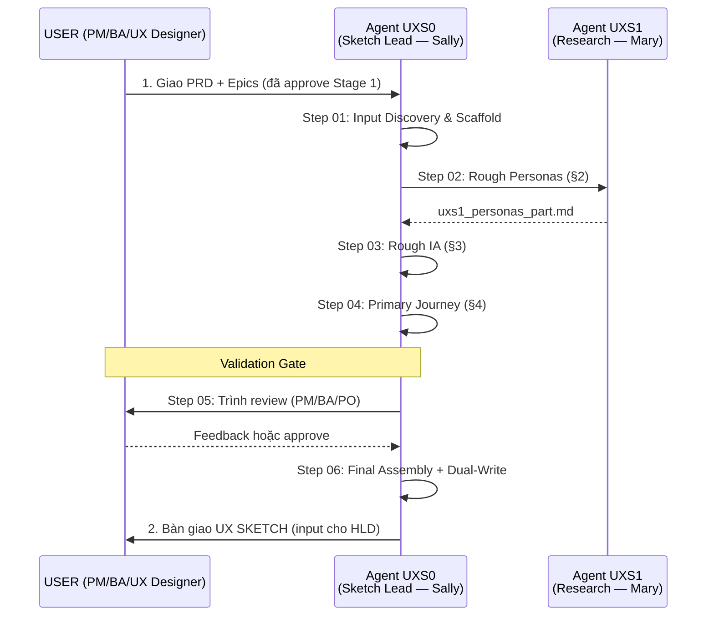

# WORKFLOW: NTAPP UX SKETCH (Stage 1 sub-step)

Luồng công việc nhẹ tạo **bản phác thảo UX (UX Sketch)** sau khi có PRD/Epics nhưng trước khi triển khai HLD. Mục đích: forcing function business intent + inform HLD design + reduce rework cho Journey Spec (`ux_design.md`) ở Stage 3b.

---

## 0. Nguyên tắc Sắt (Iron Rules)

Workflow này tuân thủ subset của Iron Rules định nghĩa trong [principles/iron_rules.md](./principles/iron_rules.md):

| # | Tóm tắt | Áp dụng | Note |
|:--|:--|:--|:--|
| R1 | Verbatim Injection | ✓ | Khi assemble parts → master |
| R2 | Screen + Preview Fidelity | ✓ relaxed | Screen Intent Table (không ASCII wireframe); preview render hi-fi nhưng KHÔNG phải SSoT / visual đã approve |
| R3 | Zero-Fabrication | ✓ | PRD/Epics only — Master DS (nếu đã bootstrap) CHỈ để skin preview, không phải nguồn requirement |
| R4 | Traceability | ✓ basic | Mỗi journey trace về Epic/Story ID |
| R6 | Quality Gates | ✓ relaxed | Pre-flight (Step 01) + Validation (Step 05) |
| R7 | Stopping Errors | ✓ | PRD/Epics absent → STOP |
| R9 | Missing Input Handling | ✓ | PRD/Epics required, các nguồn khác KHÔNG applicable |
| R10 | Inheritance Compliance | ✓ partial | Chỉ PRD inheritance — HLD/Module 0/Master DS chưa tồn tại |
| R5, R8 | — | ✗ | Không có Master DS / Module 0 để enforce naming hoặc lock |

Khi step file cite "tuân thủ Rx" — đọc iron_rules.md để biết chi tiết, KHÔNG tự suy diễn.

---

## 1. Sơ đồ phối hợp (UX Sketch Squad Orchestration)



---

## 2. Đội ngũ Agent

| Agent | Vai trò | Persona BMAD | Steps phụ trách |
|:------|:--------|:-------------|:----------------|
| **UXS0** | UX Sketch Lead & Orchestrator | Sally (`bmad-agent-ux-designer`) | 01, 03, 04, 05, 06 |
| **UXS1** | Research Analyst | Mary (`bmad-agent-analyst`) | 02 |

---

## 3. Danh sách các bước

| Step | File | Agent | Section | Mô tả |
|:-----|:-----|:------|:--------|:------|
| 01 | [step-01-init.md](./steps/step-01-init.md) | UXS0 | §1 | Input Discovery (PRD + Epics) + Scaffold + Executive Brief draft |
| 02 | [step-02-rough-personas.md](./steps/step-02-rough-personas.md) | UXS1 | §2 | 2-3 personas rough — name, role, top 3 pain points, top 3 goals |
| 03 | [step-03-rough-ia.md](./steps/step-03-rough-ia.md) | UXS0 | §3 | Top-level navigation tree + integration points với existing systems |
| 04 | [step-04-primary-journey.md](./steps/step-04-primary-journey.md) | UXS0 | §4 | 1-2 luồng chính — Mermaid sequence + Screen Intent Table 3-5 screen (KHÔNG ASCII wireframe) |
| 05 | [step-05-validation.md](./steps/step-05-validation.md) | UXS0 | — | Validation gate với PM/BA/PO trên **preview hi-fi** (agent mở session + đưa URL; click element → comment → agent sửa part → re-render) + capture Open Questions cho HLD (§5); `sketch_preview: lavish` default ON (§3.1b — hạ fidelity `lofi`, tắt `off`). Mở session ở đây, **không đóng** |
| 06 | [step-06-assembly.md](./steps/step-06-assembly.md) | UXS0 | — | Final Assembly + Dual-Write (canonical + archive) + bàn giao **trên session lavish còn sống**, `end` chỉ ở đây (§3.4) |

---

## 4. Quy chuẩn tài liệu

- **Template:** `./templates/ux-sketch-template.md`
- **Ngôn ngữ tài liệu:** `{document_output_language}` (từ config)
- **Trọng tâm:**
  - **Forcing function:** ép thinking về user interaction chi tiết — không phải full spec.
  - **Lightweight:** 5-15 trang (1-2 journey × 3-5 screen intent row) + 1 preview hi-fi — sketch v0, KHÔNG thay bộ artifact Stage 3b (`ux_design.md` + `ux_conventions.md`).
  - **Inform HLD:** §3 Rough IA và §5 Open Questions cụ thể là input cho Tech Lead ở Stage 2.

---

## 5. Hệ thống Artifacts (Storage)

- **Đường dẫn gốc:** `{planning_artifacts}/` — resolved at runtime per skill config (xem §5.1).
- **Cấu trúc lưu trữ:**

```
{planning_artifacts}/                        (= Stage_1_Discovery/ux_sketch/)
├── ux_sketch.md                             (canonical Master — cuối §4 có Preview Index)
├── ux_sketch_parts/                         (atomic parts)
│   ├── uxs1_personas_part.md                (Step 02)
│   └── uxs0_journey_part.md                 (Step 04 — append §3 + §4)
├── previews/
│   └── {feature_slug}_ux_sketch_preview.html (Step 05 §3.1b (b) — preview HI-FI, RETAINED render-evidence, commit; anchor `#screen-slug` + `data-*` per frame)
└── archive/
    └── ux_sketch_v{N}.md                    (versioned snapshot)
```

**Quy tắc:**
- UXS1 lưu `uxs1_personas_part.md`. UXS0 lưu các phần còn lại + assemble.
- Step 06 dual-write: canonical (overwrite latest) + archive (versioned). N auto-detect bằng `ls archive/ux_sketch_v*.md`.
- Preview `previews/{feature_slug}_ux_sketch_preview.html` **hi-fi**, RETAINED (commit cùng sketch) — review surface chính của gate Step 05 + visual seed cho feature-design 4a; KHÔNG phải SSoT (sửa part rồi re-render, không sửa tay HTML) và KHÔNG phải visual đã DS-approve (Stage 4b own component/token). Mapping frame ↔ downstream qua bảng **Preview Index** cuối §4 (step-06 §3.1b) — anchor khớp `<section id>` per frame.
- **Session lavish là 1 vòng đời duy nhất:** agent mở ở Step 05 §3.1b (c), giữ sống qua mọi loop-back, `end` đúng 1 lần ở Step 06 §3.4 sau bàn giao. File trên đĩa tĩnh có chủ đích (chrome annotate do server inject) → `file://` và `lavish-axi export` chỉ để ĐỌC; annotate luôn qua session URL `http://127.0.0.1:4387/session/{key}` (`{key}` = sha256 đường dẫn preview → URL ổn định, mở lại bằng `npx -y lavish-axi "<path>"`). User KHÔNG bao giờ phải tự gõ lệnh để review lần đầu — agent chạy và đưa URL.
- §1 Executive Brief và §3 Rough IA và §4 Primary Journey và §5 Open Questions all assembled bởi UXS0.

### 5.1 Config resolution (paths)

Skill này tuân theo cùng cascade 3-layer như các NTAPP skill khác:

- **Layer 1** — `{project-root}/_bmad/bmm/config.yaml`: cung cấp default `planning_artifacts`, `stage_1_discovery`, `project_knowledge`, `document_output_language`.
- **Layer 2** — `{project-root}/.bmm-config.yaml` section `ntapp-ux-sketch:`: override `planning_artifacts` cho UX Sketch (mặc định `{project-root}/NTAPP-output/Stage_1_Discovery/ux_sketch/`) + `sketch_preview` (`lavish` mặc định = preview **hi-fi** + vòng annotate ở step-05 §3.1b; `lofi` = wireframe grayscale như v1; `off` = không render) + `sketch_preview_theme` (theme DaisyUI dùng khi project CHƯA có Master DS — default `corporate`). Headless/CI vẫn render preview, chỉ bỏ vòng annotate.
- **Layer 3** — Interactive fallback nếu cả 2 layer đều miss biến cần.

Biến runtime sau cascade:

| Biến | Nguồn | Dùng cho |
|:---|:---|:---|
| `planning_artifacts` | Layer 1/2/3 | OUTPUT — chứa `ux_sketch.md` + parts (vd: `NTAPP-output/Stage_1_Discovery/ux_sketch/`) |
| `stage_1_discovery` | Layer 1 | INPUT — nơi đọc PRD/Epics (vd: `NTAPP-output/Stage_1_Discovery/`) |
| `project_knowledge` | Layer 1 | INPUT — domain docs nếu brownfield (vd: `docs/`) |
| `intermediate_folder` | Derived | `{planning_artifacts}/ux_sketch_parts/` — chứa part files |
| `design_system_root` | Layer 1/2 (`bmad.design_system_root`) | INPUT **optional, read-only** — resolve DS root theo `ds-resolution.md` để lấy `master_token.json` + `_reference/` skin preview hi-fi. Chưa bootstrap → dùng `sketch_preview_theme`, KHÔNG block |

---

## 6. Approve & Handoff

| Stage | Người làm | Approve |
|:--|:--|:--|
| Stage 1 sub-step (Sketch) | UX Designer (UXS0) | UX Designer + PO co-approve |

Sau approve → handoff cho **SA** ở Stage 2 (Architecture). SA dùng sketch §3 Rough IA + §5 Open Questions làm input bổ sung khi design HLD/Module 0.

---

## 7. Relationship với `/ntapp-ux-design` (Stage 3b)

Sketch là **optional upstream** của full ux-design:

- `/ntapp-ux-design` Step 01 (Pre-flight) check `{stage_1_discovery}/ux_sketch/ux_sketch.md` tồn tại.
- **Nếu có:** ux_design §1.3 Persona references + §3 IA delta + §4.1 Primary Journey kế thừa từ sketch (R10 inheritance). Audit drift giữa sketch và HLD/Module 0:
  - Sketch có actor mà HLD §3.1.1 miss → escalate STOP.
  - Sketch có IA item mà HLD module list miss → escalate.
  - Sketch journey có state mà Module 0 §7 miss → escalate.
- **Nếu không có sketch:** ux-design generate from scratch — §1.3 reference PRD §User Stories (actor lock vẫn theo HLD §3.1.1), KHÔNG block.

→ Sketch không bắt buộc nhưng nếu có thì supersede không có. Drift giữa sketch và HLD/Module 0 phải reconcile trước khi expand thành Master Spec.

---

*Sketch ≠ Journey Spec Stage 3b. Sketch là phiên bản v0 lightweight để inform HLD. `ux_design.md` + `ux_conventions.md` vẫn cần ở Stage 3b (khi feature qua applicability gate) sau khi HLD/Module 0 ra.*
