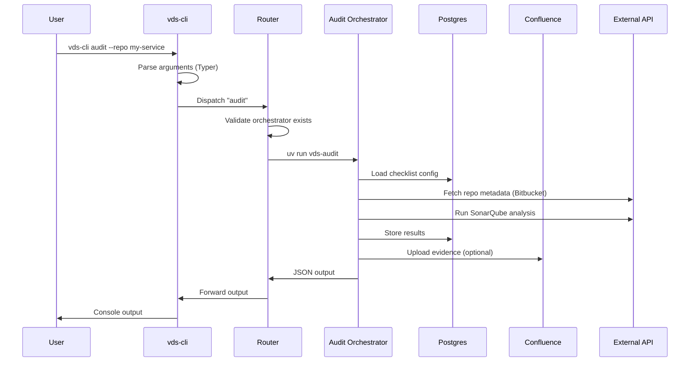
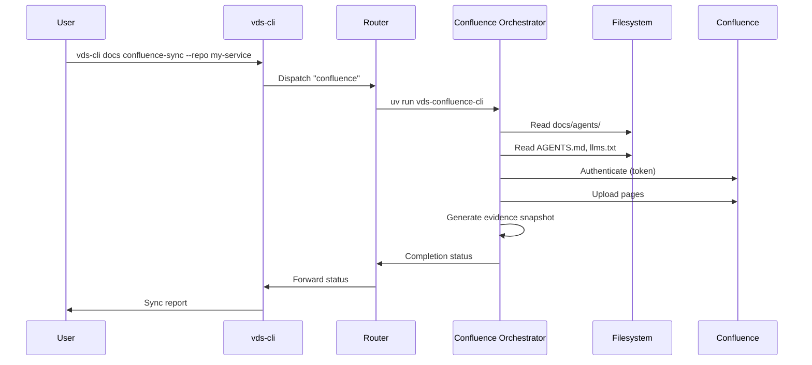
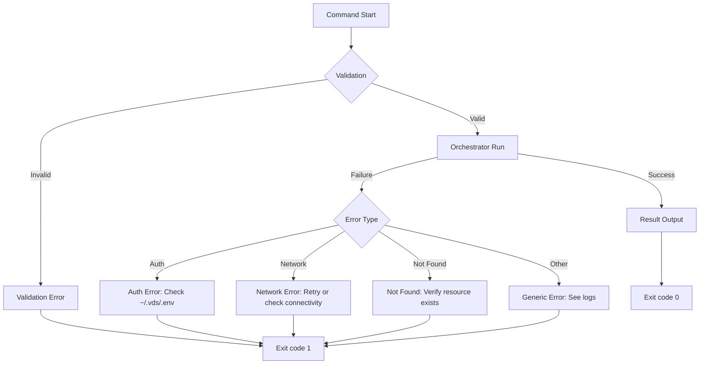

<!-- diátaxis: explanation -->

# Data Flow

## Request Lifecycle

### Audit Command



### Confluence Sync Command



## Error Handling Flow



## Data Transformation Points

### Input Normalization

- Repo names are normalized to lowercase
- Paths are resolved to absolute paths
- Env vars are loaded from `~/.vds/.env` before orchestrator invocation

### Output Formatting

- JSON output: For programmatic consumption
- Table output: For human readability (Rich tables)
- Markdown output: For documentation generation
- Evidence format: Structured JSON for Confluence upload

### Caching

| Cache Key | Store | TTL | Invalidation |
|-----------|-------|-----|-------------|
| Orchestrator metadata | Redis | 1 hour | On version change |
| Confluence page list | Postgres | 4 hours | On sync completion |
| Audit results | Postgres | Permanent | On re-audit |
| AI memory vectors | Qdrant | Permanent | On explicit update |

## Logging Flow

```
Orchestrator → structlog → JSON → Console/File → Optional: Postgres evidence
```

All log entries include:
- Timestamp (ISO 8601)
- Orchestrator name
- Operation
- Status (started/completed/failed)
- Context (repo, checklist, user)

## Data Flow Workflow

Trace the path of a single audit request end-to-end:

```bash
vds-cli audit --repo my-service --checklist security
# CLI parses args, dispatches to Audit Orchestrator via Router
# Orchestrator loads checklist from Postgres
# External APIs (Bitbucket, SonarQube) are invoked
# Results are stored back in Postgres and returned as JSON
```

## See Also

- [Orchestrator Architecture](../reference/orchestrator-architecture.md)
- [System Architecture](../explanation/system-architecture.md)
- [Troubleshooting Guide](../how-to/troubleshooting-guide.md)
