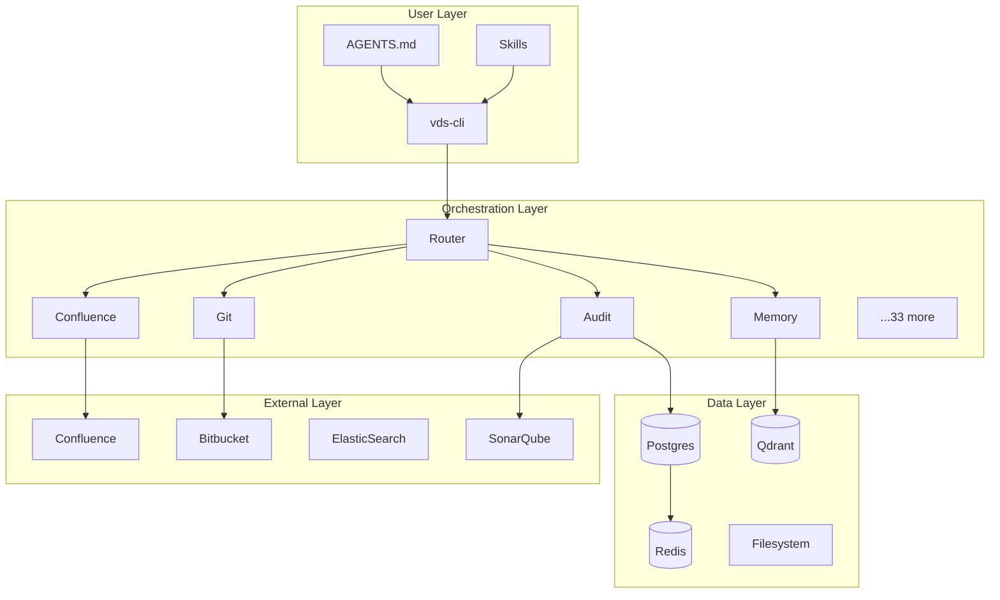

<!-- diátaxis: explanation -->

# System Architecture

## Component Diagram



## Interaction Patterns

### Request/Response (Synchronous)

Most orchestrator commands are synchronous:

```
User → vds-cli → Router → uv run → Orchestrator CLI → External API → Response
```

Example: `vds-cli audit --repo my-service`

### Async/Pub-Sub

The scheduler uses Redis pub/sub for job distribution:

```
Scheduler → Redis Channel → Worker → Orchestrator → Result → Postgres
```

### Streaming

Multi-agent workflows stream results via SSE (Server-Sent Events):

```
Multi-agent → Event Stream → Console/Telegram
```

## Data Stores

| Store | Purpose | Persistence | Access Pattern |
|-------|---------|-------------|----------------|
| Postgres | Audit results, progress reports, orchestrator state | Persistent | SQL queries |
| Redis | Job queues, session state, cache | Ephemeral | Key-value, pub/sub |
| Qdrant | AI memory vectors, semantic search | Persistent | Vector similarity |
| Filesystem | Specs, docs, evidence files | Persistent | File I/O |

## Deployment View

### Local Development

```bash
# Start services
docker compose up -d

# Sync environment
uv sync

# Run CLI
vds-cli --help
```

### CI/CD

```yaml
# .github/workflows/docs-quality.yml
- name: Validate docs
  run: vds-cli docs validate
- name: Run tests
  run: pytest
```

### Docker (Production)

All orchestrators run as independent containers orchestrated by Docker Compose. The CLI container mounts the orchestrator source directories and dispatches via `uv run`.

## Security Boundaries

| Boundary | Mechanism |
|----------|-----------|
| External API credentials | `~/.vds/.env` (user-local, not in repo) |
| Database connections | Connection strings via env vars |
| Git operations | SSH keys or HTTPS tokens |
| AI memory | API key in env, data in Qdrant |

## Scaling Considerations

- **Horizontal**: Add worker containers for scheduler jobs
- **Vertical**: Scale Postgres and Redis for higher throughput
- **Caching**: Redis for frequently accessed orchestrator metadata
- **Queue depth**: Monitor Redis list lengths for backlog detection

## See Also

- [Orchestrator Architecture](../reference/orchestrator-architecture.md)
- [Data Flow](../explanation/data-flow.md)
- [Configuration Reference](../reference/configuration-reference.md)
