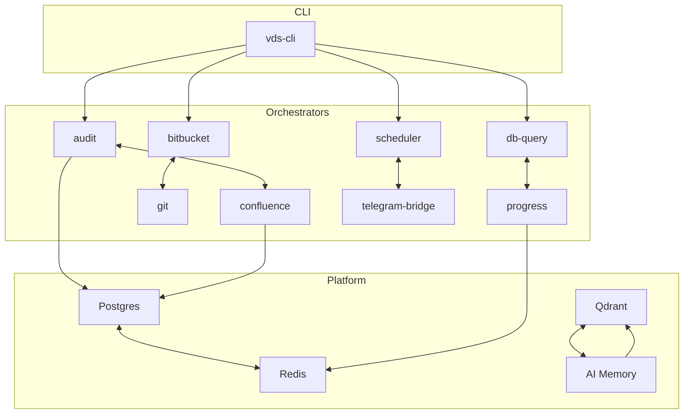

<!-- diátaxis: explanation -->

# WHO Ecosystem Introduction

The WHO (Workflow Orchestration Harness) ecosystem is a unified platform for automating software engineering workflows across the VDS organization. It combines AI agents, orchestrated CLI tools, and persistent memory to accelerate development, audit, and infrastructure tasks.

## What You Get

- **36 orchestrators** covering audit, reporting, infrastructure, and integration workflows
- **27 agent skills** for specialized tasks (research, spec creation, code review)
- **Cross-session memory** so AI agents remember context between conversations
- **Validated documentation** with quality gates and freshness tracking

## Ecosystem Components

## Target Audiences

| Audience | Entry Point | Primary Tools |
|----------|-------------|---------------|
| **Platform Engineers** | [Quick Start](quick-start.md) | Docker, uv, CI/CD |
| **Service Developers** | [Feature Progression](feature-progression-guide.md) | Orchestrators, skills |
| **Auditors** | [Audit Triage Playbook](../../reference/audit-triage-playbook.md) | `vds-cli audit` |
| **AI Agents** | [Agent Operational Contract](../../reference/agent-operational-contract.md) | AGENTS.md, skills |

## Repositories

- [`vds-scripts`](https://bitbucket.org/viettel-digital-services/vds-scripts) — CLI, orchestrators, and core workflows
- [`vds-skills`](https://bitbucket.org/viettel-digital-services/vds-skills) — Agent skills and reference guides
- [`vds-ai-memory`](https://bitbucket.org/viettel-digital-services/vds-ai-memory) — Cross-session memory and knowledge base

## Quick Links

- [Setup](quick-start.md) — Get running in 5 minutes
- [Features](features-overview.md) — What you can do
- [Architecture](system-architecture.md) — How it works
- [Configuration](configuration-reference.md) — All settings
- [Tips](tips-and-tricks.md) — Work faster
- [Troubleshooting](troubleshooting-guide.md) — Fix problems
- [What's New](whats-new.md) — Recent changes
- [Contribute](contribute-new-orchestrator.md) — Add capabilities
