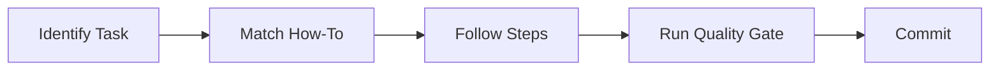

<!-- diátaxis: how-to -->
# How-To Guides

> Step-by-step workflow guides for common VDS operations.

## Workflow Quick Reference

Use the following command to list all how-to guides in a script or orchestrator context:

```bash
vds-cli docs index --agent-script-path docs/agents/how-to/ --check-diataxis
```

## Available Guides

| Guide | Orchestrator | Skill |
|-------|-------------|-------|
| [Install and Bootstrap WHO Scripts and Skills](install-and-bootstrap-who-scripts-and-skills.md) | `vds-scripts` | bootstrap |
| [Configure Agents](configure-agents.md) | `vds-scripts` | config |
| [Run Ecosystem Daily Report](run-ecosystem-daily-report.md) | `scheduler_orchestrator` | reporting |
| [Apply Phase 3 Migration](apply-phase3-migration.md) | `scheduler_orchestrator` | migration |

## Writing a New How-To

1. Copy `TEMPLATE.md` (if available) or an existing guide.
2. Add the `<!-- diátaxis: how-to -->` header.
3. Include the prerequisite section, step-by-step workflow, and error handling.
4. Run the doc quality gate before committing:

```bash
vds-cli docs validate --check-diataxis --repo-root .
```

## Workflow



## See Also

- [Tutorials](../tutorials/) — Learning-oriented walkthroughs for new team members
- [Reference](../reference/) — API contracts, CLI commands, and orchestrator runbooks
- [Explanation](../explanation/) — Architectural decisions and design rationale
- [Skills overview](choosing-the-right-skill.md) — How to pick the correct skill for a task
