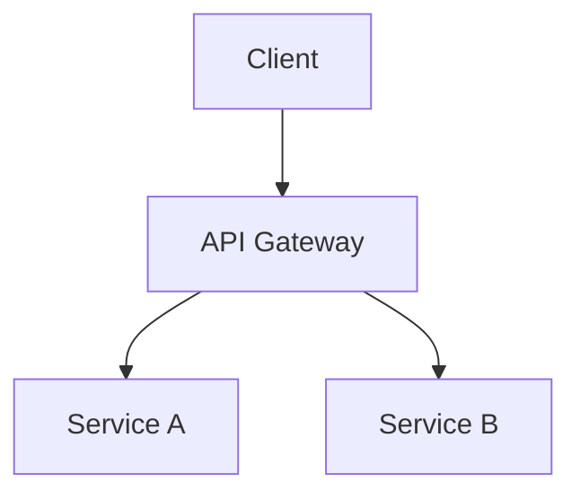

<!-- diátaxis: how-to -->

# Document Delivery Workflow

> Generate and deliver documentation from markdown through diagrams, PDF, and Confluence.

## Prerequisites

- `vds-scripts` cloned and bootstrapped
- Confluence credentials in `~/.vds/.env`
- Markdown source files in `docs/` directory

## Workflow Overview

```
Markdown (source content)
    ↓
Diagrams (generate visuals)
    ↓
PDF (format for delivery)
    ↓
Confluence (publish and share)
```

## Step 1: Prepare Markdown Content

Write documentation in markdown with embedded mermaid diagrams:

```markdown
# Architecture Overview

## System Diagram



## Details

See [API Reference](../reference/api.md).
```

## Step 2: Generate Diagrams

Render mermaid diagrams to images:

```bash
./scripts/worktree_uv.sh run --project vds_cli \
  vds-cli diagrams mermaid --input architecture.md --output diagrams/
```

Expected output:

```
[diagrams] Found 2 mermaid blocks
[diagrams] Rendered: diagrams/diagram-1.svg
[diagrams] Rendered: diagrams/diagram-2.svg
```

Generate C4 diagrams if needed:

```bash
vds-cli diagrams c4 --level container --input c4-model.md --output c4-container.png
```

## Step 3: Convert to PDF

Generate PDF from markdown:

```bash
./scripts/worktree_uv.sh run --project vds_cli \
  vds-cli pdf md2pdf --input architecture.md --output architecture.pdf --template corporate
```

Expected output:

```
[pdf] Converting architecture.md...
[pdf] Applied template: corporate
[pdf] Output: architecture.pdf (12 pages)
```

Batch generate for all docs:

```bash
vds-cli pdf batch --input-dir docs/ --output-dir pdfs/ --template corporate
```

## Step 4: Publish to Confluence

Sync documentation to Confluence:

```bash
./scripts/worktree_uv.sh run --project vds_cli \
  vds-cli confluence sync --input architecture.md --page-id 12345 --space WHO
```

Expected output:

```
[confluence] Uploading to space WHO...
[confluence] Page updated: Architecture Overview
[confluence] Attachments: 3 images, 1 PDF
```

## Step 5: Verify and Share

Validate published content:

```bash
vds-cli confluence validate --page-id 12345 --check-links --check-images
```

Share with team:

```bash
vds-cli confluence notify --page-id 12345 --channel slack --message "Architecture docs updated"
```

## CI Integration

Add to `.github/workflows/docs.yml`:

```yaml
- name: Document Delivery
  run: |
    vds-cli diagrams mermaid --input docs/ --output diagrams/
    vds-cli pdf batch --input-dir docs/ --output-dir pdfs/
    vds-cli confluence sync --input docs/ --space WHO
```

## Troubleshooting

| Symptom | Cause | Fix |
|---------|-------|-----|
| Mermaid render fails | Invalid syntax | Validate with `vds-cli diagrams validate` |
| PDF missing fonts | System fonts unavailable | Install `libgobject-2.0-0` or use Docker |
| Confluence upload fails | Auth expired | Refresh `CONFLUENCE_TOKEN` in `~/.vds/.env` |
| Images not attached | Path mismatch | Use relative paths from markdown file |
