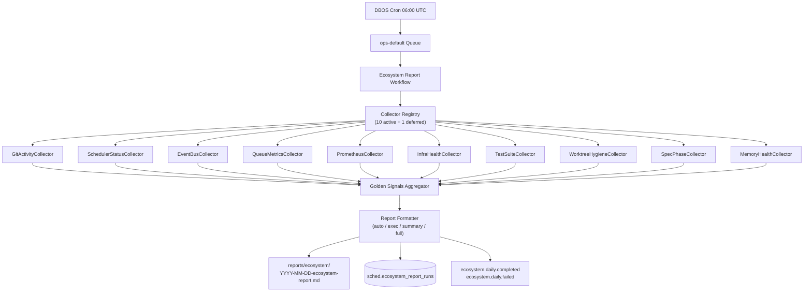

<!-- diátaxis: reference -->

# Ecosystem Daily Report

> Automated daily health collation for the VDS ecosystem (DBOS cron + adaptive reporting).

**Summary**
Runs at 06:00 UTC via DBOS cron, executes 10 parallel collectors, aggregates Golden Signals into a 0-100 health score, and emits Markdown + DB + events.

## Table of Contents

1. [Quick Reference](#quick-reference)
2. [Architecture](#architecture)
3. [Collector Inventory](#collector-inventory)
4. [Configuration](#configuration)
5. [Report Output](#report-output)
6. [Health Score](#health-score)
7. [Phase 3 Status](#phase-3-status)

## Quick Reference

| Item | Value |
|------|-------|
| Alias | `ecosystem.daily.report` |
| Schedule | `ecosystem-daily-report` |
| Cron | `0 6 * * *` (06:00 UTC) |
| Queue | `ops-default` |
| Output path | `reports/ecosystem/YYYY-MM-DD-ecosystem-report.md` |
| DB table | `sched.ecosystem_report_runs` |
| Events | `ecosystem.daily.completed`, `ecosystem.daily.failed` |
| Config prefix | `VDS_ECOSYSTEM_DAILY__` |
| Report modes | `auto` (default), `exec`, `summary`, `full` |
| Collector timeout | 10 s (default) |

## Architecture



**ASCII overview:**
```
  Cron (06:00 UTC) --> ops-default Queue --> Ecosystem Report Workflow
      |
      +--> Collector Registry (parallel execution)
      |     +-- GitActivityCollector       (Tier 1)
      |     +-- SchedulerStatusCollector  (Tier 1)
      |     +-- EventBusCollector         (Tier 1)
      |     +-- QueueMetricsCollector     (Tier 1)
      |     +-- PrometheusCollector       (Tier 1)
      |     +-- InfraHealthCollector      (Tier 1)
      |     +-- TestSuiteCollector        (Tier 2)
      |     +-- WorktreeHygieneCollector  (Tier 2)
      |     +-- SpecPhaseCollector        (Tier 2)
      |     +-- MemoryHealthCollector     (Tier 3)
      |
      +--> Golden Signals Aggregator
              |
              +--> Report Formatter
                      +--> Markdown report file
                      +--> DB table  (sched.ecosystem_report_runs)
                      +--> Events      (completed / failed)
```

**Key design points:**

- **Pluggable collector protocol** — each collector implements `EcosystemCollector` with an async `collect()` returning `CollectorResult`.
- **Parallel execution** — total runtime is bounded by the slowest collector, not the sum of timeouts.
- **Graceful degradation** — a single collector failure (timeout, exception, connection refused) produces an `[unavailable]` placeholder; the report never crashes due to one collector.
- **Adaptive reporting** — `auto` mode dispatches the report verbosity based on the computed health score.

## Collector Inventory

All collectors implement the `EcosystemCollector` protocol. Ten are active; one is deferred to Phase 3.

| # | Collector | Tier | Purpose | Source | Weight in health score |
|---|-----------|------|---------|--------|------------------------|
| 1 | `GitActivityCollector` | 1 | Git activity across repos | Local `.git/` repos | delivery |
| 2 | `SchedulerStatusCollector` | 1 | Schedule + workflow health | `sched.schedules`, `sched.workflow_registry`, `sched.chain_definitions` | runtime |
| 3 | `EventBusCollector` | 1 | Event outbox + subscription depth | `sched.events_outbox`, `sched.subscriptions` | events |
| 4 | `QueueMetricsCollector` | 1 | Queue depth + DBOS status | `dbos.workflow_status` | runtime |
| 5 | `PrometheusCollector` | 1 | SLO / SLI from metrics endpoint | `http://localhost:8005/metrics` | observability |
| 6 | `InfraHealthCollector` | 1 | Docker + Postgres + Redis health | Docker, `pg_stat_*`, `redis-cli INFO` | infrastructure |
| 7 | `TestSuiteCollector` | 2 | Latest test outcomes | `.pytest_cache/` | knowledge |
| 8 | `WorktreeHygieneCollector` | 2 | Stale worktree + disk usage | `git worktree list`, `du` | delivery |
| 9 | `SpecPhaseCollector` | 2 | Spec coverage + phase alignment | `.gpt-5.4/specs/` YAML frontmatter | knowledge |
| 10 | `MemoryHealthCollector` | 3 | Memory service liveness | `http://localhost:8010/health` | knowledge |
| 11 | `LLMUsageCollector` | 3 | LLM token / cost usage | Serialized JSONL logs from `logs/ecosystem/` | knowledge |
| 12 | `TrendForecastCollector` | 3 | Health trend forecasting | Computes trend direction + trend classification | knowledge |

**Scoring weights:** runtime 25%, infrastructure 20%, observability 15%, events 15%, delivery 15%, knowledge 10%.

## Configuration

Environment variables use the prefix `VDS_ECOSYSTEM_DAILY__`.

| Variable | Default | Purpose |
|----------|---------|---------|
| `VDS_ECOSYSTEM_DAILY__COLLECTOR_TIMEOUT_S` | `10` | Per-collector timeout (seconds) |
| `VDS_ECOSYSTEM_DAILY__DISABLED_COLLECTORS` | `[]` | JSON list of section names to skip, e.g. `["Prometheus/SLO", "Memory"]` |
| `VDS_ECOSYSTEM_DAILY__REPORT_MODE` | `auto` | Force a mode: `auto`, `exec`, `summary`, `full` |
| `VDS_ECOSYSTEM_DAILY__ERROR_THRESHOLD` | `10` | Anomaly threshold for 24h workflow errors |
| `VDS_ECOSYSTEM_DAILY__PENDING_THRESHOLD` | `100` | Anomaly threshold for pending queue depth |
| `VDS_ECOSYSTEM_DAILY__COMMIT_THRESHOLD` | `50` | Anomaly threshold for daily commit count |
| `VDS_ECOSYSTEM_DAILY__ZERO_OUTBOX_ALERT` | `true` | Emit anomaly when outbox is empty |
| `VDS_ECOSYSTEM_DAILY__DOCKER_SOCKET` | `/var/run/docker.sock` | Docker socket path for InfraHealth collector |
| `VDS_ECOSYSTEM_DAILY__REDIS_HOST` | `localhost` | Redis host for InfraHealth collector |
| `VDS_ECOSYSTEM_DAILY__REDIS_PORT` | `6379` | Redis port for InfraHealth collector |

## Report Output

**Markdown file**
Path: `reports/ecosystem/YYYY-MM-DD-ecosystem-report.md`

**Database row**
Table: `sched.ecosystem_report_runs`
Key columns:
- `id` (text PK, UUID)
- `report_date` (date, unique)
- `generated_at` (timestamptz)
- `health_score` (integer, 0-100)
- `golden_signals` (JSONB)
- `generation_duration_ms` (integer)
- `exec_text`, `summary_text` (text, nullable)

**Events**
- `ecosystem.daily.completed` — emitted on success
- `ecosystem.daily.failed` — emitted on failure

## Health Score

- **Range:** 0-100
- **Scoring:** six weighted components start at 100, each receives collector-provided deductions; floor at 0, ceiling at 100.
- **Trend:** `up`, `down`, or `flat` vs previous day's persisted score.

| Range | Emoji | Meaning |
|-------|-------|---------|
| 85-100 | 🟢 | Healthy — all systems nominal |
| 60-84 | 🟡 | Degraded — attention needed |
| 0-59 | 🔴 | Critical — immediate triage required |

**Health-based auto mode dispatch:**

| Condition | Auto mode selected | Approximate length |
|-----------|-------------------|--------------------|
| Health ≥ 85, 0 anomalies | `exec` | 6-8 lines |
| Health ≥ 85, 1+ anomalies | `exec+anomalies` | 10-14 lines |
| Health 60-84 | `summary` | 14-18 lines |
| Health < 60 | `full+triage` | 18-20+ lines |

## Phase 3 Status

**Phase 3 is in-progress (edr-phase3/intelligent-watchdog branch, 6 commits landed).**

Phase 3 delivers five capability waves atop Phase 2 infrastructure:

### Wave 0 — Foundation (Wave 0.1, 0.2, 0.3)
- **Wave 0.1**: vds-cli ecosystem dashboard CLI entry point + Wave 3 Slack delivery
- **Wave 0.2**: JSONL exporter for LLM usage spans (structured logs to `logs/ecosystem/llm_usage_<date>.jsonl`)
- **Wave 0.3**: llm_pricing.yaml configuration for cost calculation

### Wave 1 — Slack Notification Delivery (TSK-P3-1.1..1.5)
- Slack webhook integration for ecosystem report publication
- Configurable notification timings and formatting
- Event-driven delivery on `ecosystem.daily.completed`

### Wave 2 — Trend Forecasting (TSK-P3-2.1..2.5)
- TrendForecastCollector implementation
- Trend direction computation (up/down/flat vs previous day)
- Sparkline ASCII rendering for historical display
- Critical bucket detection at 15% decline threshold

### Wave 3 — CLI Dashboard (Wave 0.1 + Wave 3, TSK-P3-3)
- `vds-cli ecosystem dashboard` command for on-demand report generation
- Integration with vds-cli routing contract
- Support for all report modes (auto, exec, summary, full)

### Wave 4 — LLM Usage Tracking (TSK-P3-4.2..4.5)
- LLMUsageCollector implementation
- Ingests JSONL logs from `logs/ecosystem/llm_usage_*.jsonl`
- Computes token counts, cost estimates (via llm_pricing.yaml)
- Populates `llm_summary` column in `sched.ecosystem_report_runs`

**Test coverage:** 99 new unit + integration tests (scheduler_orchestrator + vds_cli ecosystem suite). Full unit suite: 1,283 passing, 0 failing, 108+ ecosystem tests.

**Wave 5 (Security + DORA) and Wave 6 (Alembic + Integration)** pending in follow-up lanes.

## Example Invocations

**Manual trigger (operator CLI):**
```bash
vds-cli scheduler schedules trigger-now ecosystem-daily-report
```

**Generate a local report on-demand:**
```bash
./scripts/worktree_uv.sh run --project scheduler_orchestrator \
  python scheduler_orchestrator/scripts/generate-report.py --mode full
```

**Diagnose a specific collector:**
```bash
./scripts/worktree_uv.sh run --project scheduler_orchestrator \
  python scheduler_orchestrator/scripts/collector-diagnostics.py "Prometheus"
```

**CI verification (all Phase 2 tests + collectors):**
```bash
./scripts/worktree_uv.sh run --project scheduler_orchestrator \
  bash scheduler_orchestrator/scripts/verify-phase2.sh
```
