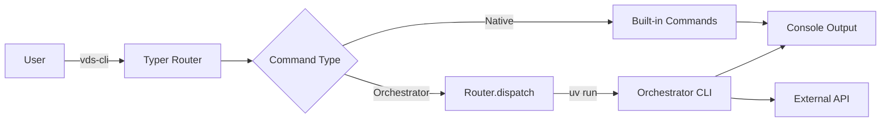

<!-- diátaxis: reference -->

# Orchestrator Architecture

The WHO CLI routes commands to 37 specialized orchestrators through a unified dispatch layer.

## Routing Architecture



### Command Dispatch Flow

1. User runs `vds-cli <orchestrator> <subcommand> <args>`
2. `vds_cli.cli` (Typer) parses the command
3. If it's a native command (`docs`, `skills`, `env`, `lint`), execute directly
4. If it's an orchestrator command, `router.py` dispatches via `uv run`
5. Orchestrator CLI runs independently and returns output

### Router Configuration

Orchestrators are registered in `router.py` as:

```python
ORCHESTRATORS = {
    "audit": {
        "module": "vds_audit_orchestrator.cli",
        "path": "audit_orchestrator",
        "entry": "vds-audit",
    },
    # ... 36 more
}
```

Each entry requires:
- `module`: Python import path to the CLI module
- `path`: Relative path to the orchestrator directory
- `entry`: CLI entry point name (as defined in `pyproject.toml` `[project.scripts]`)

## Orchestrator Categories

### Audit & Quality

| Orchestrator | Entry Point | Module | Purpose |
|-------------|-------------|--------|---------|
| `audit` | `vds-audit` | `vds_audit_orchestrator.cli` | Multi-repo quality audits |
| `sonarqube` | `vds-sonarqube` | `vds_sonarqube_orchestrator.cli` | SonarQube analysis |
| `hexagonal` | `vds-hexagonal` | `vds_hexagonal_orchestrator.cli` | Architecture compliance |
| `public_interface` | `vds-public-interface` | `vds_public_interface_orchestrator.cli` | Module boundary checks |

### Documentation

| Orchestrator | Entry Point | Module | Purpose |
|-------------|-------------|--------|---------|
| `confluence` | `vds-confluence-cli` | `confluence_orchestrator.cli` | Confluence sync |
| `markdown` | `vds-markdown` | `vds_markdown_orchestrator.cli` | Markdown processing |
| `brd` | `vds-brd` | `vds_brd_orchestrator.cli` | Business requirements |
| `spec` | `vds-spec` | `vds_spec_orchestrator.cli` | Spec validation |
| `diagrams` | `vds-diagrams` | `vds_diagram_generator.cli` | Diagram generation |

### Data & Storage

| Orchestrator | Entry Point | Module | Purpose |
|-------------|-------------|--------|---------|
| `db_query` | `vds-db-query` | `vds_db_query_orchestrator.cli` | Database queries |
| `elastic` | `vds-elastic` | `vds_elastic_orchestrator.cli` | ElasticSearch |
| `schema` | `vds-schema-convert` | `vds_schema_converter.cli` | Schema conversion |
| `excel` | `vds-excel` | `vds_excel_orchestrator.cli` | Excel processing |
| `google_sheets` | `vds-google-sheets-cli` | `vds_google_sheets_orchestrator.cli` | Google Sheets |
| `metabase` | `vds-metabase` | `vds_metabase_orchestrator.cli` | Metabase integration |

### DevOps & Infrastructure

| Orchestrator | Entry Point | Module | Purpose |
|-------------|-------------|--------|---------|
| `git` | `vds-git-orchestrator` | `vds_git_orchestrator.cli` | Worktree management |
| `scheduler` | `vds-scheduler` | `vds_scheduler_orchestrator.cli` | Job scheduling |
| `evolution` | `vds-evolution` | `vds_evolution.cli` | Ecosystem health |
| `links` | `vds-links` | `vds_links_orchestrator.cli` | Link health |
| `structure` | `vds-structure` | `vds_structure_orchestrator.cli` | Structure analysis |
| `circular_dependency` | `vds-circular-dependency` | `vds_circular_dependency_orchestrator.cli` | Cycle detection |

### AI & Agents

| Orchestrator | Entry Point | Module | Purpose |
|-------------|-------------|--------|---------|
| `memory` | `vds-memory` | `vds_memory_orchestrator.cli` | AI memory |
| `research` | `vds-research` | `vds_research_orchestrator.cli` | Research workflow |
| `multi_agent` | `vds-multi-agent` | `vds_multi_agent_orchestrator.cli` | Parallel agents |
| `telegram` | `vds-telegram` | `vds_telegram_orchestrator.cli` | Telegram bot |
| `claude` | `vds-claude` | `vds_claude_orchestrator.cli` | Claude API |
| `mcp` | `vds-mcp` | `vds_mcp_orchestrator.cli` | MCP servers |
| `lsp` | `vds-lsp` | `vds_lsp_orchestrator.cli` | LSP integration |

### Integration

| Orchestrator | Entry Point | Module | Purpose |
|-------------|-------------|--------|---------|
| `bitbucket` | `vds-bitbucket-cli` | `vds_bitbucket_orchestrator.cli` | Bitbucket API |
| `jira` | `vds-jira-cli` | `vds_jira_orchestrator.cli` | Jira integration |
| `openapi` | `vds-openapi` | `vds_openapi_orchestrator.cli` | OpenAPI handling |
| `pdf` | `vds-pdf` | `vds_pdf_orchestrator.cli` | PDF processing |
| `intellij` | `vds-intellij` | `vds_intellij_orchestrator.cli` | IntelliJ integration |

### Reporting

| Orchestrator | Entry Point | Module | Purpose |
|-------------|-------------|--------|---------|
| `progress` | `vds-progress` | `vds_progress_orchestrator.cli` | Progress reports |
| `grafana` | `vds-grafana` | `vds_grafana_orchestrator.cli` | Grafana dashboards |

## Common Patterns

### Typer CLI

All orchestrators use Typer for CLI definition:

```python
import typer
app = typer.Typer(help="Orchestrator description")

@app.command()
def main(arg: str):
    """Command help text."""
    ...

if __name__ == "__main__":
    app()
```

### Structlog Logging

All orchestrators use structlog for structured logging:

```python
import structlog
logger = structlog.get_logger(__name__)

logger.info("operation_started", repo=repo_name, checklist=checklist_id)
```

### Settings with pydantic-settings

Orchestrators use pydantic-settings for configuration:

```python
from pydantic_settings import BaseSettings

class OrchestratorSettings(BaseSettings):
    env_prefix: str = "ORCHESTRATOR_"
    timeout: float = 30.0
```

### Error Handling

Orchestrators wrap errors with context:

```python
try:
    result = external_api.call()
except ExternalAPIError as e:
    raise OrchestratorError(f"API call failed: {e}") from e
```

## Extension: Adding a New Orchestrator

1. Create directory under `vds-scripts/<name>_orchestrator/`
2. Add `pyproject.toml` with `[project.scripts]` entry point
3. Implement CLI module using Typer
4. Register in `router.py`:
   ```python
   "my_orchestrator": {
       "module": "my_orchestrator.cli",
       "path": "my_orchestrator",
       "entry": "vds-my-orchestrator",
   },
   ```
5. Add tests in `tests/`
6. Update `AGENTS.md` and relevant docs

## See Also

- [System Architecture](../explanation/system-architecture.md)
- [Data Flow](../explanation/data-flow.md)
- [Contribute New Orchestrator](../how-to/contribute-new-orchestrator.md)
