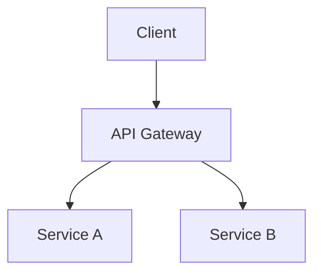

<!-- diátaxis: how-to -->
<!-- lang: vi -->
<!-- draft-translation: needs-human-review -->

> ⚠️ **BẢN DỊCH NHÁP — CẦN CON NGƯỜI RÀ SOÁT**
>
> Đây là bản dịch tiếng Việt do máy tạo ra từ nguồn tiếng Anh tại `../../../../agents/how-to/orchestrator-workflows/document-delivery-workflow.md`.
> Theo `.gpt-5.4/specs/who-project-documentation-enhancement/requirements.md`, tài liệu tiếng Việt phải do con người dịch trước khi được xem là chính thức. Người rà soát cần kiểm tra, chỉnh sửa thuật ngữ kỹ thuật, và xóa banner này trước khi file trở thành chính thức.
>
> Theo dõi: [`docs/vi/TRANSLATION-BACKLOG.md`](../../../TRANSLATION-BACKLOG.md)

# Quy trình phân phối tài liệu

> Tạo và phân phối tài liệu từ markdown qua các khâu diagram, PDF và Confluence.

## Điều kiện tiên quyết

- `vds-scripts` đã được clone và khởi tạo
- Thông tin xác thực Confluence trong `~/.vds/.env`
- File nguồn markdown nằm trong thư mục `docs/`

## Tổng quan quy trình

```
Markdown (nội dung nguồn)
    ↓
Diagrams (sinh hình ảnh)
    ↓
PDF (định dạng phân phối)
    ↓
Confluence (xuất bản và chia sẻ)
```

## Bước 1: Chuẩn bị nội dung markdown

Soạn tài liệu bằng markdown có nhúng sơ đồ mermaid:

```markdown
# Architecture Overview

## System Diagram



## Details

See [API Reference](../reference/api.md).
```

## Bước 2: Sinh sơ đồ

Render sơ đồ mermaid thành hình ảnh:

```bash
./scripts/worktree_uv.sh run --project vds_cli \
  vds-cli diagrams mermaid --input architecture.md --output diagrams/
```

Kết quả mong đợi:

```
[diagrams] Found 2 mermaid blocks
[diagrams] Rendered: diagrams/diagram-1.svg
[diagrams] Rendered: diagrams/diagram-2.svg
```

Sinh sơ đồ C4 nếu cần:

```bash
vds-cli diagrams c4 --level container --input c4-model.md --output c4-container.png
```

## Bước 3: Chuyển đổi sang PDF

Sinh PDF từ markdown:

```bash
./scripts/worktree_uv.sh run --project vds_cli \
  vds-cli pdf md2pdf --input architecture.md --output architecture.pdf --template corporate
```

Kết quả mong đợi:

```
[pdf] Converting architecture.md...
[pdf] Applied template: corporate
[pdf] Output: architecture.pdf (12 pages)
```

Sinh hàng loạt cho mọi tài liệu:

```bash
vds-cli pdf batch --input-dir docs/ --output-dir pdfs/ --template corporate
```

## Bước 4: Xuất bản lên Confluence

Đồng bộ tài liệu lên Confluence:

```bash
./scripts/worktree_uv.sh run --project vds_cli \
  vds-cli confluence sync --input architecture.md --page-id 12345 --space WHO
```

Kết quả mong đợi:

```
[confluence] Uploading to space WHO...
[confluence] Page updated: Architecture Overview
[confluence] Attachments: 3 images, 1 PDF
```

## Bước 5: Xác minh và chia sẻ

Kiểm tra nội dung đã xuất bản:

```bash
vds-cli confluence validate --page-id 12345 --check-links --check-images
```

Chia sẻ với đội:

```bash
vds-cli confluence notify --page-id 12345 --channel slack --message "Architecture docs updated"
```

## Tích hợp CI

Thêm vào `.github/workflows/docs.yml`:

```yaml
- name: Document Delivery
  run: |
    vds-cli diagrams mermaid --input docs/ --output diagrams/
    vds-cli pdf batch --input-dir docs/ --output-dir pdfs/
    vds-cli confluence sync --input docs/ --space WHO
```

## Xử lý sự cố

| Triệu chứng | Nguyên nhân | Cách khắc phục |
|---------|-------|-----|
| Render mermaid thất bại | Cú pháp không hợp lệ | Xác thực bằng `vds-cli diagrams validate` |
| PDF thiếu font | Hệ thống thiếu font | Cài `libgobject-2.0-0` hoặc dùng Docker |
| Upload Confluence thất bại | Xác thực hết hạn | Làm mới `CONFLUENCE_TOKEN` trong `~/.vds/.env` |
| Hình ảnh không được đính kèm | Sai đường dẫn | Dùng đường dẫn tương đối từ file markdown |
